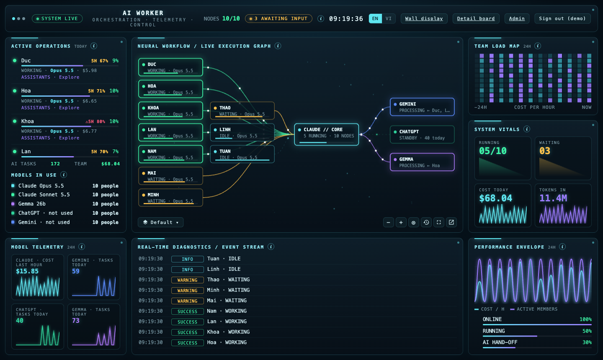
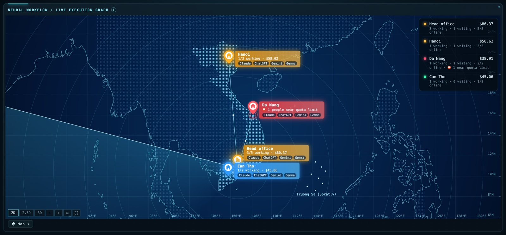
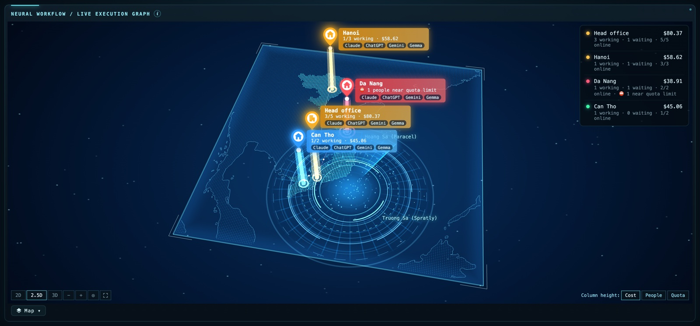
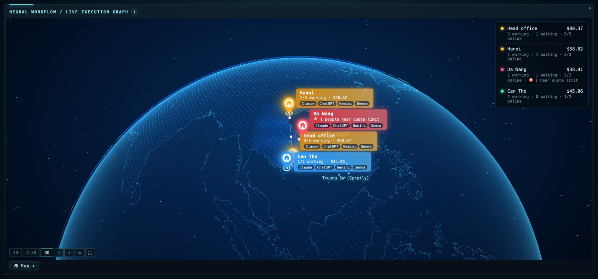
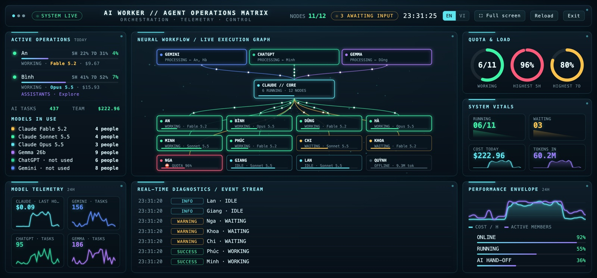
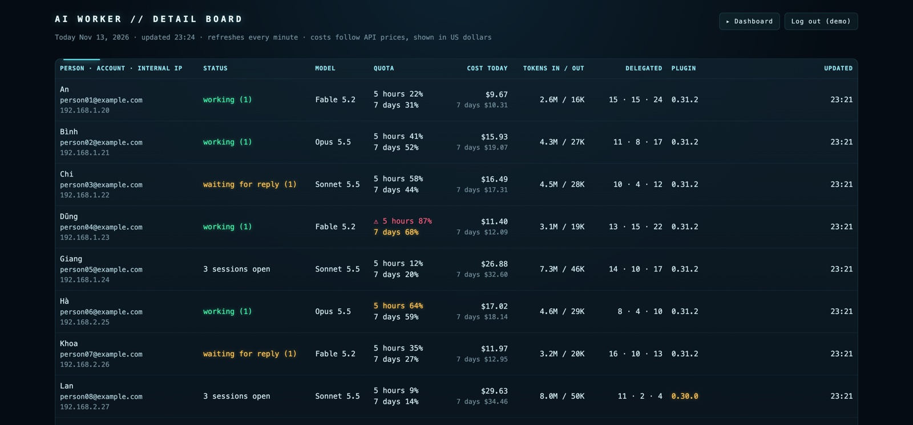
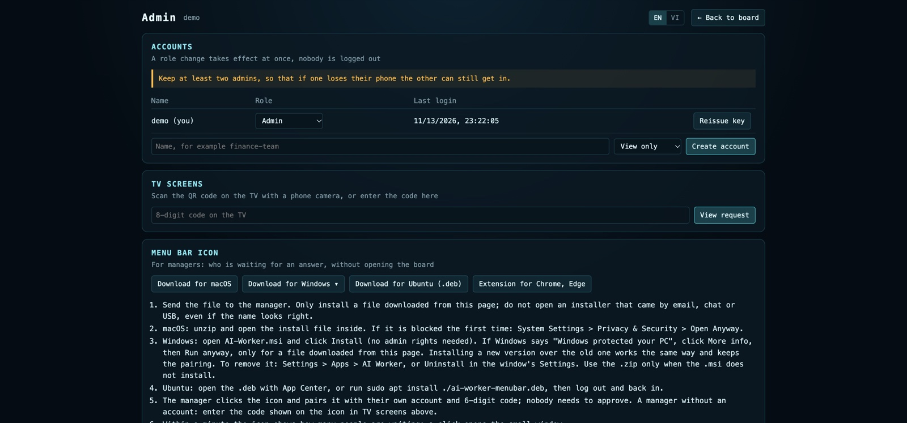
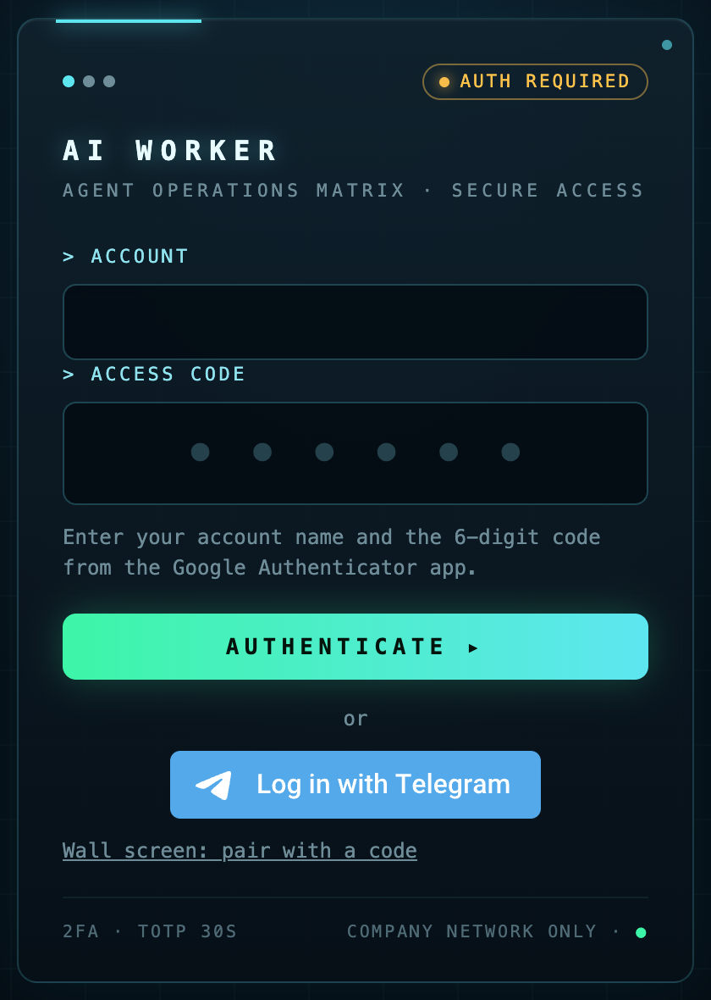
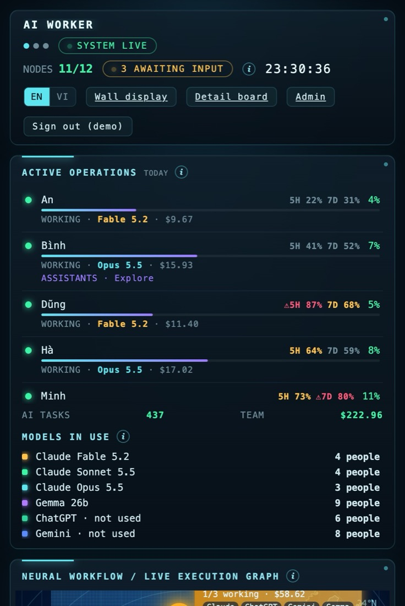
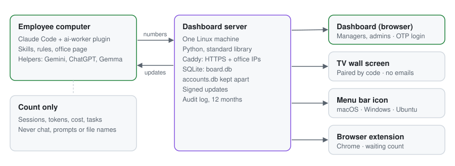

[Tiếng Việt](README.vi.md) | English <!-- i18n-allow -->

# AI Worker Office

See how your company uses Claude and its helper assistants, live, on one board.

<p>
  <a href="LICENSE"></a>
  <a href="https://github.com/anhle9x/ai-worker/actions/workflows/test-install.yml"></a>
  
  
</p>

AI Worker is a Claude Code plugin on each employee's computer and a small server on one Linux machine. The plugin counts what Claude and the helper assistants (Gemini, ChatGPT, Gemma) are doing: sessions, who is waiting for an answer, tokens, cost, tasks handed off. The server gathers those numbers into a live 3D board for managers, a TV wall screen, a menu bar icon and a browser extension. It never sends chat content, prompts, file names or project names.

<!-- one row that scrolls sideways, one picture to a view. GitHub shrinks pictures in a table to fit the page; the line of em spaces under each caption cannot wrap (nowrap), so it holds the cell at the width of the page -->
<table>
  <tr>
    <td nowrap align="center" valign="top"><br><sub><b>Operations board (sample data).</b> Who is working, who waits for an answer, cost and quota, live.</sub><br>&emsp;&emsp;&emsp;&emsp;&emsp;&emsp;&emsp;&emsp;&emsp;&emsp;&emsp;&emsp;&emsp;&emsp;&emsp;&emsp;&emsp;&emsp;&emsp;&emsp;&emsp;&emsp;&emsp;&emsp;&emsp;&emsp;&emsp;&emsp;&emsp;&emsp;&emsp;&emsp;&emsp;&emsp;&emsp;&emsp;&emsp;&emsp;&emsp;&emsp;&emsp;&emsp;&emsp;&emsp;&emsp;&emsp;&emsp;&emsp;&emsp;&emsp;&emsp;&ensp;</td>
    <td nowrap align="center" valign="top"><br><sub><b>Flat map.</b> Each office shows people working, cost today and the assistants in use.</sub><br>&emsp;&emsp;&emsp;&emsp;&emsp;&emsp;&emsp;&emsp;&emsp;&emsp;&emsp;&emsp;&emsp;&emsp;&emsp;&emsp;&emsp;&emsp;&emsp;&emsp;&emsp;&emsp;&emsp;&emsp;&emsp;&emsp;&emsp;&emsp;&emsp;&emsp;&emsp;&emsp;&emsp;&emsp;&emsp;&emsp;&emsp;&emsp;&emsp;&emsp;&emsp;&emsp;&emsp;&emsp;&emsp;&emsp;&emsp;&emsp;&emsp;&emsp;&emsp;&ensp;</td>
    <td nowrap align="center" valign="top"><br><sub><b>2.5D map.</b> The column on each office stands for cost, people or quota: you choose.</sub><br>&emsp;&emsp;&emsp;&emsp;&emsp;&emsp;&emsp;&emsp;&emsp;&emsp;&emsp;&emsp;&emsp;&emsp;&emsp;&emsp;&emsp;&emsp;&emsp;&emsp;&emsp;&emsp;&emsp;&emsp;&emsp;&emsp;&emsp;&emsp;&emsp;&emsp;&emsp;&emsp;&emsp;&emsp;&emsp;&emsp;&emsp;&emsp;&emsp;&emsp;&emsp;&emsp;&emsp;&emsp;&emsp;&emsp;&emsp;&emsp;&emsp;&emsp;&emsp;&ensp;</td>
    <td nowrap align="center" valign="top"><br><sub><b>Globe.</b> The same offices on a 3D globe: drag to turn it, scroll to zoom in or out.</sub><br>&emsp;&emsp;&emsp;&emsp;&emsp;&emsp;&emsp;&emsp;&emsp;&emsp;&emsp;&emsp;&emsp;&emsp;&emsp;&emsp;&emsp;&emsp;&emsp;&emsp;&emsp;&emsp;&emsp;&emsp;&emsp;&emsp;&emsp;&emsp;&emsp;&emsp;&emsp;&emsp;&emsp;&emsp;&emsp;&emsp;&emsp;&emsp;&emsp;&emsp;&emsp;&emsp;&emsp;&emsp;&emsp;&emsp;&emsp;&emsp;&emsp;&emsp;&emsp;&ensp;</td>
    <td nowrap align="center" valign="top"><br><sub><b>Wall screen.</b> Made for a TV: full screen, quota rings, paired with a code an admin approves.</sub><br>&emsp;&emsp;&emsp;&emsp;&emsp;&emsp;&emsp;&emsp;&emsp;&emsp;&emsp;&emsp;&emsp;&emsp;&emsp;&emsp;&emsp;&emsp;&emsp;&emsp;&emsp;&emsp;&emsp;&emsp;&emsp;&emsp;&emsp;&emsp;&emsp;&emsp;&emsp;&emsp;&emsp;&emsp;&emsp;&emsp;&emsp;&emsp;&emsp;&emsp;&emsp;&emsp;&emsp;&emsp;&emsp;&emsp;&emsp;&emsp;&emsp;&emsp;&emsp;&ensp;</td>
    <td nowrap align="center" valign="top"><br><sub><b>Detail board.</b> One row for each person: status, model, quota, cost, tokens, plugin version.</sub><br>&emsp;&emsp;&emsp;&emsp;&emsp;&emsp;&emsp;&emsp;&emsp;&emsp;&emsp;&emsp;&emsp;&emsp;&emsp;&emsp;&emsp;&emsp;&emsp;&emsp;&emsp;&emsp;&emsp;&emsp;&emsp;&emsp;&emsp;&emsp;&emsp;&emsp;&emsp;&emsp;&emsp;&emsp;&emsp;&emsp;&emsp;&emsp;&emsp;&emsp;&emsp;&emsp;&emsp;&emsp;&emsp;&emsp;&emsp;&emsp;&emsp;&emsp;&emsp;&ensp;</td>
    <td nowrap align="center" valign="top"><br><sub><b>Admin page.</b> Accounts and roles, TV pairing, downloads for the menu bar icon and extension.</sub><br>&emsp;&emsp;&emsp;&emsp;&emsp;&emsp;&emsp;&emsp;&emsp;&emsp;&emsp;&emsp;&emsp;&emsp;&emsp;&emsp;&emsp;&emsp;&emsp;&emsp;&emsp;&emsp;&emsp;&emsp;&emsp;&emsp;&emsp;&emsp;&emsp;&emsp;&emsp;&emsp;&emsp;&emsp;&emsp;&emsp;&emsp;&emsp;&emsp;&emsp;&emsp;&emsp;&emsp;&emsp;&emsp;&emsp;&emsp;&emsp;&emsp;&emsp;&emsp;&ensp;</td>
    <td nowrap align="center" valign="top"><br><sub><b>Login.</b> Account name and a 6-digit code, or Log in with Telegram.</sub><br>&emsp;&emsp;&emsp;&emsp;&emsp;&emsp;&emsp;&emsp;&emsp;&emsp;&emsp;&emsp;&emsp;&emsp;&emsp;&emsp;&emsp;&emsp;&emsp;&emsp;&emsp;&emsp;&emsp;&emsp;&emsp;&emsp;&emsp;&emsp;&emsp;&emsp;&emsp;&emsp;&emsp;&emsp;&emsp;&emsp;&emsp;&emsp;&emsp;&emsp;&emsp;&emsp;&emsp;&emsp;&emsp;&emsp;&emsp;&emsp;&emsp;&emsp;&emsp;&ensp;</td>
    <td nowrap align="center" valign="top"><br><sub><b>Narrow screen.</b> On a phone the panels stack one under the other, from top to bottom.</sub><br>&emsp;&emsp;&emsp;&emsp;&emsp;&emsp;&emsp;&emsp;&emsp;&emsp;&emsp;&emsp;&emsp;&emsp;&emsp;&emsp;&emsp;&emsp;&emsp;&emsp;&emsp;&emsp;&emsp;&emsp;&emsp;&emsp;&emsp;&emsp;&emsp;&emsp;&emsp;&emsp;&emsp;&emsp;&emsp;&emsp;&emsp;&emsp;&emsp;&emsp;&emsp;&emsp;&emsp;&emsp;&emsp;&emsp;&emsp;&emsp;&emsp;&emsp;&emsp;&ensp;</td>
  </tr>
</table>

## What it does

- **One board for the whole company:** who is working, who waits for an answer and for how long, cost today and over 7 days, quota left, per office on a map.
- **Rewind the last 24 hours** to see how the day went.
- **Alerts without the browser:** a menu bar icon (macOS, Windows, Ubuntu) and a Chrome or Edge extension count the people waiting.
- **Shared skills and rules** for every computer, and self-update with signed packages.
- **Roles and audit:** admins, managers and wall screens see different data; log in with a 6-digit OTP code or with Telegram (Telegram needs a bot set up first, see the [install guide](docs/INSTALL.md)); every change is logged for 12 months.

## How it works

<picture>
  <source media="(prefers-color-scheme: dark)" srcset="assets/architecture-dark.svg">
  
</picture>

Without a server the plugin still runs on each computer, with its own office page, but there is no company board and no self-update. The design is in [docs/ARCHITECTURE.md](docs/ARCHITECTURE.md).

## Quick start

**Just looking?** Run the board on your own computer with sample people. It needs only `python3` 3.8 or newer:

```bash
git clone https://github.com/anhle9x/ai-worker.git
cd ai-worker
python3 server/demo.py
```

On Windows the last line is `py server\demo.py`.

It prints an address, the account name `demo` and a 6-digit code. Open the address and type both: the board is up with 12 made-up people in 4 offices. Nothing is installed and nothing leaves your computer; Ctrl+C stops it and deletes the sample data. Checked on macOS, Linux and Windows.

**The admin, once** (about 30 minutes). Steps and commands: [docs/INSTALL.md](docs/INSTALL.md).

1. Copy `server/` to a Linux server and run `sudo bash install.sh`. It prints the send key and creates the first admin.
2. Put Caddy in front for HTTPS and your office IP list (template: `server/aiworker.caddy`).
3. Make the update signing keys, fill in `packaging/company.json`, run `bash packaging/build.sh packaging/company.json`.

**Each employee:** unzip the package, double-click `INSTALL-Mac.command`, `INSTALL-Windows.bat` or run `INSTALL-Linux.sh`, type your full name. In Claude Code, type `/office` to see your own sessions.

**Managers:** open the server address, sign in with the 6-digit code from Google Authenticator, or press **Log in with Telegram** once Telegram is linked (when the server has a Telegram bot set up). Install the menu bar icon from the **Admin** page if you want alerts.


How to use each screen: [docs/USER-GUIDE.md](docs/USER-GUIDE.md).

## Where it runs

| Part | Runs on | Needs |
|---|---|---|
| Plugin | macOS, Windows, Linux | Claude Code (desktop app Code tab or CLI) |
| Dashboard server | Linux with systemd | Python 3.8 or newer, Caddy or nginx; no other library |
| Menu bar icon | macOS, Windows 10/11, Ubuntu (X11 and Wayland) | Downloaded from the server's Admin page |
| Browser extension | Chrome, Edge | Download from the server's Admin page, pair with a code |

### What is not counted

The board shows Claude Code on computers where the plugin is installed, and nothing else:

- **claude.ai in a browser, and the Chat tab of the Claude app.** They have no plugins.
- **Claude Code sessions that run in the cloud** (claude.ai/code). They run on Anthropic's servers, not on the staff computer, so the plugin installed there is not loaded. Not tried yet: treat them as not counted.
- **A computer without the plugin,** or one that cannot reach the server.

Someone who only chats on claude.ai therefore shows as not using Claude, though that use may still count against the same account's quota. Read the board as "who uses Claude Code, and how much", not "who uses Claude the most".

## Documents

| | |
|---|---|
| [User guide](docs/USER-GUIDE.md) | Staff, managers, admins |
| [Install and configure](docs/INSTALL.md) | First deployment, updates, settings, data sent |
| [Operations](docs/OPERATIONS.md) | Daily checks, problems, backup, rollback, logs |
| [Architecture](docs/ARCHITECTURE.md), [data](docs/DATA-MODEL.md), [permissions](docs/PERMISSIONS.md) | How it is built |
| [Skills and rules](docs/SKILLS.md) | What every computer gets |
| [Test plan](docs/TEST-PLAN.md) | What is tested, what to check by hand |
| [All documents](docs/README.md) | Grouped by purpose |

## Security

Designed against the common web risks (CSRF, XSS, injection, broken login, access control, exposed data), reviewed with AI assistants, not audited by a security firm. The table of what is protected and what remains, and how to report a problem privately: [SECURITY.md](SECURITY.md).

## Contributing and support

[CONTRIBUTING.md](CONTRIBUTING.md) · [Code of conduct](CODE_OF_CONDUCT.md) · [Changes](CHANGELOG.md) · [Contact and sponsoring](SUPPORT.md)

## License and your responsibilities

AI Worker is under the [MIT License](LICENSE). Third-party parts keep their own licenses: see [THIRD-PARTY.md](THIRD-PARTY.md). Names and trademarks: see [NOTICE](NOTICE).

**Your responsibilities if you deploy it.** AI Worker comes with no warranty. You run your own server and decide what is collected, so you are responsible for:
- **Telling your staff first.** It sends names, account emails, IP addresses and usage numbers to your server. Start from the [employee notice template](docs/employee-notice.md) and have your legal or HR contact review it, because rules differ by country.
- **Securing the server.** Protect access with HTTPS and a network limit, keep admin accounts small, and back up the data.
- **Your own keys.** `keys/allowed_signers` ships empty, so updates stay off until you put your own public key in `~/.ai-worker-keys/allowed_signers` and build the package. Never commit a private key.
- **The terms of Claude, Gemini and ChatGPT.** Check that your plans allow the way you use them, and what data your staff may send to them.

**Publishing your own copy:** `packaging/check-clean.sh` stops private keys, tokens and your private words (a list kept outside the repository) from being published; `--install-hooks` runs it before each commit and push. It refuses to run without that list unless you set `AI_WORKER_NO_DENY=1`. `packaging/export-public.sh` exports a clean copy without history.
