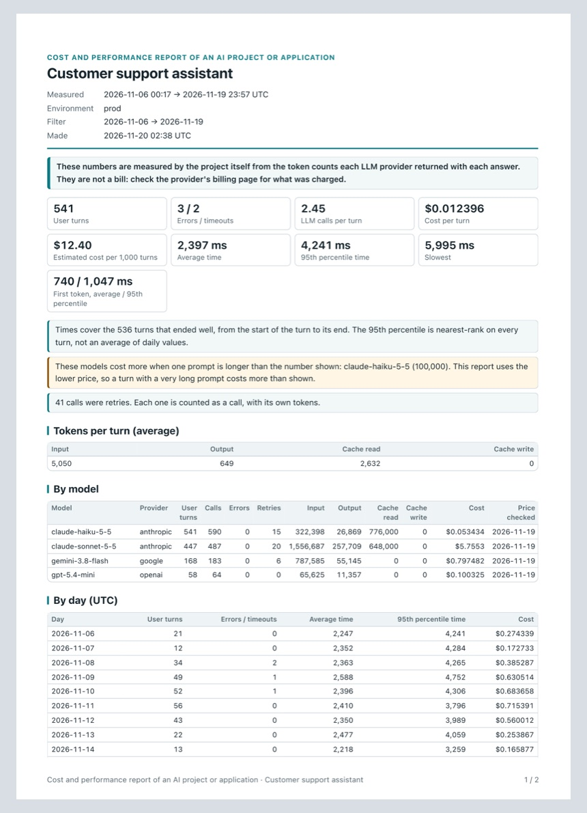
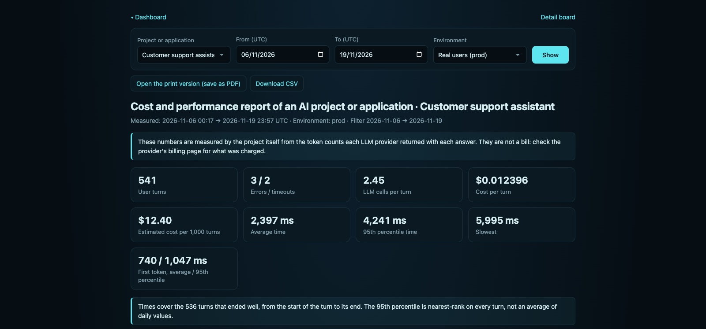
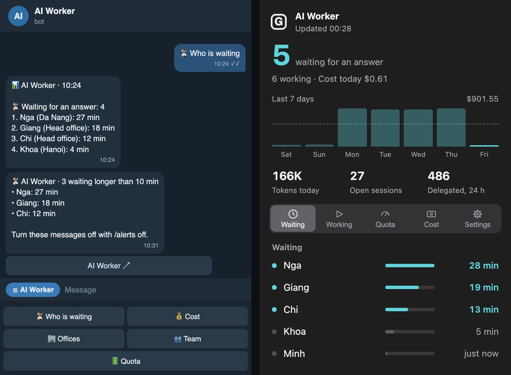
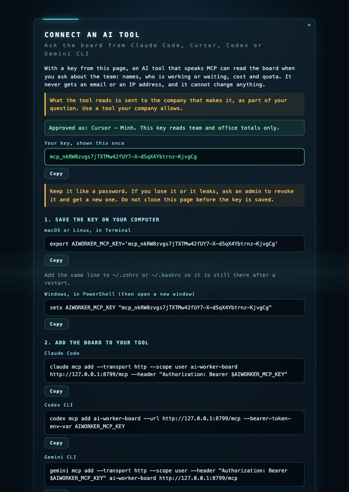
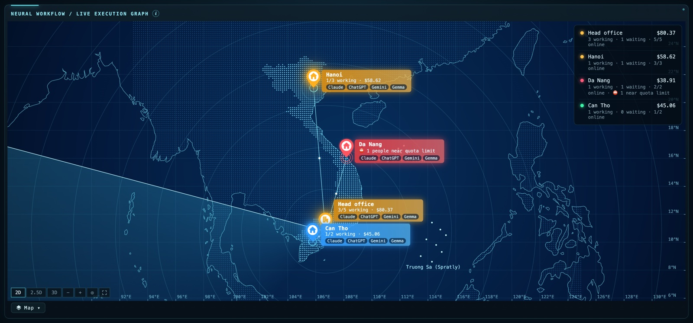
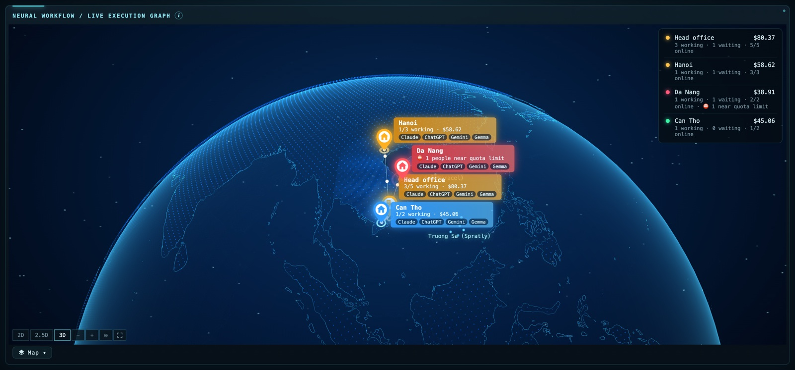
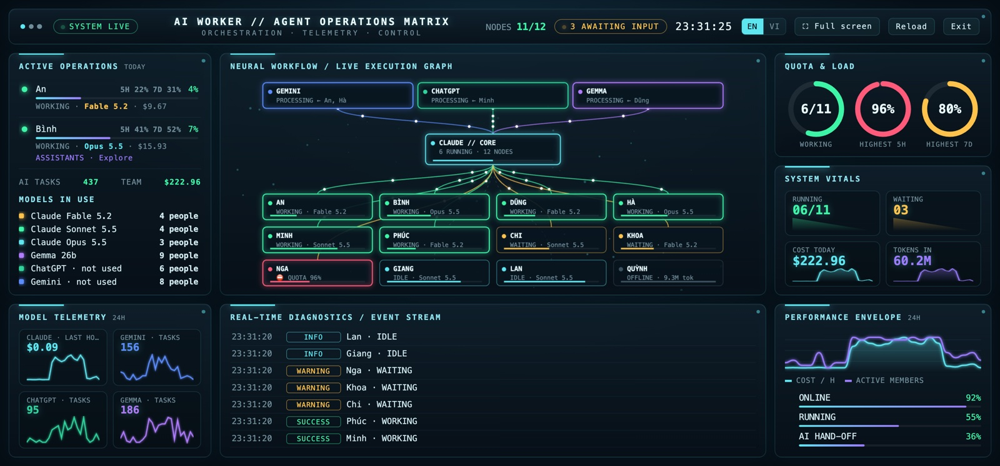
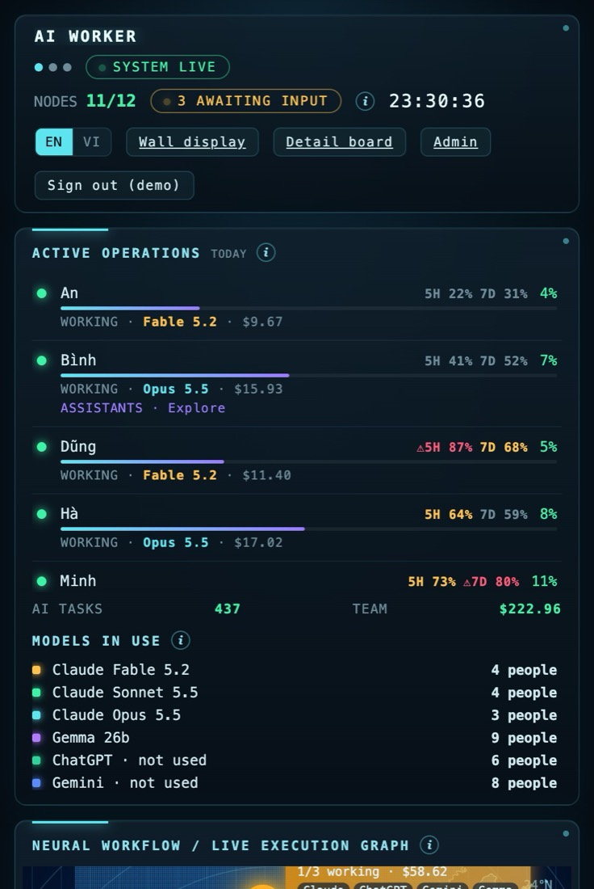

[Tiếng Việt](README.vi.md) | English <!-- i18n-allow -->

# AI Worker

Measure AI cost and speed from your whole team to every AI product you build, turn your team's procedures (SOPs) into skills, keep AI from leaking your passwords; all on your own server.

<p>
  <a href="LICENSE"></a>
  <a href="https://github.com/anhle9x/ai-worker/actions/workflows/test-install.yml"></a>
  
  
</p>

Usage reports tell you what the company spent on AI. AI Worker tells you **who needs help right now**, and **what each of your team's AI projects costs per use**.

- **People, not just numbers.** A live board shows who is working, who is waiting for an answer and for how long, across Claude, Codex, Cursor, Gemini CLI and the helper assistants: in a browser, on a TV wall screen, from the menu bar or inside Telegram.
- **A cost and speed report for your own AI project.** Copy one file into the project (Python, JavaScript, TypeScript, C#, Go, Java, Rust, C/C++), with any LLM provider, and get a measured report: cost per use and per 1,000 uses, average, 95th percentile and slowest time, by model. Export the PDF and send it. See [measure an AI project or application](docs/AI-PROJECTS.md).
- **Turn your team's procedures (SOPs) into skills.** Give `make-skill` an SOP or a description of how a job is done: it writes a draft skill so Claude follows that procedure, stops at passwords and keys, leaves personal data out, and switches the skill on only after you say yes.
- **Skills that work out of the box, not only for developers.** `ai-cost-report` makes that report; `qa-test` tests a web page or an iOS or Android app and writes the bug report for the developers; `draw-flow` draws how a flow works, failure paths included; `meeting-notes` turns notes into minutes with owners and deadlines; `handoff` leaves a note so the next session carries on. See [every skill](docs/SKILLS.md).
- **It never reads the work.** Computers send names and numbers only (sessions, tokens, cost, quota). Chats, prompts and file names are never sent to the board, and the data lives on your own server.
- **The whole office can use it, free.** Staff double-click an installer and type their name. No Team or Enterprise plan, no device management; English and Vietnamese. Open source (MIT); the server needs one Linux machine with Python and SQLite.

<!-- one row that scrolls sideways, one picture to a view. GitHub shrinks pictures in a table to fit the page; the line of em spaces under each caption cannot wrap (nowrap), so it holds the cell at the width of the page -->
<table>
  <tr>
    <!-- the video cell is kept narrow on purpose: GitHub sizes the player to the width of its cell, and 17 em spaces make it as tall as the pictures -->
    <td nowrap align="center" valign="top"><video src="https://github.com/user-attachments/assets/74d2aca1-608f-4b0d-9812-2a5f3509a882" controls></video><sub><b>Intro video (2 minutes).</b><br>From the cost report to the board in Telegram.</sub><br>&emsp;&emsp;&emsp;&emsp;&emsp;&emsp;&emsp;&emsp;&emsp;&emsp;&emsp;&emsp;&emsp;&emsp;&emsp;&emsp;&emsp;</td>
    <td nowrap align="left" valign="top"><br><sub><b>Cost and performance report (sample project).</b> Measured from each real turn: cost per use, p95 time, by model; prints as an A4 PDF.</sub><br>&emsp;&emsp;&emsp;&emsp;&emsp;&emsp;&emsp;&emsp;&emsp;&emsp;&emsp;&emsp;&emsp;&emsp;&emsp;&emsp;&emsp;&emsp;&emsp;&emsp;&emsp;&emsp;&emsp;&emsp;&emsp;&emsp;&emsp;&emsp;&emsp;&emsp;&emsp;&emsp;&emsp;&emsp;&emsp;&emsp;&emsp;&emsp;&emsp;&emsp;&emsp;&emsp;&emsp;&emsp;&emsp;&emsp;&emsp;&emsp;&emsp;&emsp;&emsp;&ensp;</td>
    <td nowrap align="center" valign="top"><br><sub><b>AI projects page.</b> Pick a project, the days and the environment: the same report on screen, with a CSV.</sub><br>&emsp;&emsp;&emsp;&emsp;&emsp;&emsp;&emsp;&emsp;&emsp;&emsp;&emsp;&emsp;&emsp;&emsp;&emsp;&emsp;&emsp;&emsp;&emsp;&emsp;&emsp;&emsp;&emsp;&emsp;&emsp;&emsp;&emsp;&emsp;&emsp;&emsp;&emsp;&emsp;&emsp;&emsp;&emsp;&emsp;&emsp;&emsp;&emsp;&emsp;&emsp;&emsp;&emsp;&emsp;&emsp;&emsp;&emsp;&emsp;&emsp;&emsp;&emsp;&ensp;</td>
    <td nowrap align="center" valign="top"><br><sub><b>Operations board (sample data).</b> Who is working, who waits for an answer, cost and quota, live.</sub><br>&emsp;&emsp;&emsp;&emsp;&emsp;&emsp;&emsp;&emsp;&emsp;&emsp;&emsp;&emsp;&emsp;&emsp;&emsp;&emsp;&emsp;&emsp;&emsp;&emsp;&emsp;&emsp;&emsp;&emsp;&emsp;&emsp;&emsp;&emsp;&emsp;&emsp;&emsp;&emsp;&emsp;&emsp;&emsp;&emsp;&emsp;&emsp;&emsp;&emsp;&emsp;&emsp;&emsp;&emsp;&emsp;&emsp;&emsp;&emsp;&emsp;&emsp;&emsp;&ensp;</td>
    <td nowrap align="center" valign="top"><br><sub><b>Telegram bot and the board's window.</b> Tap a button and the bot answers; it writes first when someone waits too long; the AI Worker button opens a small board. The chat frame is an illustration, the bot's words are real.</sub><br>&emsp;&emsp;&emsp;&emsp;&emsp;&emsp;&emsp;&emsp;&emsp;&emsp;&emsp;&emsp;&emsp;&emsp;&emsp;&emsp;&emsp;&emsp;&emsp;&emsp;&emsp;&emsp;&emsp;&emsp;&emsp;&emsp;&emsp;&emsp;&emsp;&emsp;&emsp;&emsp;&emsp;&emsp;&emsp;&emsp;&emsp;&emsp;&emsp;&emsp;&emsp;&emsp;&emsp;&emsp;&emsp;&emsp;&emsp;&emsp;&emsp;&emsp;&emsp;&ensp;</td>
    <td nowrap align="center" valign="top"><br><sub><b>Ask the board from an AI tool (MCP).</b> Get a code, an admin approves, then Claude Code, Cursor, Codex or Gemini CLI can read the board's numbers.</sub><br>&emsp;&emsp;&emsp;&emsp;&emsp;&emsp;&emsp;&emsp;&emsp;&emsp;&emsp;&emsp;&emsp;&emsp;&emsp;&emsp;&emsp;&emsp;&emsp;&emsp;&emsp;&emsp;&emsp;&emsp;&emsp;&emsp;&emsp;&emsp;&emsp;&emsp;&emsp;&emsp;&emsp;&emsp;&emsp;&emsp;&emsp;&emsp;&emsp;&emsp;&emsp;&emsp;&emsp;&emsp;&emsp;&emsp;&emsp;&emsp;&emsp;&emsp;&emsp;&ensp;</td>
    <td nowrap align="center" valign="top"><br><sub><b>Flat map.</b> Each office shows people working, cost today and the assistants in use.</sub><br>&emsp;&emsp;&emsp;&emsp;&emsp;&emsp;&emsp;&emsp;&emsp;&emsp;&emsp;&emsp;&emsp;&emsp;&emsp;&emsp;&emsp;&emsp;&emsp;&emsp;&emsp;&emsp;&emsp;&emsp;&emsp;&emsp;&emsp;&emsp;&emsp;&emsp;&emsp;&emsp;&emsp;&emsp;&emsp;&emsp;&emsp;&emsp;&emsp;&emsp;&emsp;&emsp;&emsp;&emsp;&emsp;&emsp;&emsp;&emsp;&emsp;&emsp;&emsp;&ensp;</td>
    <td nowrap align="center" valign="top"><br><sub><b>2.5D map.</b> The column on each office stands for cost, people or quota: you choose.</sub><br>&emsp;&emsp;&emsp;&emsp;&emsp;&emsp;&emsp;&emsp;&emsp;&emsp;&emsp;&emsp;&emsp;&emsp;&emsp;&emsp;&emsp;&emsp;&emsp;&emsp;&emsp;&emsp;&emsp;&emsp;&emsp;&emsp;&emsp;&emsp;&emsp;&emsp;&emsp;&emsp;&emsp;&emsp;&emsp;&emsp;&emsp;&emsp;&emsp;&emsp;&emsp;&emsp;&emsp;&emsp;&emsp;&emsp;&emsp;&emsp;&emsp;&emsp;&emsp;&ensp;</td>
    <td nowrap align="center" valign="top"><br><sub><b>Globe.</b> The same offices on a 3D globe: drag to turn it, scroll to zoom in or out.</sub><br>&emsp;&emsp;&emsp;&emsp;&emsp;&emsp;&emsp;&emsp;&emsp;&emsp;&emsp;&emsp;&emsp;&emsp;&emsp;&emsp;&emsp;&emsp;&emsp;&emsp;&emsp;&emsp;&emsp;&emsp;&emsp;&emsp;&emsp;&emsp;&emsp;&emsp;&emsp;&emsp;&emsp;&emsp;&emsp;&emsp;&emsp;&emsp;&emsp;&emsp;&emsp;&emsp;&emsp;&emsp;&emsp;&emsp;&emsp;&emsp;&emsp;&emsp;&emsp;&ensp;</td>
    <td nowrap align="center" valign="top"><br><sub><b>Wall screen.</b> Made for a TV: full screen, quota rings, paired with a code an admin approves.</sub><br>&emsp;&emsp;&emsp;&emsp;&emsp;&emsp;&emsp;&emsp;&emsp;&emsp;&emsp;&emsp;&emsp;&emsp;&emsp;&emsp;&emsp;&emsp;&emsp;&emsp;&emsp;&emsp;&emsp;&emsp;&emsp;&emsp;&emsp;&emsp;&emsp;&emsp;&emsp;&emsp;&emsp;&emsp;&emsp;&emsp;&emsp;&emsp;&emsp;&emsp;&emsp;&emsp;&emsp;&emsp;&emsp;&emsp;&emsp;&emsp;&emsp;&emsp;&emsp;&ensp;</td>
    <td nowrap align="center" valign="top"><br><sub><b>Detail board.</b> One row for each person: status, model, quota, cost, tokens, plugin version.</sub><br>&emsp;&emsp;&emsp;&emsp;&emsp;&emsp;&emsp;&emsp;&emsp;&emsp;&emsp;&emsp;&emsp;&emsp;&emsp;&emsp;&emsp;&emsp;&emsp;&emsp;&emsp;&emsp;&emsp;&emsp;&emsp;&emsp;&emsp;&emsp;&emsp;&emsp;&emsp;&emsp;&emsp;&emsp;&emsp;&emsp;&emsp;&emsp;&emsp;&emsp;&emsp;&emsp;&emsp;&emsp;&emsp;&emsp;&emsp;&emsp;&emsp;&emsp;&emsp;&ensp;</td>
    <td nowrap align="center" valign="top"><br><sub><b>Admin page.</b> What ai-worker stopped, a check that no log line was changed, AI tool keys left unused.</sub><br>&emsp;&emsp;&emsp;&emsp;&emsp;&emsp;&emsp;&emsp;&emsp;&emsp;&emsp;&emsp;&emsp;&emsp;&emsp;&emsp;&emsp;&emsp;&emsp;&emsp;&emsp;&emsp;&emsp;&emsp;&emsp;&emsp;&emsp;&emsp;&emsp;&emsp;&emsp;&emsp;&emsp;&emsp;&emsp;&emsp;&emsp;&emsp;&emsp;&emsp;&emsp;&emsp;&emsp;&emsp;&emsp;&emsp;&emsp;&emsp;&emsp;&emsp;&emsp;&ensp;</td>
    <td nowrap align="center" valign="top"><br><sub><b>Login.</b> Account name and a 6-digit code, or Log in with Telegram.</sub><br>&emsp;&emsp;&emsp;&emsp;&emsp;&emsp;&emsp;&emsp;&emsp;&emsp;&emsp;&emsp;&emsp;&emsp;&emsp;&emsp;&emsp;&emsp;&emsp;&emsp;&emsp;&emsp;&emsp;&emsp;&emsp;&emsp;&emsp;&emsp;&emsp;&emsp;&emsp;&emsp;&emsp;&emsp;&emsp;&emsp;&emsp;&emsp;&emsp;&emsp;&emsp;&emsp;&emsp;&emsp;&emsp;&emsp;&emsp;&emsp;&emsp;&emsp;&emsp;&ensp;</td>
    <td nowrap align="center" valign="top"><br><sub><b>Narrow screen.</b> On a phone the panels stack one under the other, from top to bottom.</sub><br>&emsp;&emsp;&emsp;&emsp;&emsp;&emsp;&emsp;&emsp;&emsp;&emsp;&emsp;&emsp;&emsp;&emsp;&emsp;&emsp;&emsp;&emsp;&emsp;&emsp;&emsp;&emsp;&emsp;&emsp;&emsp;&emsp;&emsp;&emsp;&emsp;&emsp;&emsp;&emsp;&emsp;&emsp;&emsp;&emsp;&emsp;&emsp;&emsp;&emsp;&emsp;&emsp;&emsp;&emsp;&emsp;&emsp;&emsp;&emsp;&emsp;&emsp;&emsp;&ensp;</td>
  </tr>
</table>

## What makes it different

- **See who is stuck, as it happens.** Who is working, who is waiting for an answer and for how long, per office on a map. Watch it on a TV wall screen, from a menu bar icon (macOS, Windows, Ubuntu) or a Chrome or Edge extension. Rewind the last 24 hours to see how the day went.
- **The whole office can use it, not only developers.** One installer for the company, on macOS, Windows and Linux. Shared skills and rules reach every computer, and updates arrive signed. The guides use plain language, in English and Vietnamese.
- **Your data stays on your server.** The server runs on your own Linux machine with Python's standard library and SQLite. Every field an employee's computer sends is listed in [docs/DATA-MODEL.md](docs/DATA-MODEL.md).
- **A cost and speed report for the AI projects your team builds.** Copy one file into the project (Python, JavaScript, TypeScript, C#, Go, Java and Kotlin, Rust, C/C++; any other language writes one JSON line), with any LLM provider. Each request is counted: time, LLM calls and tokens, never the question or the answer. The `ai-cost-report` skill, or the board's **AI projects** page, turns that into a report: cost per request and per 1,000 requests, average, 95th percentile and slowest time, by model and by day; print it as an A4 PDF or export a CSV. See [measure an AI project or application](docs/AI-PROJECTS.md).
- **Guardrails on every computer, a record on the server.** Keys, tokens and passwords never leave for ChatGPT or Gemini. Anything hard to undo waits for your yes: a commit holding a secret, deleting a whole folder, rewriting git history, running a script straight from the internet, turning off macOS's Gatekeeper, writing straight to a disk, opening a file to everyone. A web page, or a helper's answer, that tries to give Claude orders is flagged. On the server, the audit log is fingerprinted against tampering, work handed to ChatGPT, Gemini or Gemma is recorded without its text, and the Admin page counts what was stopped. See [what the plugin stops](SECURITY.md#what-the-plugin-stops-on-the-computer).

## Other features

- **Codex, Cursor and Gemini CLI on the same board:** a small connector, installed by each person for the tool they use, shows sessions open, working and waiting. It needs no Claude Code, Python or Node, and sends counts only. Run for real with Codex CLI on macOS; other tools and systems are tested with sample data only. See the [install guide](docs/INSTALL.md#codex-cursor-and-gemini-cli-on-the-board).
- **Cost and quota:** cost today and over 7 days and quota left, per person and per office. The detail board compares this week and month with the last.
- **Ask Claude about the team:** a manager pairs their Claude with the board once, then just asks, for example "who is waiting longest?", typed or spoken, in their own language. Claude answers from the board's numbers.
- **Ask from other AI tools:** the server has a read-only MCP endpoint, so any AI tool that speaks MCP can ask too, with a key an admin approves.
- **The board inside Telegram:** a manager taps the bot's **AI Worker** button to open a small board on their phone: who is waiting, the 7-day cost chart, quotas. The bot answers with buttons, no AI model reads the question, and it writes first when someone waits too long (`/alerts 10`). Optional, off by default. See [the window inside Telegram](docs/INSTALL.md#the-boards-window-inside-telegram-optional) and [messages when someone waits too long](docs/INSTALL.md#messages-when-someone-waits-too-long-optional-per-chat).
- **Turn a procedure into a skill:** give `/ai-worker:make-skill` an SOP or a description of how a job is done. It writes a draft skill, stops at passwords and keys, leaves personal data out, and switches the skill on only after you say yes.
- **Roles and audit:** admins, managers and wall screens see different data; log in with a 6-digit OTP code or with Telegram (needs a bot set up first, see the [install guide](docs/INSTALL.md)); every change is logged for 12 months.

## Is it the right tool?

- **You only want the token cost on your own computer:** a local usage counter is simpler. You do not need a server.
- **Your organization is on a Team or Enterprise plan and manages its devices:** Anthropic's own [analytics](https://code.claude.com/docs/en/analytics) and [managed plugin settings](https://code.claude.com/docs/en/plugins/org) already give usage reports and roll plugins out. AI Worker adds the live board of who is waiting, and works without either.
- **A small or mid-size office where many people do not write code and there is no device management:** this is the case AI Worker fits best.

## How it works

<picture>
  <source media="(prefers-color-scheme: dark)" srcset="assets/architecture-dark.svg">
  
</picture>

The window inside Telegram reaches the server on its own path, `/tg/`; see [docs/ARCHITECTURE.md](docs/ARCHITECTURE.md#the-boards-window-inside-telegram-optional). What the plugin stops on the computer is in [SECURITY.md](SECURITY.md#what-the-plugin-stops-on-the-computer). An AI project or application your team built sends only its own counts, to `/projects/ingest`, with a key of its own; see [docs/ARCHITECTURE.md](docs/ARCHITECTURE.md#measuring-an-ai-project-or-application).

Without a server the plugin still runs on each computer, with its own office page, but there is no company board and no self-update. The design is in [docs/ARCHITECTURE.md](docs/ARCHITECTURE.md).

## Quick start

**Just looking?** Run the board on your own computer with sample people. It needs only Git and Python 3.8 or newer.

macOS and Linux:

```bash
git clone https://github.com/anhle9x/ai-worker.git
cd ai-worker
python3 server/demo.py
```

Windows, in PowerShell or Command Prompt. If Git or Python is missing, install it first, then open a new window so the new commands are found:

```powershell
winget install --id Git.Git -e --source winget
winget install --id Python.Python.3.12 -e --source winget
```

```powershell
git clone https://github.com/anhle9x/ai-worker.git
cd ai-worker
py server\demo.py
```

It prints an address, the account name `demo` and a 6-digit code. Open the address and type both: the board is up with 12 sample people in 4 offices. Nothing is installed and nothing leaves your computer; Ctrl+C stops it and deletes the sample data. Checked on macOS, Linux and Windows.

**The admin, once** (about 30 minutes). Steps and commands: [docs/INSTALL.md](docs/INSTALL.md).

1. Copy `server/` to a Linux server and run `sudo bash install.sh`. It prints the send key and creates the first admin.
2. Put Caddy in front for HTTPS and your office IP list (template: `server/aiworker.caddy`).
3. Make the update signing keys, fill in `packaging/company.json`, run `bash packaging/build.sh packaging/company.json`.

**Each employee:** unzip the package, double-click `INSTALL-Mac.command`, `INSTALL-Windows.bat` or run `INSTALL-Linux.sh`, type your full name. In Claude Code, type `/office` to see your own sessions.

**Managers:** open the server address, sign in with the 6-digit code from Google Authenticator, or press **Log in with Telegram** once Telegram is linked (when the server has a Telegram bot set up). Install the menu bar icon from the **Admin** page if you want alerts.


How to use each screen: [docs/USER-GUIDE.md](docs/USER-GUIDE.md).

## Where it runs

| Part | Runs on | Needs |
|---|---|---|
| Plugin | macOS, Windows, Linux | Claude Code: the desktop app's Code tab, the CLI, or the VS Code extension |
| Connector for Codex, Cursor, Gemini CLI | macOS, Linux, Windows | The tool itself, and curl or wget; no Claude Code |
| Dashboard server | Linux with systemd | Python 3.8 or newer, Caddy or nginx; no other library |
| Menu bar icon | macOS, Windows 10/11, Ubuntu (X11 and Wayland) | Downloaded from the server's Admin page |
| Telegram bot, its alerts and its window (optional) | Telegram on a phone or a computer | A bot made with @BotFather; `TELEGRAM_ASK=1` on the server, and `TELEGRAM_APP=1` for the window, which opens on the networks the server lets in. The window was tried on Android and Telegram Desktop, not yet on an iPhone |
| Browser extension | Chrome, Edge | Download from the server's Admin page, pair with a code |

### What is not counted

The board shows Claude Code on computers where the plugin is installed, and Codex, Cursor and Gemini CLI on computers where the connector is installed (sessions only: no tokens, cost or quota). It does not show:

- **claude.ai in a browser, and the Chat tab of the Claude app.** They have no plugins.
- **Claude Code sessions that run in the cloud** (claude.ai/code). They run on Anthropic's servers, not on the staff computer, so the plugin installed there is not loaded. Not tried yet: treat them as not counted.
- **A computer without the plugin or the connector,** or one that cannot reach the server.

Someone who only chats on claude.ai therefore shows as not using Claude, though that use may still count against the same account's quota. Read the board as "who uses Claude Code, and how much", not "who uses Claude the most".

## Roadmap

Where the project is going. There are no dates: an item ships when it has been checked.

- [x] A live board of who is working and who is waiting in Claude Code, with a wall screen, a menu bar icon and a browser extension
- [x] The plugin in the Claude Code extension for VS Code
- [x] Codex, Cursor and Gemini CLI on the same board (0.32.0): sessions only
- [x] Ask the board from any AI tool that speaks MCP: a read-only endpoint on the server, with a key an admin approves. Tried in Claude Code and Codex CLI.
- [x] Ask the board from a Telegram chat, for managers who do not write code: buttons and short questions, no AI model, off by default
- [x] Use by week and month: the server keeps one total per person per day, and the detail board compares this week and this month with the last
- [ ] The Cursor, Gemini CLI and Windows connectors tried inside the real tools. So far only Codex on macOS has been.
- [ ] The MCP endpoint tried from Cursor and Gemini CLI. So far Claude Code, Codex CLI and the Chat tab of the Claude app (through a claude.ai connector) have been.
- [x] Charts of use by week and month on the detail board: cost per week for 12 weeks and per month for up to 13 months, for the team and for each office
- [x] The menu bar window inside Telegram (0.37.0), for chats an admin allows: tried on Telegram Desktop and Android, on the office network
- [x] The window inside Telegram for chats that read totals only (0.41.0): the server sends totals and no person
- [ ] The window inside Telegram from outside the office network
- [x] A Telegram message when someone waits too long, turned on by each chat (`/alerts`), with a button that opens the window
- [x] Cost and speed of an AI project or application your team built (0.44.0), with any LLM provider; sent to the board and read there (0.45.0). Tried on a real board with test turns
- [ ] A real project measured for a whole period and reported from the board

## Documents

| | |
|---|---|
| [User guide](docs/USER-GUIDE.md) | Staff, managers, admins |
| [Install and configure](docs/INSTALL.md) | First deployment, updates, settings, data sent |
| [Operations](docs/OPERATIONS.md) | Daily checks, problems, backup, rollback, logs |
| [Architecture](docs/ARCHITECTURE.md), [data](docs/DATA-MODEL.md), [permissions](docs/PERMISSIONS.md) | How it is built |
| [Skills and rules](docs/SKILLS.md) | What every computer gets |
| [Measure an AI project or application](docs/AI-PROJECTS.md) | Teams that built a project calling an LLM |
| [Test plan](docs/TEST-PLAN.md) | What is tested, what to check by hand |
| [All documents](docs/README.md) | Grouped by purpose |

## Security

Designed against the common web risks (CSRF, XSS, injection, broken login, access control, exposed data), reviewed with AI assistants, not audited by a security firm. The table of what is protected and what remains, and how to report a problem privately: [SECURITY.md](SECURITY.md).

## Contributing and support

[CONTRIBUTING.md](CONTRIBUTING.md) · [Code of conduct](CODE_OF_CONDUCT.md) · [Changes](CHANGELOG.md) · [Contact and sponsoring](SUPPORT.md)

## License and your responsibilities

AI Worker is under the [MIT License](LICENSE). Third-party parts keep their own licenses: see [THIRD-PARTY.md](THIRD-PARTY.md). Names and trademarks: see [NOTICE](NOTICE).

**Your responsibilities if you deploy it.** AI Worker comes with no warranty. You run your own server and decide what is collected, so you are responsible for:
- **Telling your staff first.** It sends names, account emails, IP addresses and usage numbers to your server. Start from the [employee notice template](docs/employee-notice.md) and have your legal or HR contact review it, because rules differ by country.
- **Securing the server.** Protect access with HTTPS and a network limit, keep admin accounts small, and back up the data.
- **Your own keys.** `keys/allowed_signers` ships empty, so updates stay off until you put your own public key in `~/.ai-worker-keys/allowed_signers` and build the package. Never commit a private key.
- **The terms of Claude, Gemini and ChatGPT.** Check that your plans allow the way you use them, and what data your staff may send to them.

**Publishing your own copy:** `packaging/check-clean.sh` stops private keys, tokens and your private words (a list kept outside the repository) from being published; `--install-hooks` runs it before each commit and push. It refuses to run without that list unless you set `AI_WORKER_NO_DENY=1`. `packaging/export-public.sh` exports a clean copy without history.
