Tiếng Việt | [English](README.md)

# AI Worker

Đo chi phí và tốc độ AI từ cả team tới từng sản phẩm AI bạn làm, biến quy trình (SOP) của phòng thành skill, không để AI làm lộ mật khẩu; tất cả trên máy chủ riêng của bạn.

<p>
  <a href="LICENSE"></a>
  <a href="https://github.com/anhle9x/ai-worker/actions/workflows/test-install.yml"></a>
  
  
</p>

Báo cáo sử dụng cho biết công ty đã tiêu bao nhiêu cho AI. AI Worker cho biết **ai đang cần giúp ngay lúc này**, và **mỗi dự án AI của nhóm tốn bao nhiêu cho mỗi lượt dùng**.

- **Thấy người, không chỉ thấy số.** Bảng trực tiếp cho biết ai đang làm, ai đang chờ trả lời và đã chờ bao lâu, với Claude, Codex, Cursor, Gemini CLI và các trợ lý phụ: trên trình duyệt, TV treo tường, thanh menu hay ngay trong Telegram.
- **Báo cáo chi phí và tốc độ cho dự án AI của bạn.** Chép một file vào dự án (Python, JavaScript, TypeScript, C#, Go, Java, Rust, C/C++), dùng hãng LLM nào cũng được, là có báo cáo đo thật: tiền mỗi lượt và mỗi 1.000 lượt, thời gian trung bình, p95 và lượt chậm nhất, theo model. In ra PDF là nộp được. Xem [đo một dự án hay ứng dụng AI](docs/AI-PROJECTS.vi.md).
- **Biến quy trình (SOP) của phòng thành skill.** Đưa cho `make-skill` một SOP hay một đoạn mô tả cách làm một việc: nó viết bản nháp skill để Claude làm đúng theo quy trình đó, dừng lại khi gặp mật khẩu hay khoá, bỏ dữ liệu cá nhân ra, và chỉ bật skill khi bạn đồng ý.
- **Skill dùng được ngay, không chỉ cho dân code.** `ai-cost-report` làm báo cáo trên; `qa-test` tự test web và app iOS, Android rồi viết bug report gửi dev; `draw-flow` vẽ sơ đồ luồng có cả nhánh lỗi; `meeting-notes` ra biên bản họp có người phụ trách và hạn chót; `handoff` ghi bàn giao để phiên sau làm tiếp. Xem [đủ danh sách skill](docs/SKILLS.vi.md).
- **Không đọc nội dung công việc.** Máy nhân viên chỉ gửi tên và các con số (phiên, token, chi phí, hạn mức). Chat, câu hỏi, tên file không bao giờ được gửi lên bảng, và số liệu nằm trên máy chủ của chính bạn.
- **Cả văn phòng dùng được, miễn phí.** Nhân viên bấm đúp bộ cài, gõ họ tên là xong. Không cần gói Team, Enterprise hay phần mềm quản lý thiết bị; có tiếng Việt. Mã nguồn mở (MIT), máy chủ chỉ cần một máy Linux với Python và SQLite.

<!-- one row that scrolls sideways, one picture to a view. GitHub shrinks pictures in a table to fit the page; the line of em spaces under each caption cannot wrap (nowrap), so it holds the cell at the width of the page -->
<table>
  <tr>
    <td nowrap align="left" valign="top">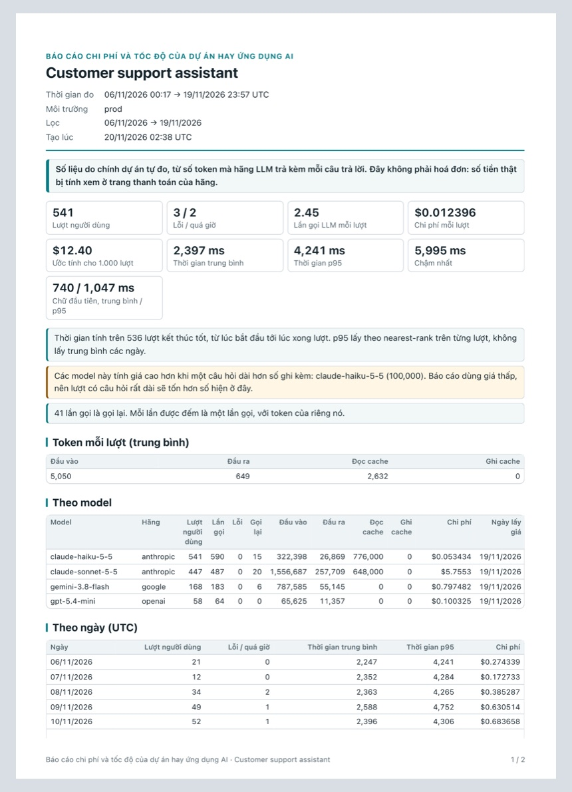<br><sub><b>Báo cáo chi phí và hiệu năng (dự án mẫu).</b> Đo thật từ từng lượt: chi phí mỗi lượt, thời gian p95, theo model; in ra PDF A4.</sub><br>&emsp;&emsp;&emsp;&emsp;&emsp;&emsp;&emsp;&emsp;&emsp;&emsp;&emsp;&emsp;&emsp;&emsp;&emsp;&emsp;&emsp;&emsp;&emsp;&emsp;&emsp;&emsp;&emsp;&emsp;&emsp;&emsp;&emsp;&emsp;&emsp;&emsp;&emsp;&emsp;&emsp;&emsp;&emsp;&emsp;&emsp;&emsp;&emsp;&emsp;&emsp;&emsp;&emsp;&emsp;&emsp;&emsp;&emsp;&emsp;&emsp;&emsp;&emsp;&ensp;</td>
    <td nowrap align="center" valign="top">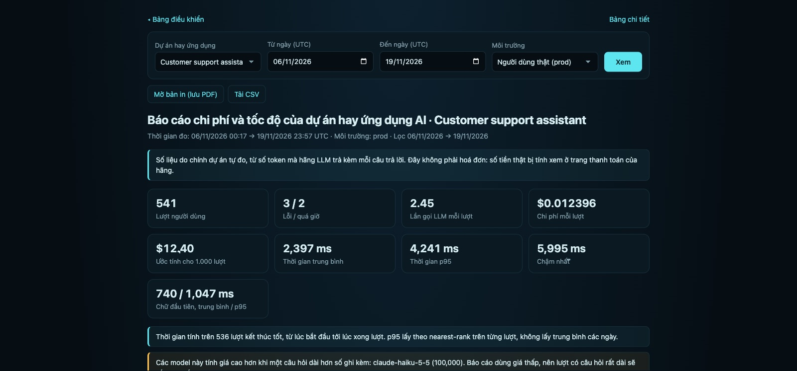<br><sub><b>Trang Dự án AI.</b> Chọn dự án, khoảng ngày và môi trường; cùng báo cáo đó trên màn hình, kèm CSV.</sub><br>&emsp;&emsp;&emsp;&emsp;&emsp;&emsp;&emsp;&emsp;&emsp;&emsp;&emsp;&emsp;&emsp;&emsp;&emsp;&emsp;&emsp;&emsp;&emsp;&emsp;&emsp;&emsp;&emsp;&emsp;&emsp;&emsp;&emsp;&emsp;&emsp;&emsp;&emsp;&emsp;&emsp;&emsp;&emsp;&emsp;&emsp;&emsp;&emsp;&emsp;&emsp;&emsp;&emsp;&emsp;&emsp;&emsp;&emsp;&emsp;&emsp;&emsp;&emsp;&ensp;</td>
    <td nowrap align="center" valign="top">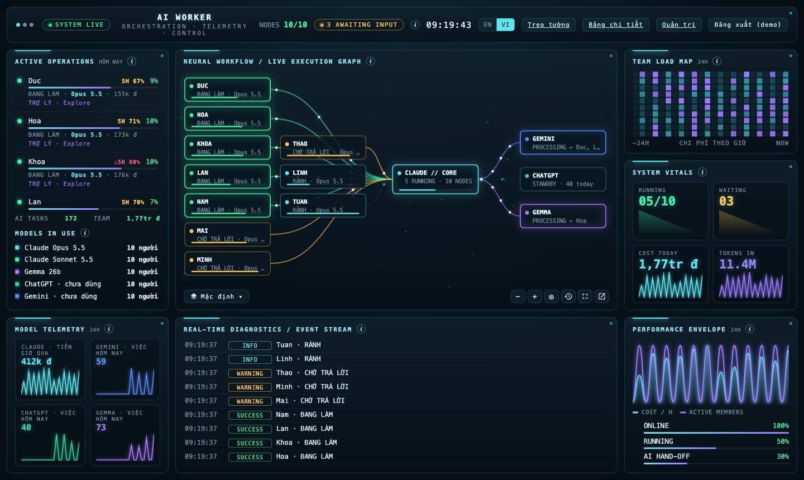<br><sub><b>Bảng điều hành (dữ liệu mẫu).</b> Ai đang làm, ai chờ trả lời, chi phí và hạn mức, cập nhật trực tiếp.</sub><br>&emsp;&emsp;&emsp;&emsp;&emsp;&emsp;&emsp;&emsp;&emsp;&emsp;&emsp;&emsp;&emsp;&emsp;&emsp;&emsp;&emsp;&emsp;&emsp;&emsp;&emsp;&emsp;&emsp;&emsp;&emsp;&emsp;&emsp;&emsp;&emsp;&emsp;&emsp;&emsp;&emsp;&emsp;&emsp;&emsp;&emsp;&emsp;&emsp;&emsp;&emsp;&emsp;&emsp;&emsp;&emsp;&emsp;&emsp;&emsp;&emsp;&emsp;&emsp;&ensp;</td>
    <td nowrap align="center" valign="top">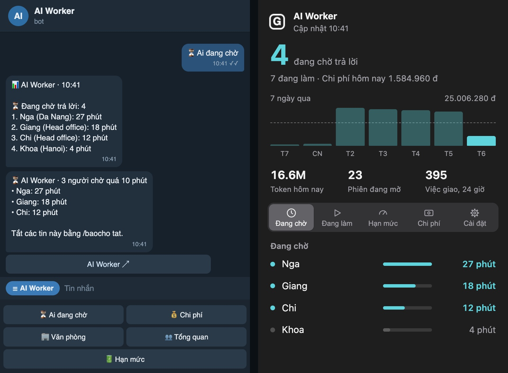<br><sub><b>Bot Telegram và khung bảng.</b> Bấm nút là bot trả lời, tự nhắn khi có người chờ lâu; nút AI Worker mở bảng nhỏ. Khung chat là ảnh minh hoạ, lời của bot là thật.</sub><br>&emsp;&emsp;&emsp;&emsp;&emsp;&emsp;&emsp;&emsp;&emsp;&emsp;&emsp;&emsp;&emsp;&emsp;&emsp;&emsp;&emsp;&emsp;&emsp;&emsp;&emsp;&emsp;&emsp;&emsp;&emsp;&emsp;&emsp;&emsp;&emsp;&emsp;&emsp;&emsp;&emsp;&emsp;&emsp;&emsp;&emsp;&emsp;&emsp;&emsp;&emsp;&emsp;&emsp;&emsp;&emsp;&emsp;&emsp;&emsp;&emsp;&emsp;&emsp;&ensp;</td>
    <td nowrap align="center" valign="top">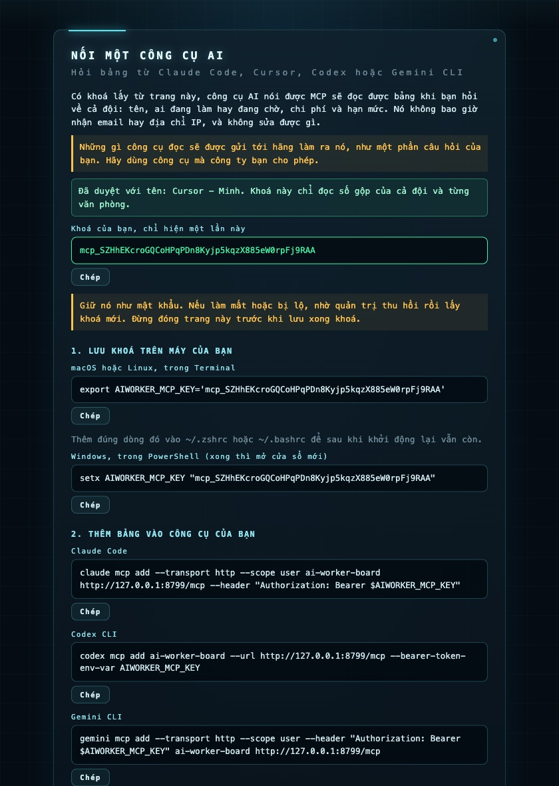<br><sub><b>Hỏi bảng từ công cụ AI (MCP).</b> Lấy mã, quản trị duyệt, rồi Claude Code, Cursor, Codex hay Gemini CLI đọc được số của bảng.</sub><br>&emsp;&emsp;&emsp;&emsp;&emsp;&emsp;&emsp;&emsp;&emsp;&emsp;&emsp;&emsp;&emsp;&emsp;&emsp;&emsp;&emsp;&emsp;&emsp;&emsp;&emsp;&emsp;&emsp;&emsp;&emsp;&emsp;&emsp;&emsp;&emsp;&emsp;&emsp;&emsp;&emsp;&emsp;&emsp;&emsp;&emsp;&emsp;&emsp;&emsp;&emsp;&emsp;&emsp;&emsp;&emsp;&emsp;&emsp;&emsp;&emsp;&emsp;&emsp;&ensp;</td>
    <td nowrap align="center" valign="top">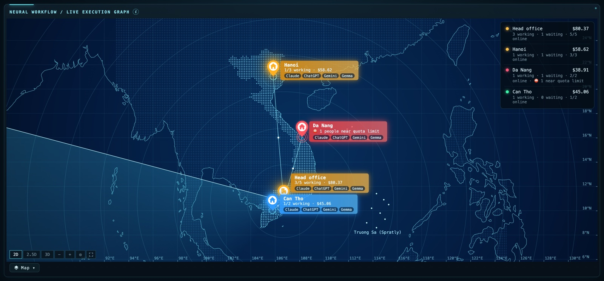<br><sub><b>Bản đồ phẳng.</b> Mỗi văn phòng hiện số người đang làm, chi phí hôm nay và trợ lý đang dùng.</sub><br>&emsp;&emsp;&emsp;&emsp;&emsp;&emsp;&emsp;&emsp;&emsp;&emsp;&emsp;&emsp;&emsp;&emsp;&emsp;&emsp;&emsp;&emsp;&emsp;&emsp;&emsp;&emsp;&emsp;&emsp;&emsp;&emsp;&emsp;&emsp;&emsp;&emsp;&emsp;&emsp;&emsp;&emsp;&emsp;&emsp;&emsp;&emsp;&emsp;&emsp;&emsp;&emsp;&emsp;&emsp;&emsp;&emsp;&emsp;&emsp;&emsp;&emsp;&emsp;&ensp;</td>
    <td nowrap align="center" valign="top">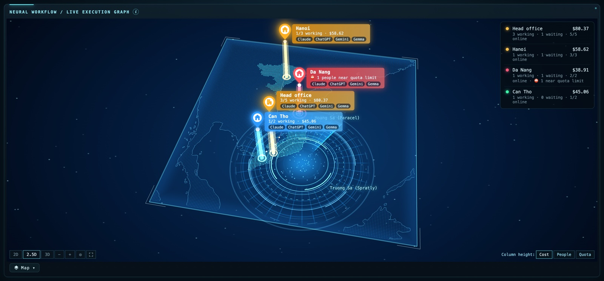<br><sub><b>Bản đồ 2.5D.</b> Cột trên mỗi văn phòng thể hiện chi phí, số người hoặc hạn mức, tuỳ bạn chọn.</sub><br>&emsp;&emsp;&emsp;&emsp;&emsp;&emsp;&emsp;&emsp;&emsp;&emsp;&emsp;&emsp;&emsp;&emsp;&emsp;&emsp;&emsp;&emsp;&emsp;&emsp;&emsp;&emsp;&emsp;&emsp;&emsp;&emsp;&emsp;&emsp;&emsp;&emsp;&emsp;&emsp;&emsp;&emsp;&emsp;&emsp;&emsp;&emsp;&emsp;&emsp;&emsp;&emsp;&emsp;&emsp;&emsp;&emsp;&emsp;&emsp;&emsp;&emsp;&emsp;&ensp;</td>
    <td nowrap align="center" valign="top">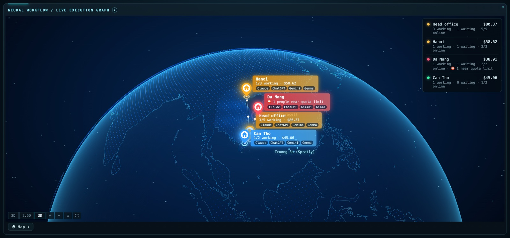<br><sub><b>Quả địa cầu.</b> Vẫn các văn phòng đó trên quả địa cầu 3D: kéo để xoay, cuộn để phóng to, thu nhỏ.</sub><br>&emsp;&emsp;&emsp;&emsp;&emsp;&emsp;&emsp;&emsp;&emsp;&emsp;&emsp;&emsp;&emsp;&emsp;&emsp;&emsp;&emsp;&emsp;&emsp;&emsp;&emsp;&emsp;&emsp;&emsp;&emsp;&emsp;&emsp;&emsp;&emsp;&emsp;&emsp;&emsp;&emsp;&emsp;&emsp;&emsp;&emsp;&emsp;&emsp;&emsp;&emsp;&emsp;&emsp;&emsp;&emsp;&emsp;&emsp;&emsp;&emsp;&emsp;&emsp;&ensp;</td>
    <td nowrap align="center" valign="top">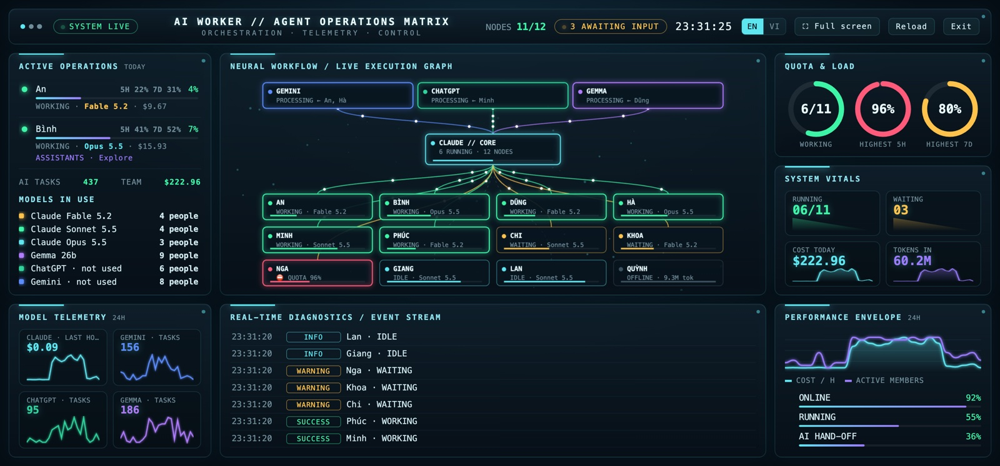<br><sub><b>Màn hình treo tường.</b> Dành cho TV: toàn màn hình, có vòng hạn mức, ghép bằng mã do quản trị duyệt.</sub><br>&emsp;&emsp;&emsp;&emsp;&emsp;&emsp;&emsp;&emsp;&emsp;&emsp;&emsp;&emsp;&emsp;&emsp;&emsp;&emsp;&emsp;&emsp;&emsp;&emsp;&emsp;&emsp;&emsp;&emsp;&emsp;&emsp;&emsp;&emsp;&emsp;&emsp;&emsp;&emsp;&emsp;&emsp;&emsp;&emsp;&emsp;&emsp;&emsp;&emsp;&emsp;&emsp;&emsp;&emsp;&emsp;&emsp;&emsp;&emsp;&emsp;&emsp;&emsp;&ensp;</td>
    <td nowrap align="center" valign="top">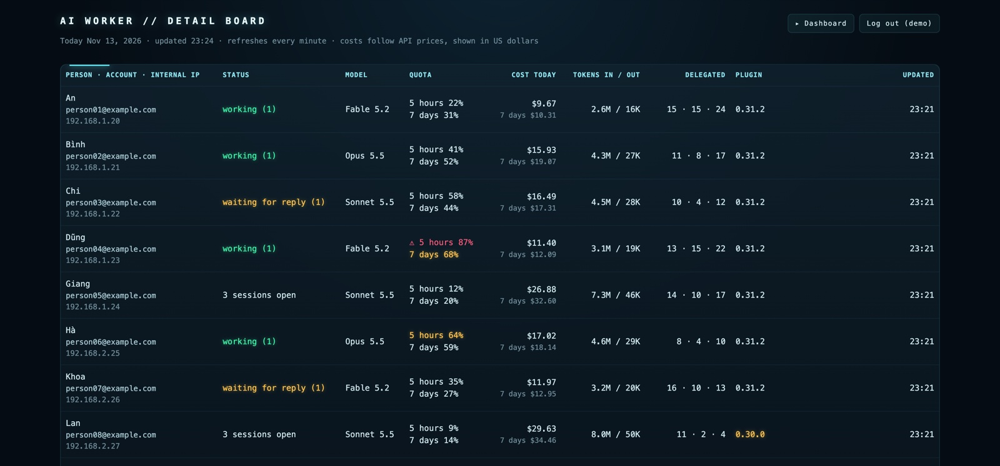<br><sub><b>Bảng chi tiết.</b> Mỗi người một dòng: trạng thái, mô hình, hạn mức, chi phí, token, bản plugin.</sub><br>&emsp;&emsp;&emsp;&emsp;&emsp;&emsp;&emsp;&emsp;&emsp;&emsp;&emsp;&emsp;&emsp;&emsp;&emsp;&emsp;&emsp;&emsp;&emsp;&emsp;&emsp;&emsp;&emsp;&emsp;&emsp;&emsp;&emsp;&emsp;&emsp;&emsp;&emsp;&emsp;&emsp;&emsp;&emsp;&emsp;&emsp;&emsp;&emsp;&emsp;&emsp;&emsp;&emsp;&emsp;&emsp;&emsp;&emsp;&emsp;&emsp;&emsp;&emsp;&ensp;</td>
    <td nowrap align="center" valign="top">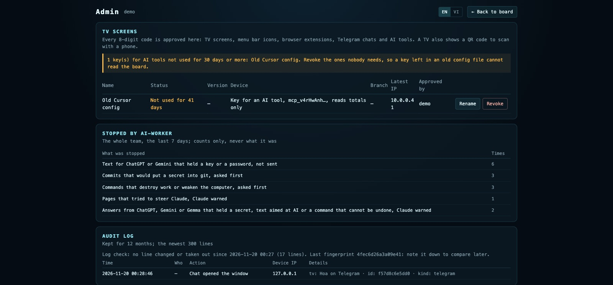<br><sub><b>Trang quản trị.</b> Những gì ai-worker đã chặn, kiểm nhật ký không bị sửa, khoá công cụ AI bỏ quên.</sub><br>&emsp;&emsp;&emsp;&emsp;&emsp;&emsp;&emsp;&emsp;&emsp;&emsp;&emsp;&emsp;&emsp;&emsp;&emsp;&emsp;&emsp;&emsp;&emsp;&emsp;&emsp;&emsp;&emsp;&emsp;&emsp;&emsp;&emsp;&emsp;&emsp;&emsp;&emsp;&emsp;&emsp;&emsp;&emsp;&emsp;&emsp;&emsp;&emsp;&emsp;&emsp;&emsp;&emsp;&emsp;&emsp;&emsp;&emsp;&emsp;&emsp;&emsp;&emsp;&ensp;</td>
    <td nowrap align="center" valign="top">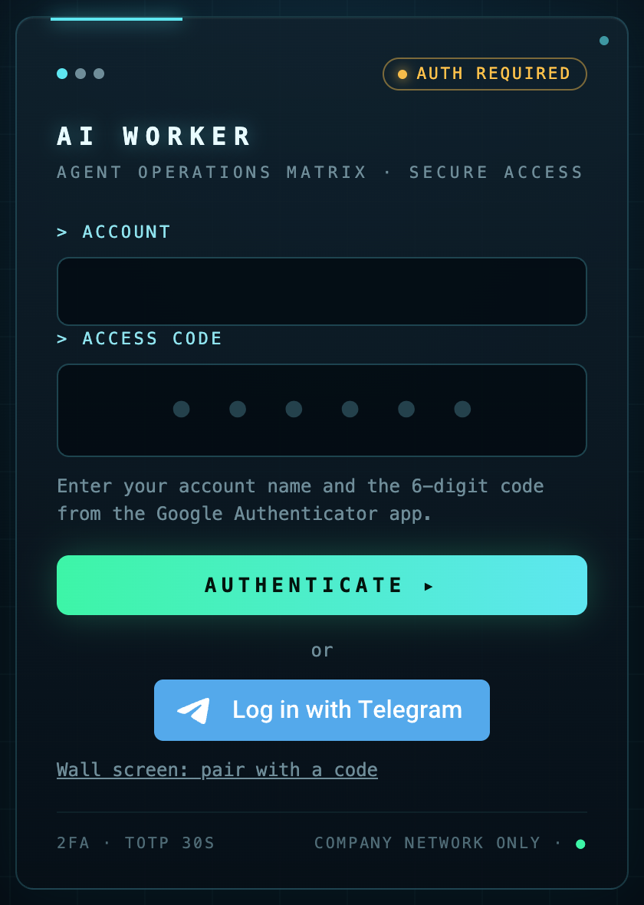<br><sub><b>Đăng nhập.</b> Tên tài khoản và mã 6 số, hoặc Log in with Telegram.</sub><br>&emsp;&emsp;&emsp;&emsp;&emsp;&emsp;&emsp;&emsp;&emsp;&emsp;&emsp;&emsp;&emsp;&emsp;&emsp;&emsp;&emsp;&emsp;&emsp;&emsp;&emsp;&emsp;&emsp;&emsp;&emsp;&emsp;&emsp;&emsp;&emsp;&emsp;&emsp;&emsp;&emsp;&emsp;&emsp;&emsp;&emsp;&emsp;&emsp;&emsp;&emsp;&emsp;&emsp;&emsp;&emsp;&emsp;&emsp;&emsp;&emsp;&emsp;&emsp;&ensp;</td>
    <td nowrap align="center" valign="top">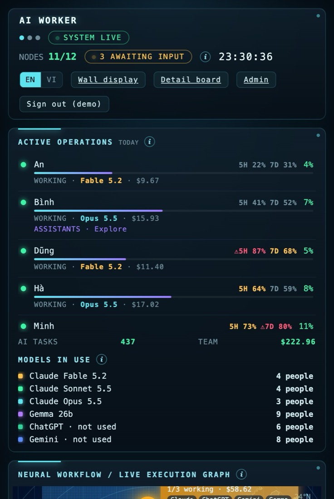<br><sub><b>Màn hình hẹp.</b> Trên điện thoại các ô xếp chồng lên nhau, từ trên xuống dưới.</sub><br>&emsp;&emsp;&emsp;&emsp;&emsp;&emsp;&emsp;&emsp;&emsp;&emsp;&emsp;&emsp;&emsp;&emsp;&emsp;&emsp;&emsp;&emsp;&emsp;&emsp;&emsp;&emsp;&emsp;&emsp;&emsp;&emsp;&emsp;&emsp;&emsp;&emsp;&emsp;&emsp;&emsp;&emsp;&emsp;&emsp;&emsp;&emsp;&emsp;&emsp;&emsp;&emsp;&emsp;&emsp;&emsp;&emsp;&emsp;&emsp;&emsp;&emsp;&emsp;&ensp;</td>
  </tr>
</table>

## Điểm khác biệt

- **Nhìn là biết ai đang kẹt.** Ai đang làm, ai đang chờ trả lời và chờ bao lâu, theo từng văn phòng trên bản đồ. Theo dõi được trên TV treo tường, trên biểu tượng thanh menu (macOS, Windows, Ubuntu) hay tiện ích Chrome, Edge. Tua lại 24 giờ qua để xem cả ngày diễn ra thế nào.
- **Ai cũng dùng được, không riêng dân code.** Một gói cài cho cả công ty, chạy trên macOS, Windows và Linux. Skill và quy tắc chung tự tới mọi máy, bản cập nhật có chữ ký số. Hướng dẫn viết dễ hiểu, có tiếng Việt.
- **Số liệu nằm trên máy chủ của bạn.** Máy chủ tự cài trên máy Linux của bạn, chỉ cần thư viện chuẩn Python và SQLite. Từng trường dữ liệu máy nhân viên gửi lên đều ghi rõ trong [docs/DATA-MODEL.vi.md](docs/DATA-MODEL.vi.md).
- **Báo cáo chi phí và tốc độ cho dự án AI của nhóm.** Chép một file vào dự án (Python, JavaScript, TypeScript, C#, Go, Java và Kotlin, Rust, C/C++; ngôn ngữ khác thì ghi một dòng JSON), dùng hãng LLM nào cũng được. Mỗi yêu cầu được đếm thời gian, số lần gọi LLM và token, không bao giờ ghi câu hỏi hay câu trả lời. Skill `ai-cost-report` hoặc trang **Dự án AI** trên bảng ra báo cáo: tiền mỗi yêu cầu và mỗi 1.000 yêu cầu, thời gian trung bình, p95 và chậm nhất, theo model và theo ngày; in ra PDF khổ A4 hoặc xuất CSV. Xem [đo một dự án hay ứng dụng AI](docs/AI-PROJECTS.vi.md).
- **Chặn rủi ro ngay trên máy, có bằng chứng trên máy chủ.** Khoá, token, mật khẩu không bao giờ bị gửi sang ChatGPT hay Gemini. Những việc khó rút lại đều chờ bạn đồng ý: commit có bí mật, xoá cả thư mục, viết lại lịch sử git, chạy script vừa tải từ mạng, tắt Gatekeeper của macOS, ghi thẳng ra ổ đĩa, mở file cho mọi người. Trang web hay câu trả lời của trợ lý tìm cách ra lệnh cho Claude thì bị đánh dấu. Trên máy chủ, nhật ký có dấu vân tay chống sửa, việc giao cho ChatGPT, Gemini, Gemma được ghi lại mà không kèm nội dung, và trang Quản trị đếm số lần đã chặn. Xem [những gì plugin chặn](SECURITY.vi.md#những-gì-plugin-chặn-trên-máy).

## Tính năng khác

- **Codex, Cursor, Gemini CLI cũng lên bảng:** một bộ nối nhỏ, mỗi người tự cài cho công cụ mình dùng, cho biết số phiên đang mở, đang làm và đang chờ. Không cần Claude Code, Python hay Node, chỉ gửi số đếm. Đã chạy thật với Codex CLI trên macOS; các công cụ và hệ điều hành khác mới kiểm bằng dữ liệu mẫu. Xem [hướng dẫn cài đặt](docs/INSTALL.vi.md#codex-cursor-và-gemini-cli-trên-bảng).
- **Chi phí và hạn mức:** chi phí hôm nay, 7 ngày qua và hạn mức còn lại, theo từng người và từng văn phòng. Bảng chi tiết so tuần này, tháng này với tuần trước, tháng trước.
- **Hỏi Claude về cả nhóm:** quản lý ghép Claude của mình với bảng một lần, rồi cứ hỏi tự nhiên, như "ai đang chờ lâu nhất?", gõ hay nói tiếng Việt đều được. Claude trả lời từ số liệu của bảng.
- **Hỏi từ công cụ AI khác:** máy chủ có cổng MCP chỉ đọc, nên công cụ AI nào hỗ trợ MCP cũng hỏi được, bằng khoá do quản trị duyệt.
- **Bảng ngay trong Telegram:** quản lý bấm nút **AI Worker** của bot là mở bảng nhỏ trên điện thoại: ai đang chờ, chi phí 7 ngày, hạn mức. Bot trả lời bằng nút bấm, không mô hình AI nào đọc câu hỏi, và tự nhắn khi có người chờ quá lâu (`/baocho 10`). Tuỳ chọn, mặc định tắt. Xem [khung bên trong Telegram](docs/INSTALL.vi.md#khung-của-bảng-bên-trong-telegram-tuỳ-chọn) và [tin báo khi có người chờ quá lâu](docs/INSTALL.vi.md#tin-báo-khi-có-người-chờ-quá-lâu-tuỳ-chọn-theo-từng-chat).
- **Biến quy trình thành skill:** đưa cho `/ai-worker:make-skill` một SOP hay mô tả cách làm một việc. Nó viết bản nháp skill, dừng lại khi gặp mật khẩu hay khoá, bỏ dữ liệu cá nhân, và chỉ bật skill khi bạn đồng ý.
- **Phân quyền và nhật ký:** quản trị, quản lý và màn hình treo tường thấy những phần dữ liệu khác nhau; đăng nhập bằng mã OTP 6 số hoặc bằng Telegram (cần cài thêm bot, xem [hướng dẫn cài đặt](docs/INSTALL.vi.md)); mọi thay đổi được lưu nhật ký 12 tháng.

## Có hợp với bạn không?

- **Bạn chỉ muốn biết chi phí token trên máy mình:** một công cụ đếm chạy trên máy là đủ và gọn hơn, không cần máy chủ.
- **Tổ chức của bạn dùng gói Team hoặc Enterprise và có quản lý thiết bị:** [bảng thống kê](https://code.claude.com/docs/en/analytics) và [phần quản lý plugin](https://code.claude.com/docs/en/plugins/org) của chính Anthropic đã có báo cáo sử dụng và cách đưa plugin tới mọi máy. AI Worker thêm bảng theo thời gian thực cho thấy ai đang chờ, và chạy được mà không cần hai thứ đó.
- **Văn phòng nhỏ hoặc vừa, nhiều người không viết code, không có quản lý thiết bị:** đây là trường hợp AI Worker hợp nhất.

## Cách hoạt động

<picture>
  <source media="(prefers-color-scheme: dark)" srcset="assets/architecture-dark.vi.svg">
  
</picture>

Khung bên trong Telegram tới máy chủ bằng đường riêng `/tg/`; xem [docs/ARCHITECTURE.vi.md](docs/ARCHITECTURE.vi.md#khung-bảng-bên-trong-telegram-tuỳ-chọn). Những gì plugin chặn trên máy có trong [SECURITY.vi.md](SECURITY.vi.md#những-gì-plugin-chặn-trên-máy). Dự án hay ứng dụng AI do nhóm tự làm chỉ gửi số đo của chính nó, tới `/projects/ingest`, bằng khoá riêng; xem [docs/ARCHITECTURE.vi.md](docs/ARCHITECTURE.vi.md#đo-một-dự-án-hay-ứng-dụng-ai).

Không có máy chủ thì plugin vẫn chạy trên từng máy với trang văn phòng riêng, nhưng không có bảng cả công ty và không tự cập nhật. Thiết kế xem [docs/ARCHITECTURE.vi.md](docs/ARCHITECTURE.vi.md).

## Cài nhanh

**Chỉ muốn xem thử?** Chạy bảng ngay trên máy bạn với dữ liệu giả lập. Chỉ cần Git và Python 3.8 trở lên.

macOS và Linux:

```bash
git clone https://github.com/anhle9x/ai-worker.git
cd ai-worker
python3 server/demo.py
```

Windows, trong PowerShell hoặc Command Prompt. Nếu máy chưa có Git hoặc Python thì cài trước, rồi mở một cửa sổ mới để máy nhận lệnh vừa cài:

```powershell
winget install --id Git.Git -e --source winget
winget install --id Python.Python.3.12 -e --source winget
```

```powershell
git clone https://github.com/anhle9x/ai-worker.git
cd ai-worker
py server\demo.py
```

Lệnh in ra một địa chỉ, tên tài khoản `demo` và một mã 6 số. Mở địa chỉ đó rồi nhập cả hai: bảng hiện lên với 12 nhân viên giả lập ở 4 văn phòng. Không cài gì và không có gì rời khỏi máy bạn; bấm Ctrl+C để dừng và xoá dữ liệu mẫu. Đã thử trên macOS, Linux và Windows.

**Người quản trị, một lần** (khoảng 30 phút). Các bước và lệnh: [docs/INSTALL.vi.md](docs/INSTALL.vi.md).

1. Chép `server/` lên một máy chủ Linux và chạy `sudo bash install.sh`. Script in ra mã gửi và tạo quản trị đầu tiên.
2. Đặt Caddy phía trước để có HTTPS và danh sách IP văn phòng (mẫu: `server/aiworker.caddy`).
3. Tạo khoá ký bản cập nhật, điền `packaging/company.json`, chạy `bash packaging/build.sh packaging/company.json`.

**Mỗi nhân viên:** giải nén gói, bấm đúp `INSTALL-Mac.command`, `INSTALL-Windows.bat` hoặc chạy `INSTALL-Linux.sh`, gõ họ tên đầy đủ. Trong Claude Code, gõ `/office` để xem các phiên của mình.

**Quản lý:** mở địa chỉ máy chủ, đăng nhập bằng mã 6 số trong Google Authenticator, hoặc bấm **Log in with Telegram** sau khi đã liên kết Telegram (nếu máy chủ đã cài bot Telegram). Muốn có báo thì cài biểu tượng thanh menu ở trang **Quản trị**.


Cách dùng từng màn hình: [docs/USER-GUIDE.vi.md](docs/USER-GUIDE.vi.md).

## Chạy trên đâu

| Phần | Chạy trên | Cần |
|---|---|---|
| Plugin | macOS, Windows, Linux | Claude Code: thẻ Code của app máy tính, CLI, hoặc phần mở rộng VS Code |
| Máy chủ bảng tổng | Linux có systemd | Python 3.8 trở lên, Caddy hoặc nginx; không thư viện nào khác |
| Bộ nối cho Codex, Cursor, Gemini CLI | macOS, Linux, Windows | Chính công cụ đó, và curl hoặc wget; không cần Claude Code |
| Biểu tượng thanh menu | macOS, Windows 10/11, Ubuntu (X11 và Wayland) | Tải ở trang Quản trị của máy chủ |
| Bot Telegram, tin báo và khung của nó (tuỳ chọn) | Telegram trên điện thoại hoặc máy tính | Một bot tạo bằng @BotFather; `TELEGRAM_ASK=1` trên máy chủ, thêm `TELEGRAM_APP=1` cho khung, khung mở được ở các mạng mà máy chủ cho vào. Khung đã thử trên Android và Telegram Desktop, chưa thử trên iPhone |
| Tiện ích trình duyệt | Chrome, Edge | Tải ở trang Quản trị, ghép bằng mã |

### Những gì không được đếm

Bảng cho thấy Claude Code trên các máy đã cài plugin, và Codex, Cursor, Gemini CLI trên các máy đã cài bộ nối (chỉ có số phiên: không có token, chi phí hay hạn mức). Bảng không cho thấy:

- **claude.ai trên trình duyệt, và thẻ Chat của app Claude.** Hai nơi này không có plugin.
- **Phiên Claude Code chạy trên đám mây** (claude.ai/code). Phiên chạy trên máy chủ của Anthropic, không phải máy nhân viên, nên plugin cài trên máy không được nạp. Chưa thử thật: hãy coi như không đếm.
- **Máy chưa cài plugin hoặc bộ nối,** hoặc máy không tới được máy chủ.

Vì vậy người chỉ chat trên claude.ai sẽ hiện là không dùng Claude, dù phần dùng đó vẫn có thể tính vào hạn mức của cùng tài khoản. Hãy đọc bảng là "ai dùng Claude Code, và dùng bao nhiêu", không phải "ai dùng Claude nhiều nhất".

## Lộ trình

Hướng đi của dự án. Không ghi ngày: mục nào kiểm xong thì phát hành mục đó.

- [x] Bảng theo thời gian thực cho thấy ai đang làm, ai đang chờ trong Claude Code, kèm màn hình treo tường, biểu tượng thanh menu và tiện ích trình duyệt
- [x] Plugin chạy trong phần mở rộng Claude Code của VS Code
- [x] Codex, Cursor và Gemini CLI lên cùng một bảng (0.32.0): mới có số phiên
- [x] Hỏi bảng từ mọi công cụ AI hỗ trợ MCP: một cổng chỉ đọc trên máy chủ, khoá do quản trị viên duyệt. Đã thử trong Claude Code và Codex CLI.
- [x] Hỏi bảng từ một chat Telegram, cho quản lý không viết code: nút bấm và câu hỏi ngắn, không dùng mô hình AI, mặc định tắt
- [x] Mức dùng theo tuần và tháng: máy chủ lưu mỗi người mỗi ngày một tổng, bảng chi tiết so tuần này, tháng này với kỳ trước
- [ ] Thử bộ nối Cursor, Gemini CLI và bản Windows trong công cụ thật. Hiện mới thử Codex trên macOS.
- [ ] Thử cổng MCP từ Cursor và Gemini CLI. Hiện đã thử Claude Code, Codex CLI và thẻ Chat của app Claude (qua một kết nối của claude.ai).
- [x] Biểu đồ mức dùng theo tuần và tháng trên bảng chi tiết: chi phí theo tuần trong 12 tuần và theo tháng trong tối đa 13 tháng, cho cả đội và từng văn phòng
- [x] Khung thanh menu ngay trong Telegram (0.37.0), cho các chat quản trị cho phép: đã thử trên Telegram Desktop và Android, ở mạng văn phòng
- [x] Khung trong Telegram cho chat chỉ đọc số gộp (0.41.0): máy chủ chỉ gửi số tổng, không có người nào
- [ ] Khung trong Telegram mở được từ ngoài mạng văn phòng
- [x] Tin nhắn Telegram khi có người chờ quá lâu, do từng chat tự bật (`/baocho`), kèm nút mở khung
- [x] Chi phí và tốc độ của dự án hay ứng dụng AI do nhóm tự làm (0.44.0), với bất kỳ hãng LLM nào; gửi lên bảng và xem ở đó (0.45.0). Đã thử trên bảng thật với lượt thử
- [ ] Đo một dự án thật trọn một kỳ và lấy báo cáo từ bảng

## Tài liệu

| | |
|---|---|
| [Hướng dẫn sử dụng](docs/USER-GUIDE.vi.md) | Nhân viên, quản lý, quản trị |
| [Cài đặt và cấu hình](docs/INSTALL.vi.md) | Triển khai lần đầu, cập nhật, tuỳ chỉnh, dữ liệu gửi đi |
| [Vận hành](docs/OPERATIONS.vi.md) | Kiểm tra hằng ngày, sự cố, sao lưu, quay về bản cũ, nhật ký |
| [Kiến trúc](docs/ARCHITECTURE.vi.md), [dữ liệu](docs/DATA-MODEL.vi.md), [phân quyền](docs/PERMISSIONS.vi.md) | Cách hệ thống được làm |
| [Skill và quy tắc](docs/SKILLS.vi.md) | Mỗi máy nhận được gì |
| [Đo một dự án hay ứng dụng AI](docs/AI-PROJECTS.vi.md) | Nhóm làm dự án có gọi LLM |
| [Kế hoạch kiểm thử](docs/TEST-PLAN.vi.md) | Kiểm tự động gì, kiểm tay gì |
| [Toàn bộ tài liệu](docs/README.vi.md) | Xếp theo mục đích |

## Bảo mật

Được thiết kế để chống các rủi ro web phổ biến (CSRF, XSS, nhúng mã, đăng nhập yếu, kiểm soát truy cập, lộ dữ liệu), đã rà bằng trợ lý AI, chưa được công ty bảo mật độc lập kiểm định. Bảng những gì được bảo vệ, những gì còn lại, và cách báo lỗi riêng: [SECURITY.vi.md](SECURITY.vi.md).

## Đóng góp và ủng hộ

[CONTRIBUTING.vi.md](CONTRIBUTING.vi.md) · [Quy tắc ứng xử](CODE_OF_CONDUCT.vi.md) · [Các thay đổi](CHANGELOG.md) · [Liên hệ và ủng hộ](SUPPORT.vi.md)

## Giấy phép và trách nhiệm của bạn

AI Worker dùng [giấy phép MIT](LICENSE). Các phần của bên thứ ba giữ giấy phép riêng: xem [THIRD-PARTY.md](THIRD-PARTY.md). Tên và nhãn hiệu: xem [NOTICE](NOTICE).

**Trách nhiệm của bạn khi triển khai.** AI Worker không kèm bảo hành. Bạn tự chạy máy chủ và tự quyết định thu thập gì, nên bạn chịu trách nhiệm về:
- **Báo trước cho nhân viên.** Plugin gửi tên, email tài khoản, địa chỉ IP và số liệu sử dụng về máy chủ của bạn. Hãy bắt đầu từ [mẫu thông báo nhân viên](docs/employee-notice.vi.md) và nhờ bộ phận pháp lý hoặc nhân sự xem lại, vì quy định mỗi nước mỗi khác.
- **Bảo vệ máy chủ.** Dùng HTTPS và giới hạn mạng, giữ ít tài khoản quản trị, sao lưu dữ liệu.
- **Khoá của riêng bạn.** `keys/allowed_signers` để trống, nên cập nhật tự động chưa chạy cho tới khi bạn ghi khoá công khai của mình vào `~/.ai-worker-keys/allowed_signers` rồi đóng gói. Không bao giờ commit khoá riêng.
- **Điều khoản của Claude, Gemini và ChatGPT.** Kiểm tra gói đang dùng có cho phép cách bạn dùng không, và nhân viên được gửi dữ liệu gì cho các dịch vụ đó.

**Công khai bản của bạn:** `packaging/check-clean.sh` chặn khoá riêng, token và các từ riêng của bạn (danh sách để ngoài repo) lọt ra ngoài; `--install-hooks` cho công cụ này chạy trước mỗi lần commit và đẩy. Không có danh sách đó thì công cụ từ chối chạy, trừ khi bạn đặt `AI_WORKER_NO_DENY=1`. `packaging/export-public.sh` xuất một bản sạch không kèm lịch sử.
