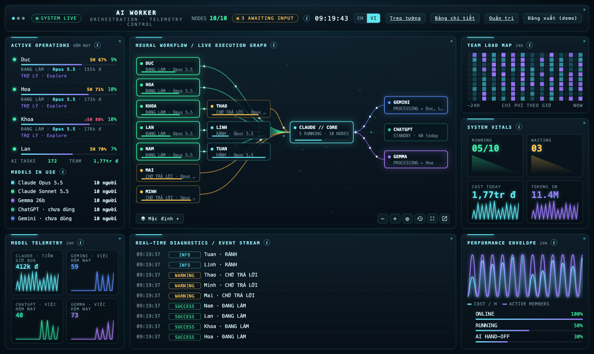
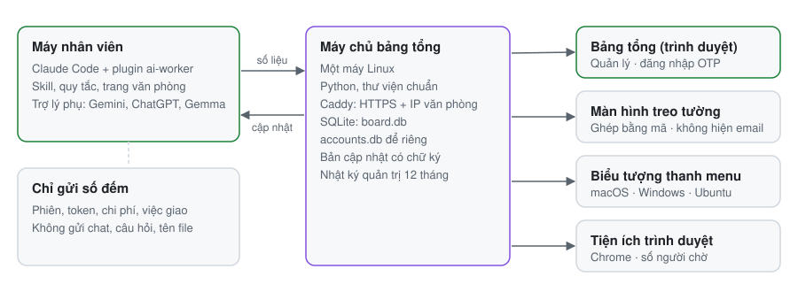

Tiếng Việt | [English](README.md)

# Văn phòng AI Worker

Xem công ty đang dùng Claude và các trợ lý phụ thế nào, theo thời gian thực, trên một bảng.

  
  
  
  

AI Worker gồm một plugin Claude Code trên máy từng nhân viên và một máy chủ nhỏ trên một máy Linux. Plugin đếm Claude và các trợ lý phụ (Gemini, ChatGPT, Gemma) đang làm gì: số phiên, ai đang chờ trả lời, token, chi phí, việc đã giao. Máy chủ gom số liệu thành bảng 3D trực tiếp cho quản lý, màn hình treo tường, biểu tượng thanh menu và tiện ích trình duyệt. Không bao giờ gửi nội dung chat, câu hỏi, tên file hay tên dự án.

## Làm được gì

- **Một bảng cho cả công ty:** ai đang làm, ai chờ trả lời và chờ bao lâu, chi phí hôm nay và 7 ngày, hạn mức còn lại, theo từng văn phòng trên bản đồ.
- **Tua lại 24 giờ qua** để xem cả ngày diễn ra thế nào.
- **Báo mà không cần mở trình duyệt:** biểu tượng thanh menu (macOS, Windows, Ubuntu) và tiện ích Chrome đếm người đang chờ.
- **Skill và quy tắc dùng chung** cho mọi máy, tự cập nhật bằng gói có chữ ký.
- **Phân quyền và nhật ký:** quản trị, quản lý, màn hình treo tường thấy dữ liệu khác nhau; đăng nhập bằng mã OTP 6 số hoặc bằng Telegram (Telegram cần cài thêm bot, xem [hướng dẫn cài đặt](docs/INSTALL.vi.md)); mọi thay đổi được ghi 12 tháng.

## Cách hoạt động

<picture>
  <source media="(prefers-color-scheme: dark)" srcset="assets/architecture-dark.vi.svg">
  
</picture>

Không có máy chủ thì plugin vẫn chạy trên từng máy với trang văn phòng riêng, nhưng không có bảng cả công ty và không tự cập nhật. Thiết kế xem [docs/ARCHITECTURE.vi.md](docs/ARCHITECTURE.vi.md).

## Cài nhanh

**IT, một lần** (khoảng 30 phút). Các bước và lệnh: [docs/INSTALL.vi.md](docs/INSTALL.vi.md).

1. Chép `server/` lên một máy chủ Linux và chạy `sudo bash install.sh`. Script in ra mã gửi và tạo quản trị đầu tiên.
2. Đặt Caddy phía trước để có HTTPS và danh sách IP văn phòng (mẫu: `server/aiworker.caddy`).
3. Tạo khoá ký bản cập nhật, điền `packaging/company.json`, chạy `bash packaging/build.sh packaging/company.json`.

**Mỗi nhân viên:** giải nén gói, bấm đúp `INSTALL-Mac.command`, `INSTALL-Windows.bat` hoặc chạy `INSTALL-Linux.sh`, gõ họ tên đầy đủ. Trong Claude Code, gõ `/office` để xem các phiên của mình.

**Quản lý:** mở địa chỉ máy chủ, đăng nhập bằng mã 6 số trong Google Authenticator, hoặc bấm **Log in with Telegram** sau khi đã liên kết Telegram (nếu máy chủ đã cài bot Telegram). Muốn có báo thì cài biểu tượng thanh menu ở trang **Quản trị**.

Cách dùng từng màn hình: [docs/USER-GUIDE.vi.md](docs/USER-GUIDE.vi.md).

## Chạy trên đâu

| Phần | Chạy trên | Cần |
|---|---|---|
| Plugin | macOS, Windows, Linux | Claude Code (thẻ Code của app máy tính hoặc CLI) |
| Máy chủ bảng tổng | Linux có systemd | Python 3.8 trở lên, Caddy hoặc nginx; không thư viện nào khác |
| Biểu tượng thanh menu | macOS, Windows 10/11, Ubuntu (X11 và Wayland) | Tải ở trang Quản trị của máy chủ |
| Tiện ích trình duyệt | Chrome | Ghép bằng mã |

Thẻ Chat của app Claude không có plugin nên không đếm được.

## Tài liệu

| | |
|---|---|
| [Hướng dẫn sử dụng](docs/USER-GUIDE.vi.md) | Nhân viên, quản lý, quản trị |
| [Cài đặt và cấu hình](docs/INSTALL.vi.md) | Triển khai lần đầu, cập nhật, tuỳ chỉnh, dữ liệu gửi đi |
| [Vận hành](docs/OPERATIONS.vi.md) | Kiểm tra hằng ngày, sự cố, sao lưu, quay về bản cũ, nhật ký |
| [Kiến trúc](docs/ARCHITECTURE.vi.md), [dữ liệu](docs/DATA-MODEL.vi.md), [phân quyền](docs/PERMISSIONS.vi.md) | Cách hệ thống được làm |
| [Skill và quy tắc](docs/SKILLS.vi.md) | Mỗi máy nhận được gì |
| [Kế hoạch kiểm thử](docs/TEST-PLAN.vi.md) | Kiểm tự động gì, kiểm tay gì |
| [Toàn bộ tài liệu](docs/README.vi.md) | Xếp theo mục đích |

## Bảo mật

Được thiết kế để chống các rủi ro web phổ biến (CSRF, XSS, nhúng mã, đăng nhập yếu, kiểm soát truy cập, lộ dữ liệu), đã rà bằng trợ lý AI, chưa được công ty bảo mật độc lập kiểm định. Bảng những gì được bảo vệ, những gì còn lại, và cách báo lỗi riêng: [SECURITY.vi.md](SECURITY.vi.md).

## Đóng góp và ủng hộ

[CONTRIBUTING.vi.md](CONTRIBUTING.vi.md) · [Quy tắc ứng xử](CODE_OF_CONDUCT.vi.md) · [Các thay đổi](CHANGELOG.md) · [Liên hệ và ủng hộ](SUPPORT.vi.md)

## Giấy phép và trách nhiệm của bạn

AI Worker dùng [giấy phép MIT](LICENSE). Các phần của bên thứ ba giữ giấy phép riêng: xem [THIRD-PARTY.md](THIRD-PARTY.md). Tên và nhãn hiệu: xem [NOTICE](NOTICE).

**Trách nhiệm của bạn khi triển khai.** AI Worker không kèm bảo hành. Bạn tự chạy máy chủ và tự quyết định thu thập gì, nên bạn chịu trách nhiệm về:
- **Báo trước cho nhân viên.** Plugin gửi tên, email tài khoản, địa chỉ IP và số liệu sử dụng về máy chủ của bạn. Hãy bắt đầu từ [mẫu thông báo nhân viên](docs/employee-notice.vi.md) và nhờ bộ phận pháp lý hoặc nhân sự xem lại, vì quy định mỗi nước mỗi khác.
- **Bảo vệ máy chủ.** Dùng HTTPS và giới hạn mạng, giữ ít tài khoản quản trị, sao lưu dữ liệu.
- **Khoá của riêng bạn.** `keys/allowed_signers` để trống, nên cập nhật tự động chưa chạy cho tới khi bạn ghi khoá công khai của mình vào `~/.ai-worker-keys/allowed_signers` rồi đóng gói. Không bao giờ commit khoá riêng.
- **Điều khoản của Claude, Gemini và ChatGPT.** Kiểm tra gói đang dùng có cho phép cách bạn dùng không, và nhân viên được gửi dữ liệu gì cho các dịch vụ đó.

**Công khai bản của bạn:** `packaging/check-clean.sh` chặn khoá riêng, token và các từ riêng của bạn (danh sách để ngoài repo) lọt ra ngoài; `--install-hooks` cho công cụ này chạy trước mỗi lần commit và đẩy. Không có danh sách đó thì công cụ từ chối chạy, trừ khi bạn đặt `AI_WORKER_NO_DENY=1`. `packaging/export-public.sh` xuất một bản sạch không kèm lịch sử.
