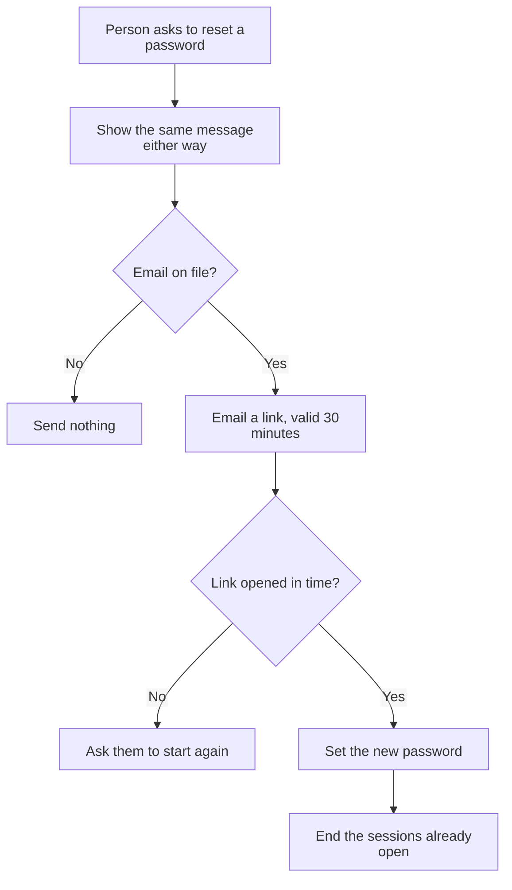

# Draw a flow

Answer and write the labels in the user's language.

Purpose: a reader sees how something really happens, including where it can refuse or fail, without anyone explaining the diagram.

## Input
`$ARGUMENTS`: the flow to draw. It may be a system in a project, or a process the user describes.

## How to do it
1. **Find what really happens.** In a project, follow the code from the first step to the last. Every step in the diagram must be something you saw. For a process the user describes, the user is the evidence. Mark what you could not confirm as `[to confirm]` in its label.
2. **Fix the scope:** one diagram, one flow, with one trigger and a clear end. "Everything about logging in" is several flows. If the request covers several, draw each one and say so.
3. **Choose the type** from the table below.
4. **Draw it** by the drawing and syntax rules below.
5. **Write one or two sentences above the diagram** on what the picture cannot show: why it works this way, or what the reader should notice. Do not retell the steps.
6. **Check that it displays** (see below).
7. **Save it** as a fenced `mermaid` block in the document it belongs to, or in `docs/` if there is none. If the project keeps documents in two languages, write both, with translated labels.
8. **Report in a few lines:** where it was saved, how it was checked, and every `[to confirm]`.

## Choosing the type
| What the reader needs to see | Type |
|---|---|
| The parts of a system and what connects them | `flowchart LR`, with `subgraph` for each machine or owner |
| Steps with decisions and branches | `flowchart TD` |
| A few steps in a straight line | `flowchart LR` |
| Messages between parties, in order | `sequenceDiagram` |
| The states one thing moves through | `stateDiagram-v2` |

If time order between two or more parties matters, use a sequence diagram. If the choices matter more, use a flowchart.

## Drawing rules
- Fifteen nodes or fewer, or about fifteen messages. Past that, split it.
- Every decision is a question, with every answer labelled. Include the "no" and the failure paths: they are usually why the diagram is worth drawing.
- In a sequence diagram, one party checking something itself is an arrow to itself, with the refusal in the text: `W->>W: Check the key, else 401`.
- Every path reaches an end. A branch that stops in the middle means a step is missing.
- A label names one action, verb first, in a few words. Use the words the code or the spec uses.
- A solid arrow is what the system does. Use a dotted arrow (`-.->`) for what a person does by hand.
- Name real things where the reader may look for them: file names, paths, status codes.
- No colors or styles unless the color carries meaning.

## Syntax rules
Start every flowchart with this line, because labels drawn as HTML can be cut off in some browsers even when the diagram looks right in yours:
`%%{init: {"htmlLabels": false, "flowchart": {"htmlLabels": false}}}%%`

Breaking any of these stops the whole diagram from displaying:
- Put every node label in double quotes: `Check["Verify (again)"]`, `Own{"Own key?"}`. Brackets in an unquoted label are an error.
- Do not use lowercase `end` as a node ID. Use `Done` or `Stop`.
- In a sequence diagram, do not use a semicolon in message text: it cuts the message off.
- Close each `alt`, `loop`, `opt` and `subgraph` with its own `end`.

Two habits keep the source easy to read and change:
- Node IDs are short and ASCII (`Check`, `Sig`). Other languages go in the labels.
- Write a double quote inside a label as `#quot;`, and a line break as ` `.

## Checking that it displays
Use the first of these that works, and say which one you used:
1. `mmdc -i <file>.mmd -o <file>.svg`, if the Mermaid command line tool is installed.
2. A preview that can display Mermaid on this computer. A local page that loads the Mermaid library and draws in the browser counts, because the diagram stays on this computer.
3. If neither works, write "not displayed yet" in your report. Do not say it works.

Do not paste diagrams with internal names into an online editor, which keeps them on someone else's server.

Then read the result as a stranger: does each arrow follow from the one before it, and does each label fit?

## Example
A person resets a password. The same message is shown whether or not the email is known, so nobody can use this page to find out who has an account.

## Limits
- Do not draw what you wish the system did as if it were true. A planned step is labelled as planned.
- Do not put passwords, keys, tokens, real names or internal addresses in a diagram.
- Do not send a diagram with internal names to Gemini or ChatGPT.
- Do not change code while drawing. If the trace turns up a bug, report it separately.
