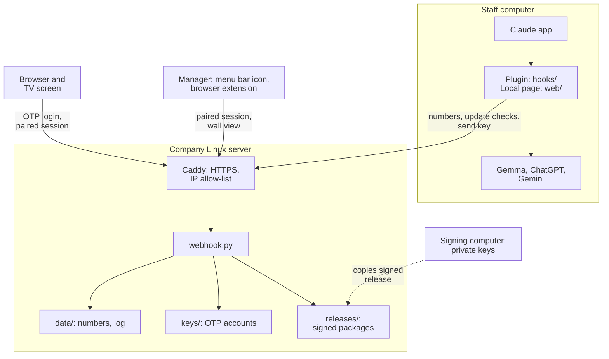
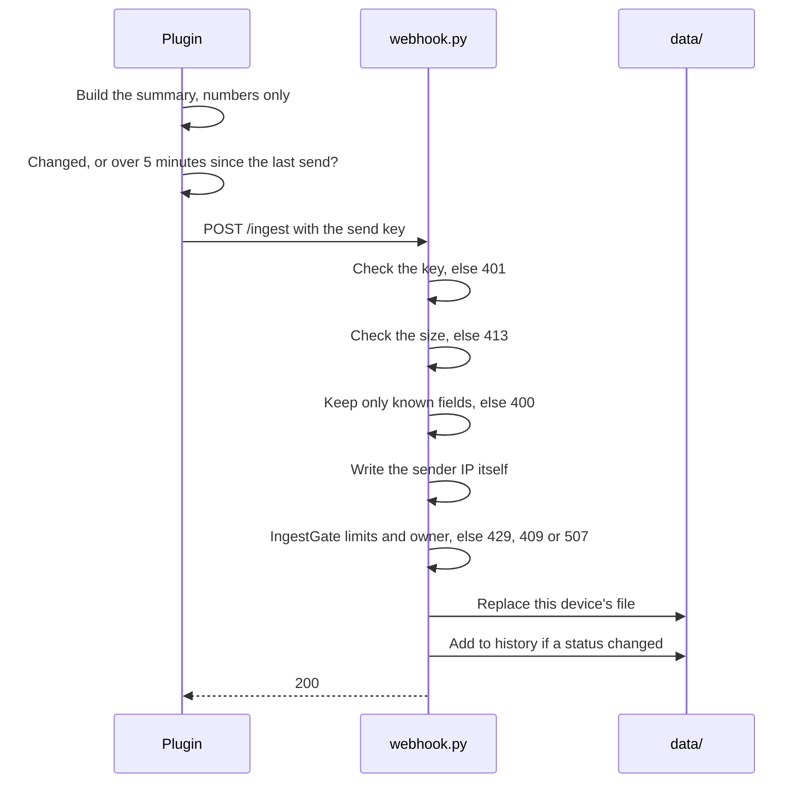
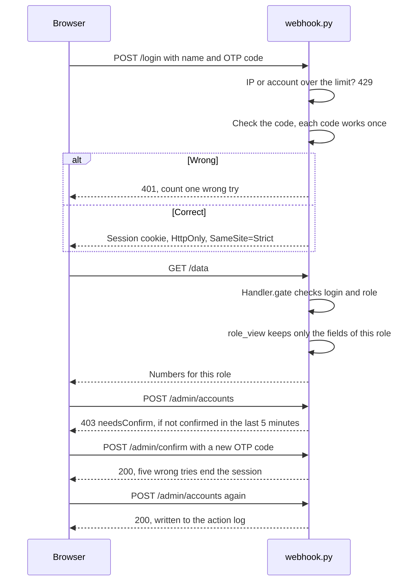
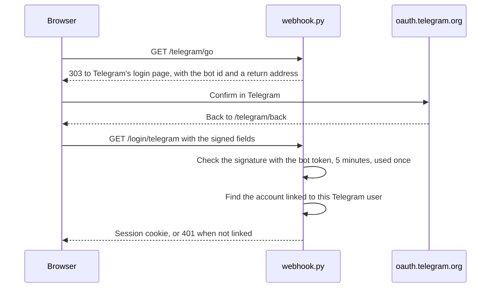
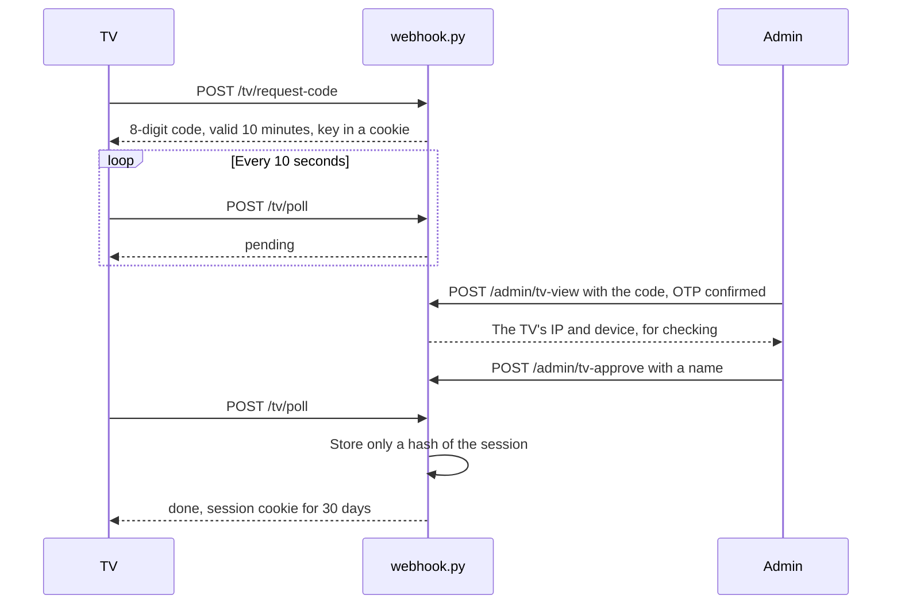
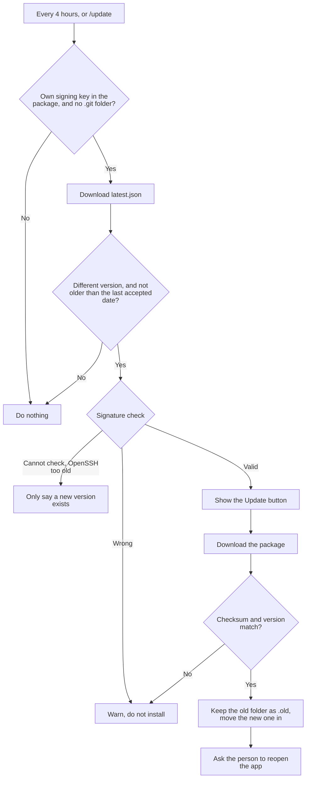
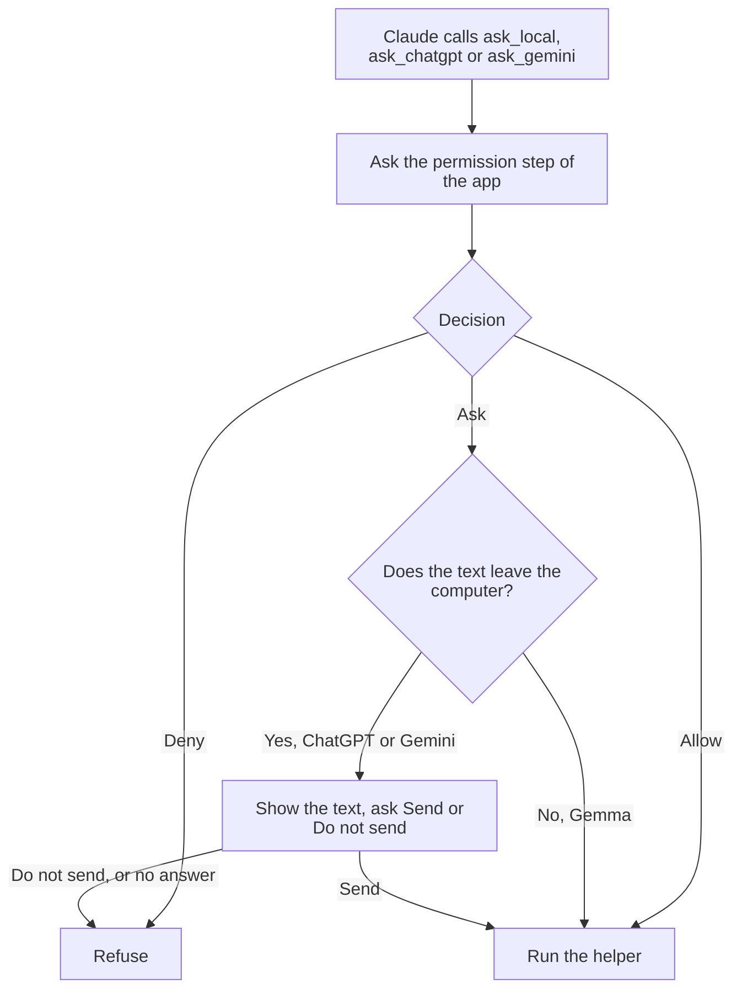
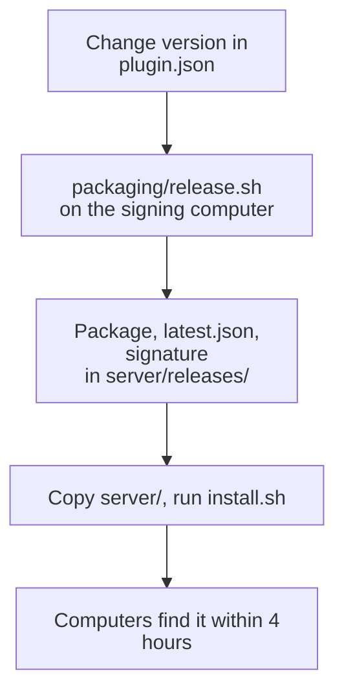

[Tiếng Việt](ARCHITECTURE.vi.md) | English <!-- i18n-allow -->

# Architecture and specification

What AI Worker Office must do, how its parts fit together and why it is built this way. For installing and running it, see [INSTALL.md](INSTALL.md) and [OPERATIONS.md](OPERATIONS.md).

The code is the final authority: if this document and the code disagree, the code shows what runs today, and the document should be corrected.

## 1. Specification

### Goal

Let a company see how Claude and the AI assistants are used, across all staff computers, without collecting what people actually write, and share one set of skills and rules.

### Not in scope

- Reading chat content, questions, answers, file names or project names.
- Tracking the Chat tab of the Claude app, which has no plugins.
- Stopping a staff member from sending false numbers under another name: everyone shares one send key (see [Known limits](#6-known-limits)).

### Who uses it

| Person | Uses | Can do |
|---|---|---|
| Staff member | Plugin on their computer | See their own sessions, get updates, send work to assistants |
| Admin | Dashboard, `/admin` | Everything below, plus accounts, locations, Team plan CSV, TV screens, the log |
| Viewer | Dashboard, `/board` | See numbers with names, emails and internal IPs; change nothing |
| Wall screen | Dashboard on a TV | See numbers with shortened names; no emails or internal IPs |
| Manager | Menu bar icon, browser extension | See who is waiting or working, quota and cost today without opening the board, with the wall screen's data; see [menu-bar-spec.md](menu-bar-spec.md) and [chrome-extension-spec.md](chrome-extension-spec.md) |
| IT | Server, signing keys | Install the webhook, build packages, sign releases |

### What it must do

| ID | Requirement | Where |
|---|---|---|
| F1 | Without a server the plugin still works on one computer | `hooks/register.tsx` |
| F2 | A computer sends a summary when its numbers change, and at least every 5 minutes while Claude is open | `hooks/register.tsx`, `hooks/team.ts` |
| F3 | The server accepts only known fields and writes the sender's IP itself | `clean_payload` in `server/board/devices.py`, `Handler.ingest` in `server/webhook.py` |
| F4 | One device stays tied to one person | `IngestGate` |
| F5 | The dashboard needs an OTP login, and the server applies each role itself | `LoginGate`, `Handler.gate`, `role_view` |
| F6 | Changing accounts, sessions or TV screens needs the OTP code again, valid for 5 minutes | `require_otp`, `LoginGate.confirm` |
| F7 | A TV joins only after an admin approves its code | `TvPairing`, `TvStore` |
| F8 | A computer installs an update only with a valid signature and checksum | `hooks/update.ts`, `updatePlugin` |
| F9 | Text for ChatGPT or Gemini is sent only with permission; a failed question counts as no | `refuseToSend`, `hooks/workers.ts` |
| F10 | Pages, plugin and installers come in English and Vietnamese | `i18n.js`, `hooks/lang.ts`, `packaging/lang.sh` |

### Limits the server enforces

| Limit | Value |
|---|---|
| Size of one send | 256 KB |
| Sends per IP | 300 per 10 minutes |
| New devices | 10 per IP per day, 300 in total |
| Wrong logins | 5 per IP and 20 per account, in 15 minutes |
| Connections | 256 in total, 16 per IP, 120 seconds each |
| Probing | 20 errors (401/404) in 10 minutes blocks an IP that is not logged in for 15 minutes |
| TV screens | 20 joined, 3 waiting per IP, 30 waiting in total |

### How long data is kept

| Data | Kept |
|---|---|
| Hourly numbers of a device | 8 days |
| A computer that stopped sending | Shown as offline after 12 minutes, deleted after 30 days |
| Action log | 12 months |
| Login sessions | 8 hours, wall accounts 7 days; lost when the webhook restarts |
| TV sessions | 30 days, renewed while in use; 1 year at most; survive restarts |

## 2. The parts



| Folder | Holds |
|---|---|
| `hooks/` | The plugin. `register.tsx` connects to the Claude app and does all input and output; the other files are pure logic |
| `web/` | The page opened by `/office` on the computer |
| `server/` | The webhook, its pages in `static/`, its tests, the installer |
| `server/menubar/` | The menu bar icon for managers: an app for macOS, an app for Windows (`windows-app/`, C#, installed from an .msi; the PowerShell tray script stays as the fallback), an AppIndicator program in a .deb for Ubuntu (the Argos script still works) |
| `extensions/manager/` | The browser extension for managers (Chrome, Edge), installed by hand |
| `packaging/` | Building packages, installers, signing releases, checks before publishing |
| `skills/`, `dev-pack/` | The common skills, and the separate technical pack |
| `tests/` | Plugin tests, install tests for Linux and Windows, language checks, the menu bar tests (`tests/menubar/`) and the extension check (`tests/extension/`) |

### Languages

Each part uses what its platform already has, so almost nothing extra needs installing. The exceptions are Microsoft's WebView2 SDK, bundled for the Windows menu bar window, and the GTK, WebKit2 and AppIndicator packages that apt installs with the Ubuntu .deb:

| Language | Where | Why |
|---|---|---|
| TypeScript | `hooks/` | The Claude app runs plugin code written in TypeScript |
| JavaScript, HTML, CSS | `web/`, `server/static/`, `extensions/manager/` | Pages in the browser and the browser extension; no build step |
| Python 3 | `server/webhook.py` and `server/board/`, `server/menubar/ai-worker.1m.py`, `server/menubar/ai-worker-indicator.py`, checks in `tests/` | Present on every Linux server and on Ubuntu. Standard library only, except `ai-worker-indicator.py`, which uses python3-gi, AppIndicator and WebKit2 from apt |
| Swift | `server/menubar/macos-app/main.swift` | The macOS menu bar app: a native popover under the icon |
| PowerShell | `server/menubar/ai-worker-tray.ps1` (the fallback Windows icon), Windows installers in `packaging/` | Built into Windows |
| C# | `server/menubar/windows-app/`, `server/menubar/menubar-popup.cs` | The Windows app `AI Worker.exe` on .NET Framework 4.8 and its window (WebView2); builds on a Mac with the .NET SDK or on Windows |
| WiX | `server/menubar/windows-app/AIWorker.wxs` | The `AI Worker.msi` installer, built on GitHub's Windows; `fetch-msi.sh` puts it in `server/menubar/`, and the server fills in its own address |
| Shell (bash), Batchfile | `packaging/`, `server/install.sh` | Installers and build scripts on macOS, Linux and Windows |

GitHub's language bar shows only the largest six; Swift and C# are counted under "Other". Code from other people (see `THIRD-PARTY.md`) is left out of the count by `.gitattributes`.

## 3. Main flows

### Sending numbers

Only a package built for a company sends anything. Each step that can refuse does so before anything is stored.



If sending fails, the plugin tries again on the next beat and warns once the problem lasts.

### Logging in and viewing



### Logging in with Telegram (optional)

Only when a bot is set up. The page loads nothing from Telegram, and the server never calls Telegram.



Linking goes the same way, after the 6-digit code on `/telegram`: the return address carries a one-time step code tied to that session.

### Pairing a TV screen

The code shown on the TV lets an admin approve it. The session goes only to the TV, because only the TV holds the key in its cookie: someone who sees the code cannot take the session.



### Updating the plugin

The server is not trusted: a hijacked server cannot hand out a bad package, because the computer checks the signature against the keys it already has.



Rolling back is a new release of the old version: a different version is accepted, while an old signed file with an older date is not, so it cannot be replayed.

### Sending text to an assistant

This applies to the plugin's own tools, used when a computer has no `ai-workers` MCP server. Gemma runs on the computer; ChatGPT and Gemini are outside companies.



### Publishing a release



## 4. Design choices

| Choice | How it works | Why |
|---|---|---|
| One route table, one gate (table-driven routing, single entry check) | Every path is in `GET_ROUTES` or `POST_ROUTES` with its permission. `Handler.gate` is the only permission check. A path that is not listed is 404 | A new path cannot forget its check; a test keeps a table of permissions |
| Allow-list on the way out (field projection by role) | `role_view` copies only the fields listed for a role | A new field stays hidden until someone chooses to show it |
| Allow-list on the way in (rebuild, do not trust input) | `clean_payload` rebuilds each send from a fixed list of fields, and again whenever a file is read | A bad send or a damaged file cannot reach the pages |
| Small classes for state (shared base class, one owner per rule) | `Store` keeps a table in memory and writes changed rows in one transaction; `Accounts`, `TvStore`, `RevokedKeys` and `DocumentStore` build on it. `LoginGate`, `IngestGate`, `BotBlocker` each own one set of limits | Each rule lives in one place and can be tested alone |
| Pure logic apart from input and output (functional core, imperative shell) | `hooks/*.ts` are pure functions; `register.tsx` is the only file using the app's `$` interface | The logic can be tested without running the app |
| Trust the signature, not the server (signed manifest) | The computer checks a signed manifest with keys in its own package | Taking over the server is not enough to reach staff computers |
| English in the code, Vietnamese in dictionaries (message catalog) | `tx("...")` looks up `*.vi.js`, `webhook_vi.py`, `lang.vi.ts`; the menu bar scripts use `server/menubar/vi.json` and the extension `extensions/manager/_locales/` | One source of text; `tests/check-i18n.py` finds what is missing |
| No outside libraries on the server | Only the Python standard library | Nothing extra to install, update or audit |

### Storage: SQLite

The server keeps everything in two SQLite files: `data/board.db` for the numbers and `keys/accounts.db` for accounts, apart so a data backup never holds OTP secrets. SQLite comes with Python, so nothing is added to install. It gives transactions, queries across months for the audit log, and room for new tables such as chat. Versions up to 0.24 used one JSON file per table; the server moves them in at its first start. Details: [DATA-MODEL.md](DATA-MODEL.md).

## 5. Checking changes

```bash
claude plugin test .
npx -y -p typescript@5.9.3 tsc -p tsconfig.json
uvx ruff check .
cd server && python3 -m unittest test_webhook
python3 tests/check-i18n.py --comments
node tests/extension/check-extension.js
```

Each push also runs `.github/workflows/test-install.yml`: on Ubuntu it builds the package, tests the private-data check (`tests/test-check-clean.sh`) and the skills' front matter, then tries installing the plugin and the server, and tests the menu bar script and the .deb (`tests/menubar/test-menubar.sh`, `test-deb.sh`); it also checks the two-language rules (`tests/check-i18n.py`); on Windows it tries installing and tests the tray icon (`tests/menubar/test-menubar.ps1`), and a second Windows job builds `AI Worker.exe` and `AI Worker.msi`, installs it without admin rights, pairs with a fake server, installs a newer build over the running app, and removes it (`tests/menubar/test-windows-app.ps1`). It does not run `test_webhook` or the extension check, so run those yourself.

`server/test_webhook.py` compares the field names of the pages with what the server sends, but it only reads the code, so a page change still needs looking at in a browser.

## 6. Known limits

- **Shared send key.** Everyone in the install package has `INGEST_KEY`, so a staff member can send false numbers under a name not yet tied to a device. If a package leaks, change the key and reinstall.
- **HTTP without a proxy.** The connection is encrypted only behind Caddy or nginx.
- **People with sudo on the server** can read all numbers and issue accounts for themselves. Keep them few.
- **Large files.** The server is split into `server/board/` (settings, login, devices, stores, views, pages, packages) with `server/webhook.py` keeping the request handler and routes. `hooks/register.tsx` and `server/static/ops.js` are still large: their parts share state in one closure and have no tests of their own yet, so they wait for those tests before being split.
- **Copied files.** `web/` and `server/static/` hold the same `ops.js`, `ops.css`, `ops3d.js`, `i18n.js`, `ops.vi.js`. The packaging script checks that they match. `extensions/manager/mini/` holds copies of `mini.js`, `mini.css` and the logos; `tests/extension/check-extension.js` checks those.
- **The TypeScript type check runs only locally.** `tsc` needs the type files Claude Code writes to `.claude-plugin/types` (not in git), so CI runs ruff and the test suites; run `tsc` before pushing.
