[Tiếng Việt](ARCHITECTURE.vi.md) | English <!-- i18n-allow -->

# Architecture and specification

What AI Worker Office must do, how its parts fit together and why it is built this way. For installing and running it, see [INSTALL.md](INSTALL.md) and [OPERATIONS.md](OPERATIONS.md).

The code is the final authority: if this document and the code disagree, the code shows what runs today, and the document should be corrected.

## 1. Specification

### Goal

Let a company see how Claude and the AI assistants are used, across all staff computers, without collecting what people actually write, and share one set of skills and rules.

### Not in scope

- Reading chat content, questions, answers, file names or project names.
- Tracking the Chat tab of the Claude app, which has no plugins.
- Tokens and cost of Codex, Cursor and Gemini CLI: their hooks do not hand them over, and reading them would mean reading the session logs, which hold the chat.
- Stopping a staff member from sending false numbers under another name: everyone shares one send key (see [Known limits](#6-known-limits)).

### Who uses it

| Person | Uses | Can do |
|---|---|---|
| Staff member | Plugin on their computer | See their own sessions, get updates, send work to assistants |
| Admin | Dashboard, `/admin` | Everything below, plus accounts, locations, Team plan CSV, TV screens, the log |
| Viewer | Dashboard, `/board` | See numbers with names, emails and internal IPs; change nothing |
| Wall screen | Dashboard on a TV | See numbers with shortened names; no emails or internal IPs |
| Manager | Menu bar icon, browser extension | See who is waiting or working, quota and cost today without opening the board, with the wall screen's data; see [menu-bar-spec.md](menu-bar-spec.md) and [chrome-extension-spec.md](chrome-extension-spec.md) |
| Person with an AI tool | Claude Code, Codex CLI, Cursor, Gemini CLI or another tool that speaks MCP, with a key an admin approved | Ask the board in their own words. The tool reads the wall screen's data as text, or team and office totals only when the admin chose that; see [INSTALL.md](INSTALL.md) |
| Person in a Telegram chat | Telegram on a phone, in a private chat an admin approved; only when the server's owner turned it on (`TELEGRAM_ASK=1`) | Ask the board by tapping a button or typing a short question. The answer is a few lines made from the wall screen's data, or team and office totals only when the admin chose that; see [INSTALL.md](INSTALL.md) |
| Server owner | Server, signing keys | Install the webhook, build packages, sign releases |

### What it must do

| ID | Requirement | Where |
|---|---|---|
| F1 | Without a server the plugin still works on one computer | `hooks/register.tsx` |
| F2 | A computer sends a summary when its numbers change, and at least every 5 minutes while Claude is open | `hooks/register.tsx`, `hooks/team.ts` |
| F3 | The server accepts only known fields and writes the sender's IP itself | `clean_payload` in `server/board/devices.py`, `Handler.ingest` in `server/webhook.py` |
| F4 | One device stays tied to one person | `IngestGate` |
| F5 | The dashboard needs an OTP login, and the server applies each role itself | `LoginGate`, `Handler.gate`, `role_view` |
| F6 | Changing accounts, sessions or TV screens needs the OTP code again, valid for 5 minutes | `require_otp`, `LoginGate.confirm` |
| F7 | A TV joins only after an admin approves its code | `TvPairing`, `TvStore` |
| F8 | A computer installs an update only with a valid signature and checksum | `hooks/update.ts`, `updatePlugin` |
| F9 | Text for ChatGPT or Gemini is sent only with permission; a failed question counts as no | `refuseToSend`, `hooks/workers.ts` |
| F10 | Pages, plugin and installers come in English and Vietnamese | `i18n.js`, `hooks/lang.ts`, `packaging/lang.sh` |
| F11 | A person on Codex, Cursor or Gemini CLI shows on the board without Claude Code: sessions open, working and waiting, per tool | `connectors/ai-worker-hook.sh`, `connectors/ai-worker-hook.ps1`; `from_connector`, `is_fresh` in `server/board/devices.py` |
| F12 | An AI tool that speaks MCP reads the board with a key of its own that an admin approved: read-only, the wall view as text, within what the key may read | `server/board/mcp.py`; `mcp_post`, `PERM_MCP_KEY` in `server/webhook.py`; `TvStore.find` in `server/board/stores.py` |
| F13 | A person asks the board from a Telegram chat an admin approved: one of a fixed set of answers, with no AI model, within what the chat may read. A process of its own talks to Telegram; the webhook never connects out | `server/telegram_bot.py`; `server/board/chat.py`, `server/board/ask.py`; `bot_telegram`, `PERM_BOT_KEY` in `server/webhook.py` |
| F13 | Use can be compared by week and by month: the server adds the hours each computer already sends into one total per person per day and keeps it 13 months; admins and viewers see it on `/board` | `server/board/daily.py`; `record_daily`, `usage_view` in `server/board/views.py`; `usage_section`, `usage_chart` in `server/board/pages.py` |

### Limits the server enforces

| Limit | Value |
|---|---|
| Size of one send | 256 KB |
| Sends per IP | 300 per 10 minutes |
| New devices | 10 per IP per day, 300 in total |
| Wrong logins | 5 per IP and 20 per account, in 15 minutes |
| Connections | 256 in total, 16 per IP, 120 seconds each |
| Probing | 20 errors (401/404) in 10 minutes blocks an IP that is not logged in for 15 minutes |
| TV screens | 20 joined, 3 waiting per IP, 30 waiting in total |
| Keys for AI tools (MCP) | 50 keys; 120 requests per key in 10 minutes; a message of 16 KB |
| Telegram chats | 50 chats; 10 waiting for approval; 20 messages per chat in 10 minutes; a chat that is not approved is answered once an hour |

### How long data is kept

| Data | Kept |
|---|---|
| Hourly numbers of a device | 8 days |
| Totals per person per day (cost, tokens, tasks delegated, office) | The current month and the 12 before it |
| The copy of a database made before a schema upgrade | 30 days |
| A computer that stopped sending | Shown as offline after 12 minutes, deleted after 30 days |
| A report from the connector for Codex, Cursor and Gemini CLI | Counted for 2 hours after it was sent, its "working" for 30 minutes; on the computer, a session with no event for 2 hours is dropped |
| Action log | 12 months |
| Calls of the board's MCP tool | 3 months, counted by calendar month |
| Answers to Telegram chats | 3 months, counted by calendar month |
| Login sessions | 8 hours, wall accounts 7 days; lost when the webhook restarts |
| TV sessions | 30 days, renewed while in use; 1 year at most; survive restarts |
| Keys for AI tools (MCP) | 30 days without use; 1 year at most; survive restarts |
| Telegram chats | 30 days without use; 1 year at most; survive restarts |

## 2. The parts

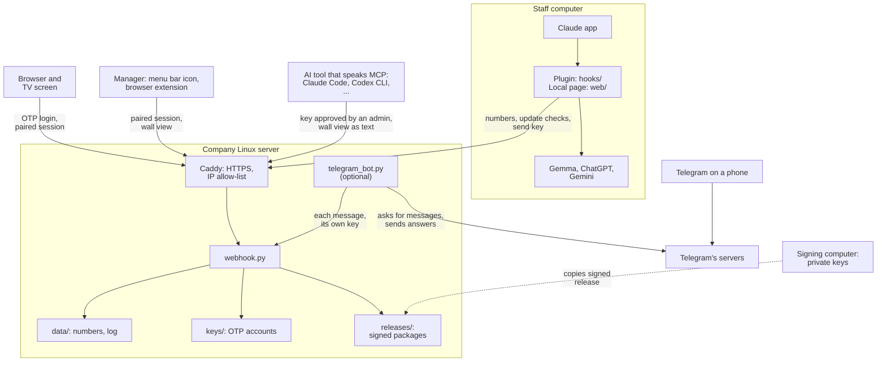

| Folder | Holds |
|---|---|
| `hooks/` | The plugin. `register.tsx` connects to the Claude app and does all input and output; the other files are pure logic |
| `web/` | The page opened by `/office` on the computer |
| `server/` | The webhook, its pages in `static/`, its tests, the installer |
| `server/menubar/` | The menu bar icon for managers: an app for macOS, an app for Windows (`windows-app/`, C#, installed from an .msi; the PowerShell tray script stays as the fallback), an AppIndicator program in a .deb for Ubuntu (the Argos script still works) |
| `extensions/manager/` | The browser extension for managers (Chrome, Edge), installed by hand |
| `connectors/` | The connector for Codex, Cursor and Gemini CLI: the hook (`ai-worker-hook.sh`, `.ps1`), its installer (`install.sh`, `.ps1`) and the JSON merge the installer uses (`merge-hooks.js`). It does not need the plugin |
| `packaging/` | Building packages, installers, signing releases, checks before publishing |
| `skills/`, `agents/`, `commands/` | The skills (everyday ones and those for coding and systems), the `planner` assistant, and the commands the app lists before a session starts |
| `tests/` | Plugin tests, install tests for Linux and Windows, language checks, the menu bar tests (`tests/menubar/`), the connector tests (`tests/connectors/`) and the extension check (`tests/extension/`) |

### Languages

Each part uses what its platform already has, so almost nothing extra needs installing. The exceptions are Microsoft's WebView2 SDK, bundled for the Windows menu bar window, and the GTK, WebKit2 and AppIndicator packages that apt installs with the Ubuntu .deb:

| Language | Where | Why |
|---|---|---|
| TypeScript | `hooks/` | The Claude app runs plugin code written in TypeScript |
| JavaScript, HTML, CSS | `web/`, `server/static/`, `extensions/manager/`, `connectors/merge-hooks.js` | Pages in the browser and the browser extension; no build step. `merge-hooks.js` runs with `osascript` on macOS and Node elsewhere |
| Python 3 | `server/webhook.py` and `server/board/`, `server/menubar/ai-worker.1m.py`, `server/menubar/ai-worker-indicator.py`, checks in `tests/` | Present on every Linux server and on Ubuntu. Standard library only, except `ai-worker-indicator.py`, which uses python3-gi, AppIndicator and WebKit2 from apt |
| Swift | `server/menubar/macos-app/main.swift` | The macOS menu bar app: a native popover under the icon |
| PowerShell | `server/menubar/ai-worker-tray.ps1` (the fallback Windows icon), Windows installers in `packaging/`, the connector for Windows in `connectors/` | Built into Windows |
| C# | `server/menubar/windows-app/`, `server/menubar/menubar-popup.cs` | The Windows app `AI Worker.exe` on .NET Framework 4.8 and its window (WebView2); builds on a Mac with the .NET SDK or on Windows |
| WiX | `server/menubar/windows-app/AIWorker.wxs` | The `AI Worker.msi` installer, built on GitHub's Windows; `fetch-msi.sh` puts it in `server/menubar/`, and the server fills in its own address |
| Shell (bash), Batchfile | `packaging/`, `server/install.sh`, `connectors/install.sh` | Installers and build scripts on macOS, Linux and Windows |
| Shell (sh) | `connectors/ai-worker-hook.sh` | The connector's hook: every macOS and Linux computer has sh, awk, sed and grep |

GitHub's language bar shows only the largest six; Swift and C# are counted under "Other". Code from other people (see `THIRD-PARTY.md`) is left out of the count by `.gitattributes`.

## 3. Main flows

### Sending numbers

Only a package built for a company sends anything. Each step that can refuse does so before anything is stored.

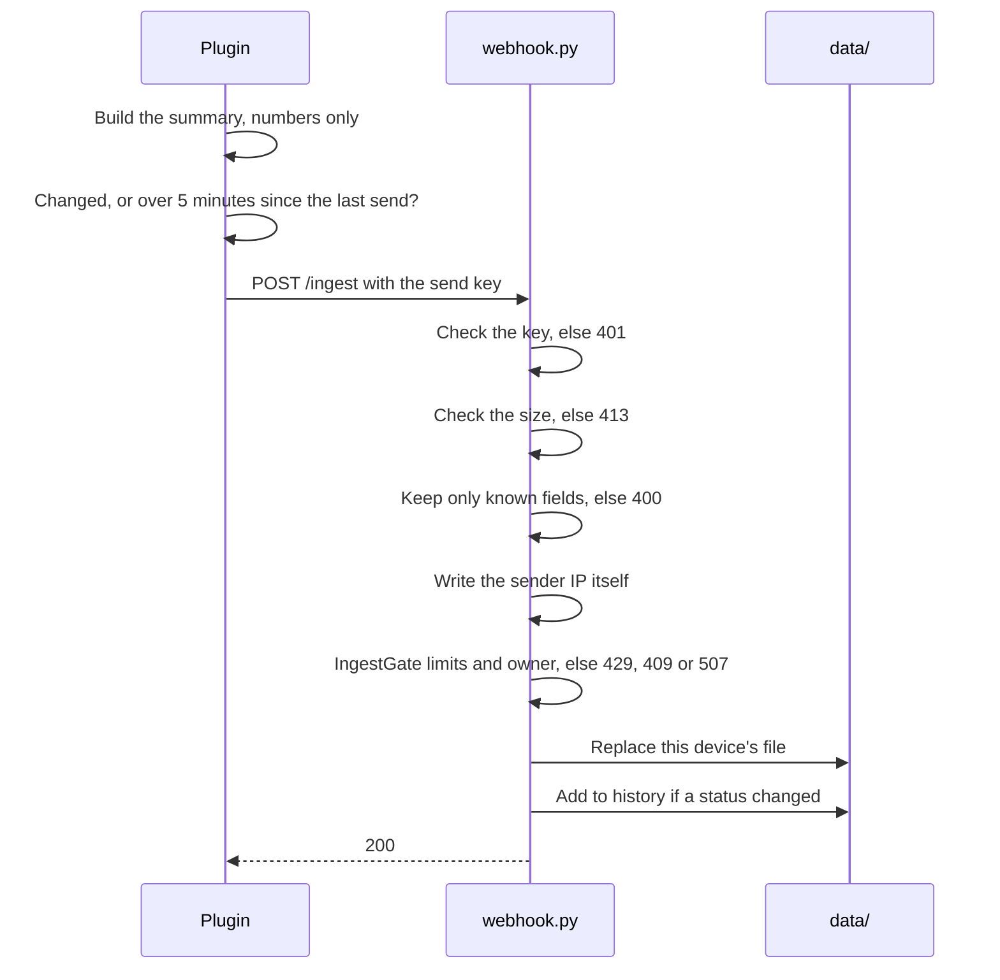

If sending fails, the plugin tries again on the next beat and warns once the problem lasts.

### Reporting from Codex, Cursor and Gemini CLI

The connector (`connectors/`) is a hook in each of these tools. It needs no Claude Code, no Python and no Node: sh, awk, sed, grep and curl or wget on macOS and Linux, PowerShell on Windows.

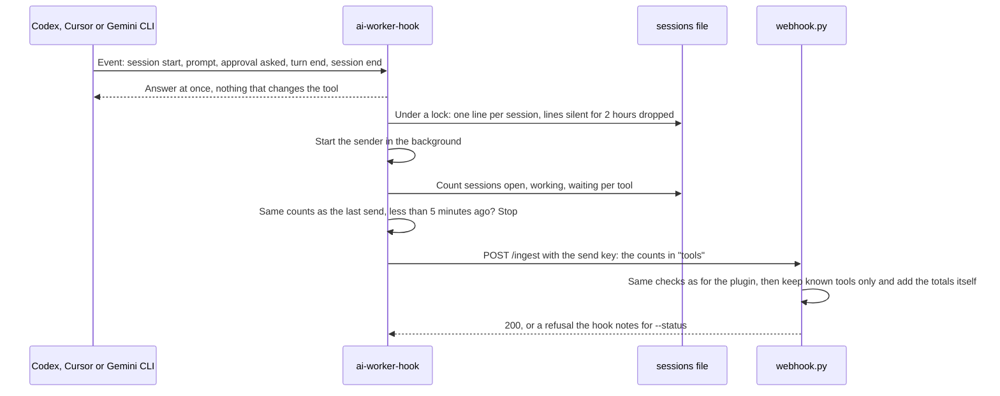

A session is waiting when the tool asked for an approval, or when its last message ended with a question mark; the hook looks at that one character and keeps nothing of the message. The server counts a connector report for 2 hours (`is_fresh` in `server/board/devices.py`), because no beat comes between events, and never counts it as a computer or a plugin install. One connector reports for all three tools, so a computer has at most two device ids: the plugin's and the connector's.

### Logging in and viewing

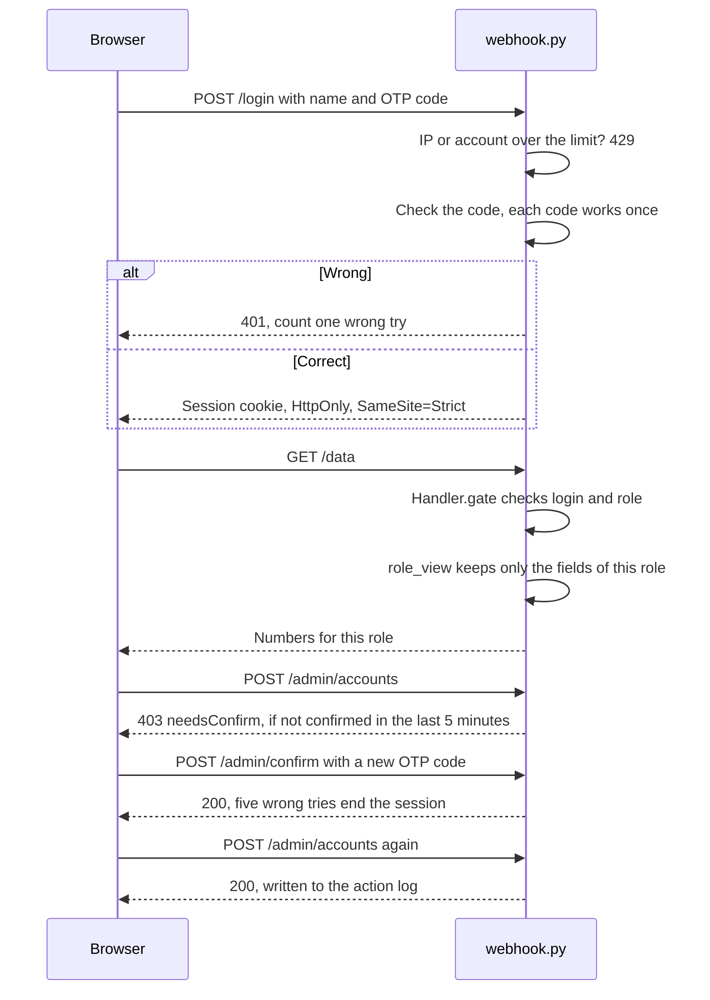

### Logging in with Telegram (optional)

Only when a bot is set up. The page loads nothing from Telegram, and for this the server never calls Telegram: the browser goes there and back.

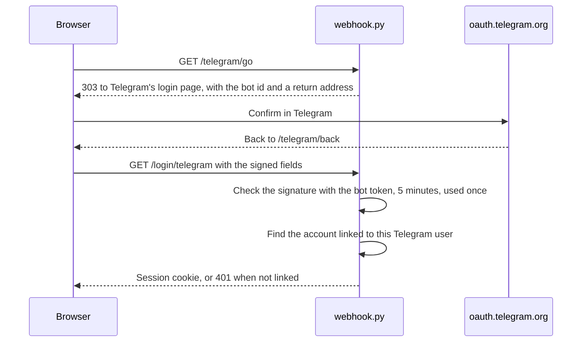

Linking goes the same way, after the 6-digit code on `/telegram`: the return address carries a one-time step code tied to that session.

### Pairing a TV screen

The code shown on the TV lets an admin approve it. The session goes only to the TV, because only the TV holds the key in its cookie: someone who sees the code cannot take the session.

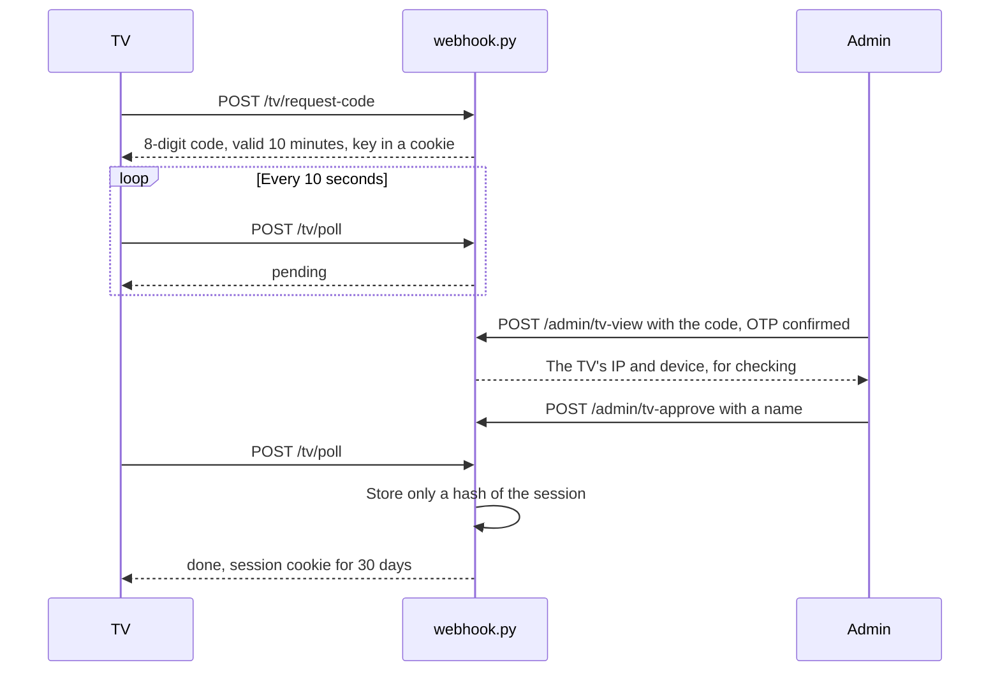

### Asking the board from an AI tool (MCP)

An AI tool that speaks MCP (Claude Code, Codex CLI, Cursor, Gemini CLI) reads the board with a key of its own. The key comes through the same code flow as a TV screen, asked for on the board's own page `/mcp/connect`, and an admin chooses what it may read. A key of this kind is found only by `TvStore.find(..., mcp=True)`, and no other key is found that way: it opens `/mcp` and nothing else, and nothing else opens `/mcp`.

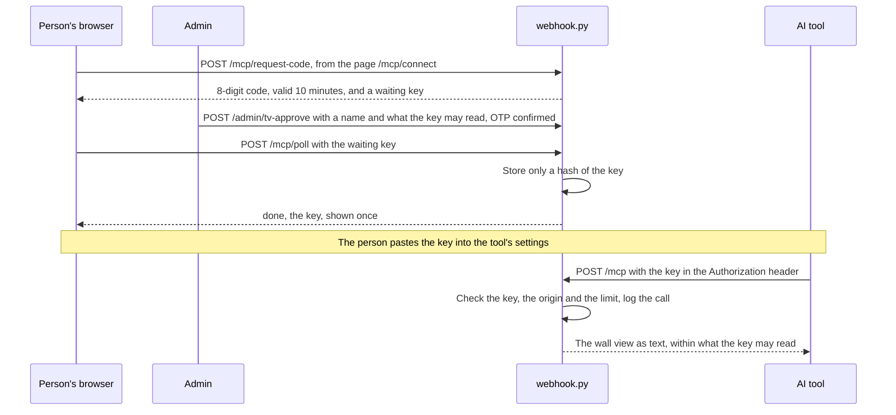

`server/board/mcp.py` is the protocol and nothing else: one JSON-RPC message, its headers and a view go in, a status and an answer come out, so it is tested without a server. The counting, the merging of small offices and the cleaning of names are in `server/board/summary.py`. It speaks two generations of MCP on the one path, because tools in use today differ: revision 2026-07-28, with no handshake (`server/discover`, `tools/list`, `tools/call`, each request checked against its `MCP-Protocol-Version`, `Mcp-Method` and `Mcp-Name` headers), and the older revisions 2025-03-26 to 2025-11-25 that open with `initialize`. There is one tool, `board_summary`, which takes no input: what a key may read is decided by the key, never by the request. Left out on purpose: SSE streams, subscriptions, resources, prompts, sampling, elicitation, tasks and OAuth; a GET or DELETE on `/mcp` answers 405.

`Handler.mcp_post` does the rest: 120 requests per key in 10 minutes (`CallLimit`), a message of at most 16 KB, and one row in the audit table for each call of the tool (`mcp-call`), kept 3 months and read apart from the admin's own log. A tool looking for OAuth settings after a 401 gets a plain 404 that is not counted as probing. `MCP=0` makes every one of these paths answer 404.
### Asking from Telegram (optional)

Only with `TELEGRAM_ASK=1`. The process that talks to Telegram is not the webhook: `server/telegram_bot.py` runs as a service of its own, connects out to Telegram and to nothing else, and passes each message to the webhook on the same machine. The webhook never connects out.

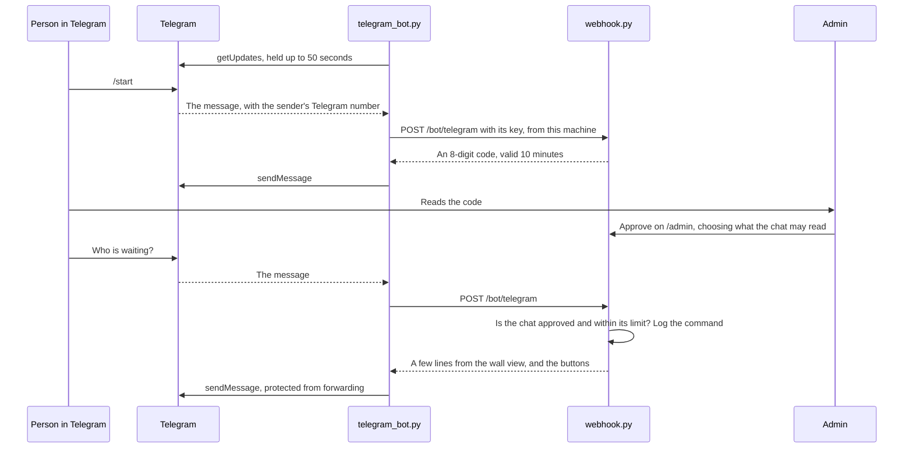

`server/board/ask.py` is pure. It reads a message as one of eight commands (a command name, a Vietnamese name without accents, a button, or a keyword in a typed question) and writes the answer from the wall view, in English or Vietnamese. No AI model reads the question, so every number is the board's own; a message that means no command gets the list of commands. `server/board/chat.py` decides the rest: a chat that no admin approved gets a pairing code and nothing else, the message that finishes the pairing gets a welcome, a chat may send 20 messages in 10 minutes, and each answer with numbers is one row in the audit table (`telegram-ask`), kept 3 months and read with the MCP calls. Only private chats are answered; for a group the bot process is told to leave.

What stands for a chat is the sender's Telegram number, which is no secret. So paired rows live on three sides (`side_of` in `server/board/stores.py`): keys for the MCP endpoint, Telegram chats, and everything else. A row is found, counted and replaced only on its own side, and `/bot/telegram` takes only a direct call from the same machine with `TELEGRAM_ASK_KEY`: a request that carries a proxy's headers gets 404.

`server/telegram_bot.py` imports nothing of the board, keeps nothing on disk and holds two secrets: the bot's token and that key. It uses Telegram's Bot API over HTTPS with long polling (`getUpdates`) and not a webhook from Telegram, so nothing is opened towards the Internet and a board with no public address can use it. It does not use MTProto, the protocol of Telegram's own apps: the standard library does not speak it, and it would log in as a person. When Telegram refuses the token, when another program reads the same bot, or when Telegram cannot be reached, the process tells the webhook, and the Admin page shows it. The installer runs it as the service `ai-worker-telegram` under its own user, with `IPAddressDeny=any` and an allow-list of this machine, its DNS servers and Telegram's networks.

### Updating the plugin

The server is not trusted: a hijacked server cannot hand out a bad package, because the computer checks the signature against the keys it already has.

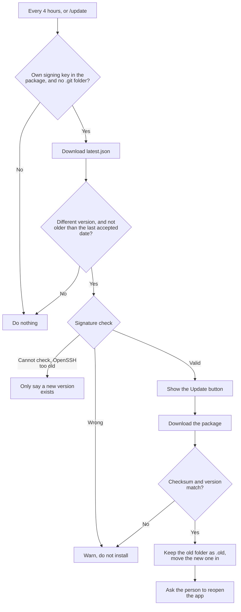

Rolling back is a new release of the old version: a different version is accepted, while an old signed file with an older date is not, so it cannot be replayed.

### Sending text to an assistant

This applies to the plugin's own tools, used when a computer has no `ai-workers` MCP server. Gemma runs on the computer; ChatGPT and Gemini are outside companies.

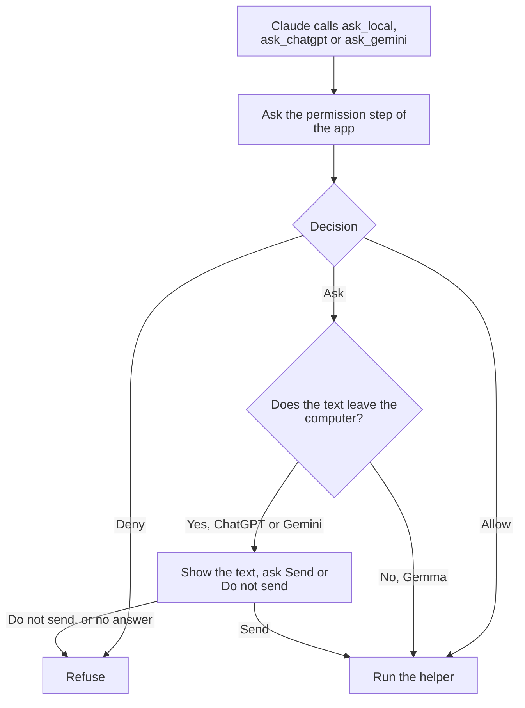

### Publishing a release

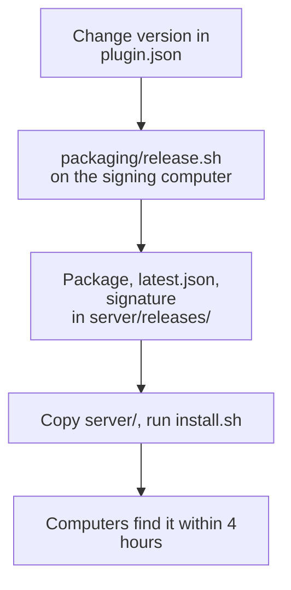

## 4. Design choices

| Choice | How it works | Why |
|---|---|---|
| One route table, one gate (table-driven routing, single entry check) | Every path is in `GET_ROUTES` or `POST_ROUTES` with its permission. `Handler.gate` is the only permission check. A path that is not listed is 404 | A new path cannot forget its check; a test keeps a table of permissions |
| Allow-list on the way out (field projection by role) | `role_view` copies only the fields listed for a role | A new field stays hidden until someone chooses to show it |
| Allow-list on the way in (rebuild, do not trust input) | `clean_payload` rebuilds each send from a fixed list of fields, and again whenever a file is read | A bad send or a damaged file cannot reach the pages |
| Small classes for state (shared base class, one owner per rule) | `Store` keeps a table in memory and writes changed rows in one transaction; `Accounts`, `TvStore`, `RevokedKeys` and `DocumentStore` build on it. `LoginGate`, `IngestGate`, `BotBlocker` each own one set of limits | Each rule lives in one place and can be tested alone |
| Pure logic apart from input and output (functional core, imperative shell) | `hooks/*.ts` are pure functions; `register.tsx` is the only file using the app's `$` interface | The logic can be tested without running the app |
| Trust the signature, not the server (signed manifest) | The computer checks a signed manifest with keys in its own package | Taking over the server is not enough to reach staff computers |
| English in the code, Vietnamese in dictionaries (message catalog) | `tx("...")` looks up `*.vi.js`, `webhook_vi.py`, `lang.vi.ts`; the menu bar scripts use `server/menubar/vi.json` and the extension `extensions/manager/_locales/` | One source of text; `tests/check-i18n.py` finds what is missing |
| No outside libraries on the server | Only the Python standard library | Nothing extra to install, update or audit |
| One kind of key per door (channel-bound credentials) | A key for the MCP endpoint is looked up only with `TvStore.find(..., mcp=True)`, and every other lookup leaves such keys out | A key that leaks from an AI tool's settings opens no page, and a TV's or an extension's key does not open the MCP endpoint |

### Storage: SQLite

The server keeps everything in two SQLite files: `data/board.db` for the numbers and `keys/accounts.db` for accounts, apart so a data backup never holds OTP secrets. SQLite comes with Python, so nothing is added to install. It gives transactions, queries across months for the audit log, and room for new tables such as chat. Versions up to 0.24 used one JSON file per table; the server moves them in at its first start. Details: [DATA-MODEL.md](DATA-MODEL.md).

## 5. Checking changes

```bash
claude plugin test .
npx -y -p typescript@5.9.3 tsc -p tsconfig.json
uvx ruff check .
cd server && python3 -m unittest test_webhook test_demo test_mcp test_ask test_telegram_bot
python3 tests/connectors/test_connectors.py
python3 tests/check-i18n.py --comments
node tests/extension/check-extension.js
node tests/check-map-layout.js
```

Each push also runs `.github/workflows/test-install.yml`: on Ubuntu it builds the package, tests the private-data check (`tests/test-check-clean.sh`) and the skills' front matter, then tries installing the plugin and the server, and tests the menu bar script and the .deb (`tests/menubar/test-menubar.sh`, `test-deb.sh`); it also checks the two-language rules (`tests/check-i18n.py`); on Windows it tries installing and tests the tray icon (`tests/menubar/test-menubar.ps1`), and a second Windows job builds `AI Worker.exe` and `AI Worker.msi`, installs it without admin rights, pairs with a fake server, installs a newer build over the running app, and removes it (`tests/menubar/test-windows-app.ps1`). In a private repository the two Windows jobs run only when a push changes what they test, or when the workflow is started by hand ([TEST-PLAN.md](TEST-PLAN.md), section 1). It does not run `test_webhook` or the extension check, so run those yourself.

`server/test_webhook.py` compares the field names of the pages with what the server sends, but it only reads the code, so a page change still needs looking at in a browser.

## 6. Known limits

- **Shared send key.** Everyone in the install package has `INGEST_KEY`, so a staff member can send false numbers under a name not yet tied to a device. If a package leaks, change the key and reinstall.
- **HTTP without a proxy.** The connection is encrypted only behind Caddy or nginx.
- **People with sudo on the server** can read all numbers and issue accounts for themselves. Keep them few.
- **Large files.** The server is split into `server/board/` (settings, login, devices, daily totals, stores, views, pages, packages) with `server/webhook.py` keeping the request handler and routes. `hooks/register.tsx` and `server/static/ops.js` are still large: their parts share state in one closure and have no tests of their own yet, so they wait for those tests before being split.
- **The connector knows less than the plugin.** It sends only on an event, so a tool closed without its end event stays on the board for up to 2 hours. A turn that fails sends no event either: seen with Codex CLI 0.164.0, where a refused model request left the session as working. (A turn cut short with Esc sends `Interrupt` instead of `Stop`, and that one is hooked.) The server therefore believes "working" from the connector for 30 minutes after the last send; in Cursor, which has no hook after each step, a turn that runs longer than that shows as idle until it ends. It knows no tokens, cost, quota or model. Its copy of the send key sits in a second place on the computer. Its name and email must be the ones the plugin sends, or the person shows as two rows. Cursor, Gemini CLI and Windows have not been tried in the real tools yet.
- **The MCP endpoint.** Tried in the real tools on macOS only: Claude Code, Codex CLI, and the Chat tab of the Claude desktop app through a claude.ai connector. Cursor, Gemini CLI and every tool on Windows and Linux have not been tried. What a tool reads goes to the company that makes it. A key that reads totals only still shows a team or a leftover group of one or two people through the totals. Calls are logged in the audit table, not a table of their own, so that an older server version can still open the database. More in [SECURITY.md](../SECURITY.md).
- **Asking from Telegram.** Tried with the real Telegram by hand on macOS, and installed on one production server so far, with a chat that reads totals only; a chat that reads each person has not been tried through the real Telegram. What a chat reads goes through Telegram, a third party, and stays in the chat. The allow-list of Telegram's networks is a copy of Telegram's published list: if Telegram moves, the bot stops until the list is updated.
- **Copied files.** `web/` and `server/static/` hold the same `ops.js`, `ops.css`, `ops3d.js`, `i18n.js`, `ops.vi.js`. The packaging script checks that they match. `extensions/manager/mini/` holds copies of `mini.js`, `mini.css` and the logos; `tests/extension/check-extension.js` checks those.
- **The TypeScript type check runs only locally.** `tsc` needs the type files Claude Code writes to `.claude-plugin/types` (not in git), so CI runs ruff and the test suites; run `tsc` before pushing.
