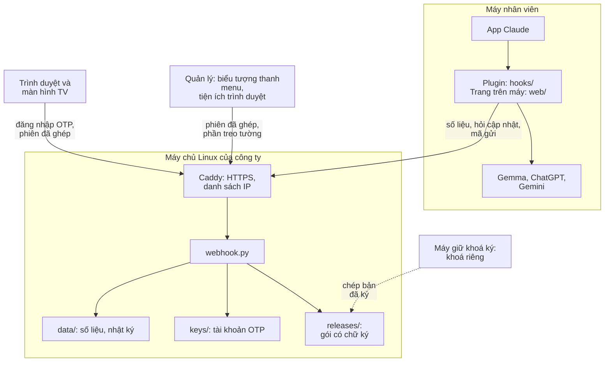
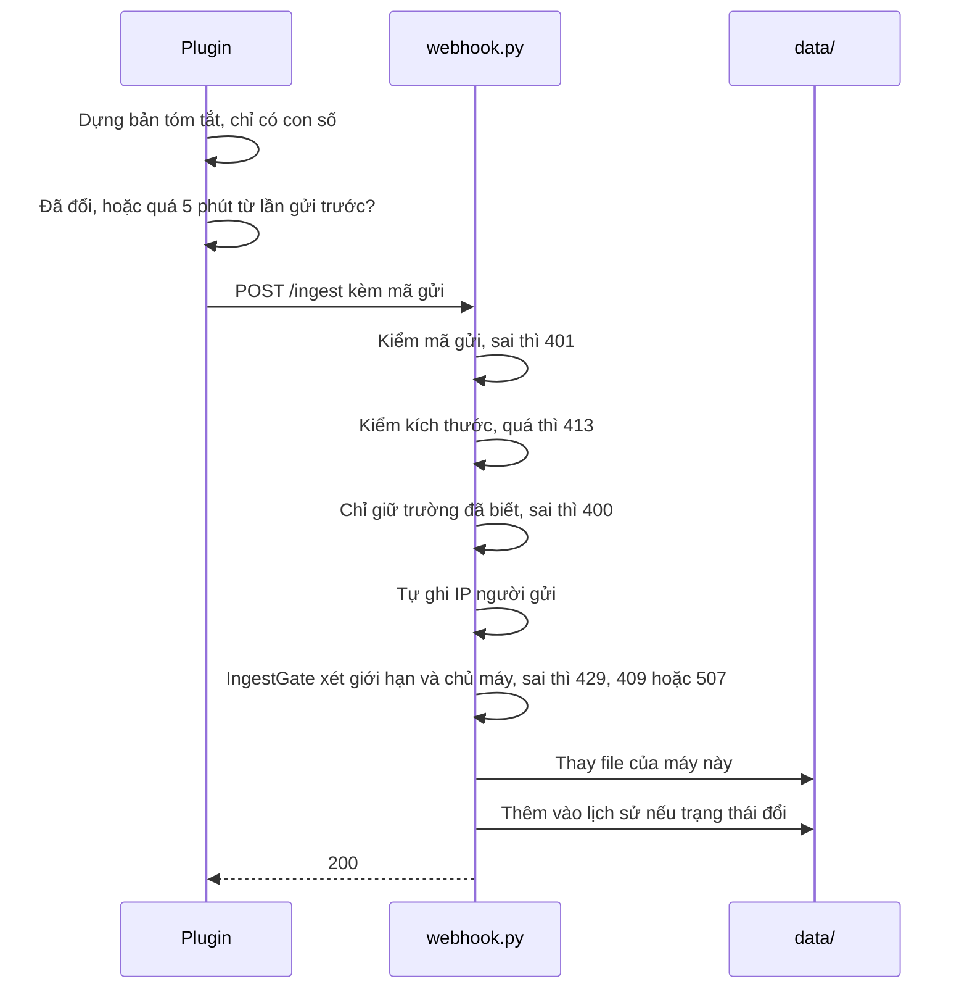
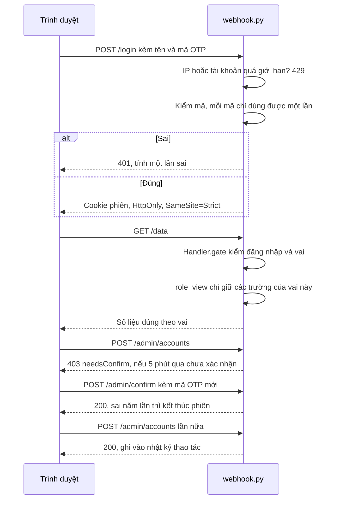
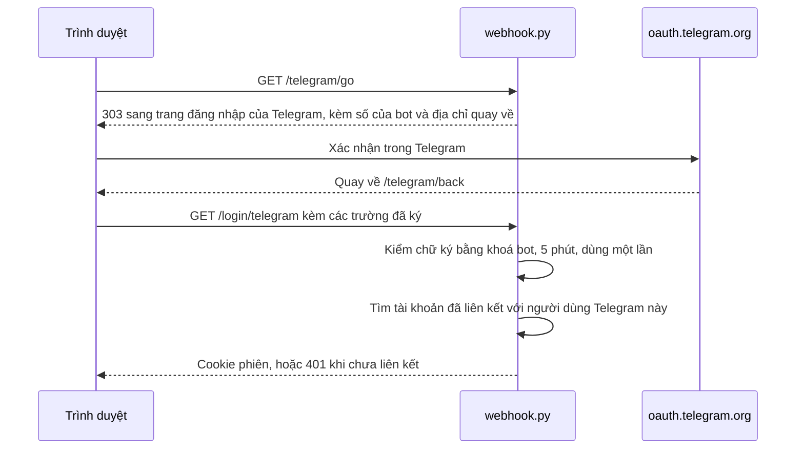
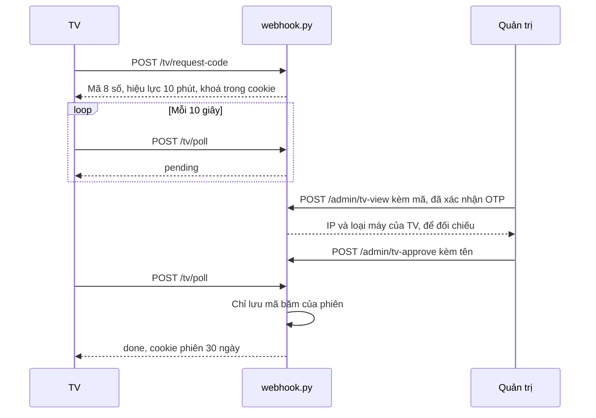
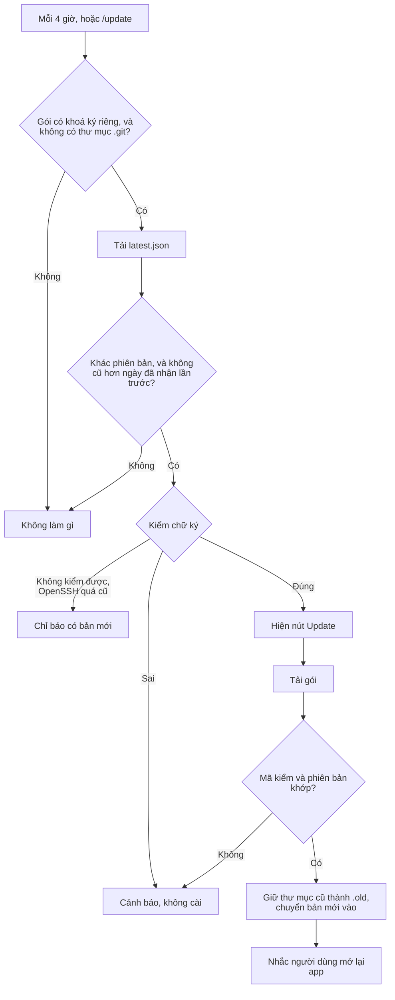
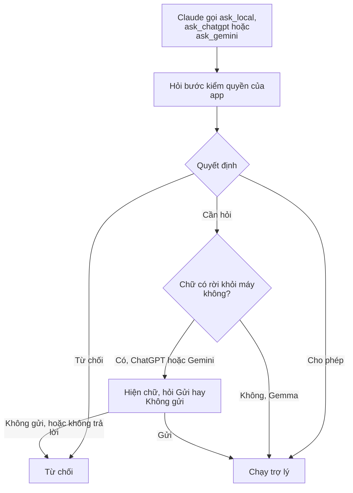
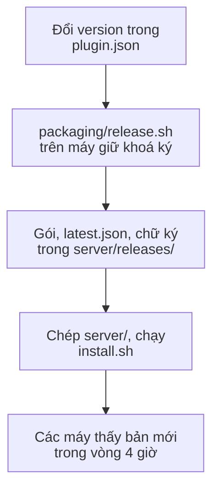

[English](ARCHITECTURE.md) | Tiếng Việt

# Kiến trúc và đặc tả

AI Worker Office phải làm gì, các phần ghép với nhau ra sao và vì sao làm như vậy. Cách cài và vận hành xem [INSTALL.vi.md](INSTALL.vi.md) và [OPERATIONS.vi.md](OPERATIONS.vi.md).

Mã nguồn là căn cứ cuối cùng: nếu tài liệu này và mã khác nhau, mã cho biết hệ thống đang chạy thế nào, và tài liệu cần được sửa lại.

## 1. Đặc tả

### Mục tiêu

Giúp công ty thấy Claude và các trợ lý AI được dùng thế nào trên mọi máy nhân viên, không thu những gì mọi người thực sự viết, và dùng chung một bộ skill và quy tắc.

### Ngoài phạm vi

- Đọc nội dung trò chuyện, câu hỏi, câu trả lời, tên file hay tên dự án.
- Theo dõi tab Chat của app Claude, vì tab này không có plugin.
- Ngăn nhân viên gửi số sai dưới tên người khác: mọi người dùng chung một mã gửi (xem [Giới hạn đã biết](#6-giới-hạn-đã-biết)).

### Ai dùng

| Người | Dùng | Làm được |
|---|---|---|
| Nhân viên | Plugin trên máy mình | Xem phiên của mình, nhận bản cập nhật, giao việc cho trợ lý |
| Quản trị | Bảng, `/admin` | Mọi việc bên dưới, thêm tài khoản, địa điểm, CSV gói Team, màn hình TV, nhật ký |
| Người xem | Bảng, `/board` | Xem số liệu kèm tên, email, IP nội bộ; không đổi được gì |
| Màn hình treo tường | Bảng trên TV | Xem số liệu với tên rút gọn; không có email, IP nội bộ |
| Quản lý | Biểu tượng thanh menu, tiện ích trình duyệt | Xem ai đang chờ, ai đang làm, hạn mức và chi phí hôm nay mà không phải mở bảng, với dữ liệu của màn hình treo tường; xem [menu-bar-spec.vi.md](menu-bar-spec.vi.md) và [chrome-extension-spec.vi.md](chrome-extension-spec.vi.md) |
| IT | Máy chủ, khoá ký | Cài webhook, đóng gói, ký bản phát hành |

### Hệ thống phải làm được

| Mã | Yêu cầu | Ở đâu |
|---|---|---|
| F1 | Không có máy chủ thì plugin vẫn chạy trên từng máy | `hooks/register.tsx` |
| F2 | Máy gửi bản tóm tắt khi số liệu đổi, và ít nhất 5 phút một lần khi Claude đang mở | `hooks/register.tsx`, `hooks/team.ts` |
| F3 | Máy chủ chỉ nhận các trường đã biết và tự ghi IP người gửi | `clean_payload` trong `server/board/devices.py`, `Handler.ingest` trong `server/webhook.py` |
| F4 | Mỗi máy gắn với một người | `IngestGate` |
| F5 | Xem bảng phải đăng nhập OTP, và máy chủ tự áp dụng từng vai | `LoginGate`, `Handler.gate`, `role_view` |
| F6 | Đổi tài khoản, phiên hay màn hình TV phải nhập lại mã OTP, hiệu lực 5 phút | `require_otp`, `LoginGate.confirm` |
| F7 | TV chỉ vào được sau khi quản trị duyệt mã của nó | `TvPairing`, `TvStore` |
| F8 | Máy chỉ cài bản cập nhật khi chữ ký và mã kiểm đều đúng | `hooks/update.ts`, `updatePlugin` |
| F9 | Chữ gửi cho ChatGPT hay Gemini phải được phép; câu hỏi lỗi thì tính là không | `refuseToSend`, `hooks/workers.ts` |
| F10 | Trang, plugin và file cài có tiếng Anh và tiếng Việt | `i18n.js`, `hooks/lang.ts`, `packaging/lang.sh` |

### Giới hạn máy chủ áp dụng

| Giới hạn | Mức |
|---|---|
| Kích thước một lần gửi | 256 KB |
| Số lần gửi mỗi IP | 300 trong 10 phút |
| Máy mới | 10 mỗi IP mỗi ngày, tổng 300 |
| Đăng nhập sai | 5 mỗi IP và 20 mỗi tài khoản, trong 15 phút |
| Kết nối | Tổng 256, 16 mỗi IP, mỗi kết nối 120 giây |
| Dò quét | 20 lỗi (401/404) trong 10 phút thì chặn IP chưa đăng nhập 15 phút |
| Màn hình TV | 20 đã ghép, 3 đang chờ mỗi IP, tổng 30 đang chờ |

### Dữ liệu giữ bao lâu

| Dữ liệu | Giữ |
|---|---|
| Số liệu theo giờ của một máy | 8 ngày |
| Máy không gửi nữa | Hiện ngoại tuyến sau 12 phút, xoá sau 30 ngày |
| Nhật ký thao tác | 12 tháng |
| Phiên đăng nhập | 8 giờ, tài khoản treo tường 7 ngày; mất khi webhook khởi động lại |
| Phiên TV | 30 ngày, tự gia hạn khi đang dùng; tối đa 1 năm; không mất khi khởi động lại |

## 2. Các phần



| Thư mục | Chứa |
|---|---|
| `hooks/` | Plugin. `register.tsx` nối với app Claude và làm mọi việc đọc ghi; các file khác là logic thuần |
| `web/` | Trang mở bằng `/office` trên máy |
| `server/` | Webhook, các trang trong `static/`, test, file cài |
| `server/menubar/` | Biểu tượng thanh menu cho quản lý: app cho macOS, app cho Windows (`windows-app/`, C#, cài từ file .msi; script khay PowerShell giữ làm dự phòng), chương trình AppIndicator trong gói .deb cho Ubuntu (script Argos vẫn dùng được) |
| `extensions/manager/` | Tiện ích trình duyệt cho quản lý (Chrome, Edge), cài tay |
| `packaging/` | Đóng gói, file cài, ký bản phát hành, kiểm tra trước khi công khai |
| `skills/`, `dev-pack/` | Bộ skill chung, và gói kỹ thuật riêng |
| `tests/` | Test plugin, test cài trên Linux và Windows, kiểm tra ngôn ngữ, test thanh menu (`tests/menubar/`) và bước kiểm tiện ích (`tests/extension/`) |

### Ngôn ngữ lập trình

Mỗi phần dùng thứ có sẵn trên nền của nó, nên gần như không phải cài thêm gì. Ngoại lệ là bộ WebView2 của Microsoft, đi kèm cho khung thanh menu Windows, và các gói GTK, WebKit2, AppIndicator mà apt cài cùng gói .deb của Ubuntu:

| Ngôn ngữ | Ở đâu | Vì sao |
|---|---|---|
| TypeScript | `hooks/` | App Claude chạy mã plugin viết bằng TypeScript |
| JavaScript, HTML, CSS | `web/`, `server/static/`, `extensions/manager/` | Trang trong trình duyệt và tiện ích trình duyệt; không cần bước dựng |
| Python 3 | `server/webhook.py` và `server/board/`, `server/menubar/ai-worker.1m.py`, `server/menubar/ai-worker-indicator.py`, các bước kiểm trong `tests/` | Có sẵn trên mọi máy chủ Linux và trên Ubuntu. Chỉ dùng thư viện chuẩn, trừ `ai-worker-indicator.py` dùng python3-gi, AppIndicator và WebKit2 do apt cài |
| Swift | `server/menubar/macos-app/main.swift` | App thanh menu macOS: khung gốc của macOS dưới biểu tượng |
| PowerShell | `server/menubar/ai-worker-tray.ps1` (biểu tượng Windows dự phòng), file cài Windows trong `packaging/` | Có sẵn trong Windows |
| C# | `server/menubar/windows-app/`, `server/menubar/menubar-popup.cs` | App Windows `AI Worker.exe` trên .NET Framework 4.8 và khung của nó (WebView2); dựng được trên Mac bằng .NET SDK hoặc trên Windows |
| WiX | `server/menubar/windows-app/AIWorker.wxs` | Gói cài `AI Worker.msi`, dựng trên Windows của GitHub; `fetch-msi.sh` đưa vào `server/menubar/`, máy chủ tự điền địa chỉ của nó |
| Shell (bash), Batchfile | `packaging/`, `server/install.sh` | File cài và script đóng gói trên macOS, Linux, Windows |

Thanh ngôn ngữ của GitHub chỉ hiện sáu ngôn ngữ lớn nhất; Swift và C# được tính trong "Other". Mã của người khác (xem `THIRD-PARTY.md`) không được tính, nhờ `.gitattributes`.

## 3. Các luồng chính

### Gửi số liệu

Chỉ gói đóng cho công ty mới gửi. Bước nào có thể từ chối thì từ chối trước khi lưu bất cứ thứ gì.



Gửi lỗi thì plugin thử lại ở nhịp sau, và báo một lần khi lỗi kéo dài.

### Đăng nhập và xem bảng



### Đăng nhập bằng Telegram (tuỳ chọn)

Chỉ khi đã cài bot. Trang không nạp gì từ Telegram, máy chủ không bao giờ gọi Telegram.



Liên kết cũng đi đường này, sau khi nhập mã 6 số ở `/telegram`: địa chỉ quay về mang một mã bước dùng một lần gắn với phiên đó.

### Ghép màn hình TV

Mã hiện trên TV để quản trị duyệt. Phiên chỉ về tay TV, vì chỉ TV giữ khoá trong cookie: người nhìn thấy mã cũng không lấy được phiên.



### Cập nhật plugin

Không tin máy chủ: máy chủ bị chiếm cũng không phát được gói xấu, vì máy nhân viên kiểm chữ ký bằng khoá nó đã có sẵn.



Quay lui là phát hành lại bản cũ với chữ ký mới: phiên bản khác thì được nhận, còn file cũ có ngày cũ hơn thì không, nên không phát lại được.

### Gửi chữ cho trợ lý

Áp dụng cho các công cụ riêng của plugin, dùng khi máy không có máy chủ MCP `ai-workers`. Gemma chạy trên máy; ChatGPT và Gemini là công ty bên ngoài.



### Phát hành



## 4. Lựa chọn thiết kế

| Lựa chọn | Cách làm | Vì sao |
|---|---|---|
| Một bảng đường dẫn, một cổng (định tuyến bằng bảng, một điểm kiểm duy nhất) | Mọi đường dẫn nằm trong `GET_ROUTES` hoặc `POST_ROUTES` kèm quyền. `Handler.gate` là nơi duy nhất kiểm quyền. Đường không có trong bảng trả 404 | Đường mới không thể quên kiểm quyền; có test giữ bảng quyền |
| Danh sách cho phép ở chiều ra (lọc trường theo vai) | `role_view` chỉ chép các trường đã liệt kê cho từng vai | Trường mới vẫn ẩn cho tới khi có người chọn hiện nó |
| Danh sách cho phép ở chiều vào (dựng lại, không tin dữ liệu vào) | `clean_payload` dựng lại mỗi lần gửi từ danh sách trường cố định, và dựng lại khi đọc file | Dữ liệu xấu hay file hỏng không tới được trang |
| Lớp nhỏ để giữ trạng thái (lớp cơ sở dùng chung, mỗi quy tắc một chủ) | `Store` giữ một bảng trong bộ nhớ và ghi các dòng đã đổi trong một giao dịch; `Accounts`, `TvStore`, `RevokedKeys`, `DocumentStore` xây trên đó. `LoginGate`, `IngestGate`, `BotBlocker` mỗi lớp giữ một nhóm giới hạn | Mỗi quy tắc ở một chỗ và thử riêng được |
| Tách logic thuần khỏi đọc ghi (functional core, imperative shell) | `hooks/*.ts` là hàm thuần; `register.tsx` là file duy nhất dùng giao diện `$` của app | Thử được logic mà không cần chạy app |
| Tin chữ ký, không tin máy chủ (signed manifest) | Máy kiểm manifest có chữ ký bằng khoá trong chính gói của nó | Chiếm được máy chủ vẫn chưa tới được máy nhân viên |
| Tiếng Anh trong mã, tiếng Việt trong từ điển (message catalog) | `tx("...")` tra `*.vi.js`, `webhook_vi.py`, `lang.vi.ts`; script thanh menu dùng `server/menubar/vi.json`, tiện ích dùng `extensions/manager/_locales/` | Chữ có một nguồn; `tests/check-i18n.py` tìm chỗ còn thiếu |
| Máy chủ không dùng thư viện ngoài | Chỉ dùng thư viện chuẩn của Python | Không phải cài, cập nhật hay rà soát thêm gì |

### Lưu trữ: SQLite

Máy chủ lưu mọi thứ trong hai file SQLite: `data/board.db` cho số liệu và `keys/accounts.db` cho tài khoản, tách riêng để bản sao lưu dữ liệu không bao giờ chứa mã bí mật OTP. SQLite có sẵn trong Python nên không phải cài thêm gì. Nó cho giao dịch, truy vấn nhật ký qua nhiều tháng, và chỗ cho bảng mới như chat. Các bản tới 0.24 lưu mỗi bảng một file JSON; máy chủ tự chuyển chúng vào ở lần khởi động đầu. Chi tiết: [DATA-MODEL.vi.md](DATA-MODEL.vi.md).

## 5. Kiểm tra thay đổi

```bash
claude plugin test .
npx -y -p typescript@5.9.3 tsc -p tsconfig.json
uvx ruff check .
cd server && python3 -m unittest test_webhook
python3 tests/check-i18n.py --comments
node tests/extension/check-extension.js
```

Mỗi lần đẩy code còn chạy `.github/workflows/test-install.yml`: trên Ubuntu thì đóng gói, thử bước kiểm dữ liệu riêng (`tests/test-check-clean.sh`) và phần đầu của các skill, cài thử plugin và máy chủ, rồi thử script thanh menu và gói .deb (`tests/menubar/test-menubar.sh`, `test-deb.sh`); còn kiểm quy tắc hai ngôn ngữ (`tests/check-i18n.py`); trên Windows thì cài thử và thử biểu tượng ở khay (`tests/menubar/test-menubar.ps1`), thêm một bước Windows nữa dựng `AI Worker.exe` và `AI Worker.msi`, cài không cần quyền quản trị, ghép với máy chủ giả, cài bản mới đè lên app đang chạy rồi gỡ (`tests/menubar/test-windows-app.ps1`). Bước này không chạy `test_webhook` hay bước kiểm tiện ích, nên phải tự chạy.

`server/test_webhook.py` đối chiếu tên trường giữa trang và máy chủ, nhưng chỉ đọc mã, nên sửa trang vẫn phải mở trình duyệt xem.

## 6. Giới hạn đã biết

- **Mã gửi dùng chung.** Ai có gói cài đều có `INGEST_KEY`, nên nhân viên có thể gửi số sai dưới một tên chưa gắn với máy nào. Gói bị lộ thì đổi mã và cài lại.
- **HTTP khi không có proxy.** Kết nối chỉ được mã hoá khi đi qua Caddy hoặc nginx.
- **Người có sudo trên máy chủ** đọc được mọi số liệu và tự cấp được tài khoản. Nên giữ ít người.
- **File lớn.** Máy chủ đã tách vào `server/board/` (cấu hình, đăng nhập, máy gửi, kho lưu, quyền xem, trang, gói cài), `server/webhook.py` giữ phần nhận yêu cầu và bảng đường dẫn. `hooks/register.tsx` và `server/static/ops.js` vẫn lớn: các phần trong đó dùng chung biến trong một khối và chưa có test riêng, nên chờ có test rồi mới tách.
- **File chép đôi.** `web/` và `server/static/` cùng có `ops.js`, `ops.css`, `ops3d.js`, `i18n.js`, `ops.vi.js`. Script đóng gói kiểm các bản này khớp nhau. `extensions/manager/mini/` giữ bản chép của `mini.js`, `mini.css` và logo; `tests/extension/check-extension.js` kiểm các bản đó.
- **Kiểm kiểu TypeScript chỉ chạy trên máy.** `tsc` cần file kiểu Claude Code ghi vào `.claude-plugin/types` (không có trong git), nên CI chỉ chạy ruff và các bộ test; chạy `tsc` trên máy trước khi đẩy.
