[English](ARCHITECTURE.md) | Tiếng Việt

# Kiến trúc và đặc tả

AI Worker Office phải làm gì, các phần ghép với nhau ra sao và vì sao làm như vậy. Cách cài và vận hành xem [INSTALL.vi.md](INSTALL.vi.md) và [OPERATIONS.vi.md](OPERATIONS.vi.md).

Mã nguồn là căn cứ cuối cùng: nếu tài liệu này và mã khác nhau, mã cho biết hệ thống đang chạy thế nào, và tài liệu cần được sửa lại.

## 1. Đặc tả

### Mục tiêu

Giúp công ty thấy Claude và các trợ lý AI được dùng thế nào trên mọi máy nhân viên, không thu những gì mọi người thực sự viết, và dùng chung một bộ skill và quy tắc.

### Ngoài phạm vi

- Đọc nội dung trò chuyện, câu hỏi, câu trả lời, tên file hay tên dự án.
- Theo dõi tab Chat của app Claude, vì tab này không có plugin.
- Token và chi phí của Codex, Cursor và Gemini CLI: hook của các công cụ này không đưa ra, và muốn đọc thì phải đọc nhật ký phiên, nơi có nội dung trò chuyện.
- Ngăn người cầm gói cài ghi nhận một máy mới dưới tên giả: gói cài mang một mã gửi chung. Máy đã có khoá riêng thì không ai gửi thay được, và `SHARED_KEY_MODE` có thể đóng việc ghi nhận máy mới (xem [Giới hạn đã biết](#6-giới-hạn-đã-biết)).

### Ai dùng

| Người | Dùng | Làm được |
|---|---|---|
| Nhân viên | Plugin trên máy mình | Xem phiên của mình, nhận bản cập nhật, giao việc cho trợ lý |
| Quản trị | Bảng, `/admin` | Mọi việc bên dưới, thêm tài khoản, địa điểm, CSV gói Team, thiết bị và khoá đã ghép, nhật ký |
| Người xem | Bảng, `/board` | Xem số liệu kèm tên, email, IP nội bộ; không đổi được gì |
| Màn hình treo tường | Bảng trên TV | Xem số liệu với tên rút gọn; không có email, IP nội bộ |
| Quản lý | Biểu tượng thanh menu, tiện ích trình duyệt | Xem ai đang chờ, ai đang làm, hạn mức và chi phí hôm nay mà không phải mở bảng, với dữ liệu của màn hình treo tường; xem [menu-bar-spec.vi.md](menu-bar-spec.vi.md) và [chrome-extension-spec.vi.md](chrome-extension-spec.vi.md) |
| Người có công cụ AI | Claude Code, Codex CLI, Cursor, Gemini CLI hoặc công cụ khác nói được MCP, kèm một khoá do quản trị duyệt | Hỏi bảng bằng lời của mình. Công cụ đọc dữ liệu của màn hình treo tường dưới dạng chữ, hoặc chỉ số gộp của cả đội và từng văn phòng khi quản trị chọn vậy; xem [INSTALL.vi.md](INSTALL.vi.md) |
| Người ở trong một chat Telegram | Telegram trên điện thoại hoặc máy tính, trong một chat riêng được quản trị duyệt; chỉ khi chủ máy chủ đã bật (`TELEGRAM_ASK=1`) | Hỏi bảng bằng cách bấm nút hoặc gõ một câu ngắn, và, nếu chat tự bật (`/baocho`), nhận tin nhắn khi có người chờ quá lâu. Câu trả lời là vài dòng làm từ dữ liệu của màn hình treo tường, hoặc chỉ số gộp của cả đội và từng văn phòng khi quản trị chọn vậy; xem [INSTALL.vi.md](INSTALL.vi.md) |
| Người mở khung bảng trong Telegram | Nút menu của bot trong một chat được quản trị cho mở khung (chat chỉ đọc số gộp thì nhận số tổng, không có tên ai); chỉ khi có thêm `TELEGRAM_APP=1`, và từ mạng mà proxy cho vào | Xem khung thanh menu ngay trong Telegram: người đang chờ và đang làm, biểu đồ chi phí 7 ngày, hạn mức và chi phí, từ dữ liệu của màn hình treo tường; xem [INSTALL.vi.md](INSTALL.vi.md) |
| Người giữ máy chủ | Máy chủ, khoá ký | Cài webhook, đóng gói, ký bản phát hành |

### Hệ thống phải làm được

| Mã | Yêu cầu | Ở đâu |
|---|---|---|
| F1 | Không có máy chủ thì plugin vẫn chạy trên từng máy | `hooks/register.tsx` |
| F2 | Máy gửi bản tóm tắt khi số liệu đổi, và ít nhất 5 phút một lần khi Claude đang mở | `hooks/register.tsx`, `hooks/send.ts`, `hooks/team.ts`, `hooks/sendv2.ts` |
| F3 | Máy chủ chỉ nhận các trường đã biết và tự ghi IP người gửi | `clean_payload` trong `server/board/devices.py`, `Handler.ingest` trong `server/webhook.py` |
| F4 | Mỗi máy gắn với một người | `IngestGate` |
| F5 | Xem bảng phải đăng nhập OTP, và máy chủ tự áp dụng từng vai | `LoginGate`, `Handler.gate`, `role_view` |
| F6 | Đổi tài khoản, phiên, thiết bị hay khoá đã ghép phải nhập lại mã OTP, hiệu lực 5 phút | `require_otp`, `LoginGate.confirm` |
| F7 | TV chỉ vào được sau khi quản trị duyệt mã của nó | `TvPairing`, `TvStore` |
| F8 | Máy chỉ cài bản cập nhật khi chữ ký và mã kiểm đều đúng | `hooks/update.ts`, `updatePlugin` |
| F9 | Chữ gửi cho ChatGPT hay Gemini phải được phép, và không bao giờ kèm bí mật (F17); câu hỏi lỗi thì tính là không | `refuseToSend`, `hooks/workers.ts` |
| F10 | Trang, plugin và file cài có tiếng Anh và tiếng Việt | `i18n.js`, `hooks/lang.ts`, `packaging/lang.sh` |
| F11 | Người dùng Codex, Cursor hoặc Gemini CLI hiện trên bảng mà không cần Claude Code: số phiên mở, đang làm và đang chờ, theo từng công cụ | `connectors/ai-worker-hook.sh`, `connectors/ai-worker-hook.ps1`; `from_connector`, `is_fresh` trong `server/board/devices.py` |
| F12 | Công cụ AI nói được MCP đọc bảng bằng khoá của riêng nó, do quản trị duyệt: chỉ đọc, phần treo tường dạng chữ, trong phạm vi khoá được đọc | `server/board/mcp.py`; `mcp_post`, `PERM_MCP_KEY` trong `server/webhook.py`; `TvStore.find` trong `server/board/stores.py` |
| F13 | Một người hỏi bảng từ một chat Telegram được quản trị duyệt: một trong số câu trả lời cố định, không có mô hình AI, trong phạm vi chat được đọc. Một tiến trình riêng nói chuyện với Telegram; webhook không bao giờ kết nối ra ngoài | `server/telegram_bot.py`; `server/board/chat.py`, `server/board/ask.py`; `bot_telegram`, `PERM_BOT_KEY` trong `server/webhook.py` |
| F14 | So được mức dùng theo tuần và theo tháng: máy chủ cộng số liệu theo giờ mà các máy vốn đã gửi thành một con số tổng cho mỗi người mỗi ngày và giữ 13 tháng; quản trị và người xem thấy nó trên `/board` | `server/board/daily.py`; `record_daily`, `usage_view` trong `server/board/views.py`; `usage_section`, `usage_chart` trong `server/board/pages.py` |
| F15 | Một chat được quản trị cho phép mở khung thanh menu bên trong Telegram (một Telegram Mini App). Điện thoại hay máy tính tự tới bảng qua HTTPS; webhook kiểm phần Telegram ký cho khung bằng một khoá suy ra từ khoá bot, và giữ phiên trong bộ nhớ | `server/board/tgapp.py`; `tg_session`, `get_tg_data`, `PERM_TG_SESSION` trong `server/webhook.py`; `server/static/tg-app.js`; `page_mini(telegram=True)` trong `server/board/pages.py`; `sync_menus` trong `server/telegram_bot.py` |
| F16 | Chat Telegram đã bật tin báo nhận một tin khi có người chờ lâu hơn số phút nó chọn: mỗi lần chờ một lần, gộp lại, tối đa một tin mỗi 5 phút, 6 tin mỗi giờ, 30 tin mỗi ngày, không gửi ban đêm; dòng đầu không nêu tên ai, và chat chỉ đọc số gộp chỉ nhận con số | `server/board/alerts.py`; `alerts_due`, `_alerts` trong `server/board/chat.py`; `sync_menus` trong `server/telegram_bot.py`; `get_tg_state`, `tg_settings` trong `server/webhook.py` |
| F17 | Chữ có thứ trông như khoá, token hay mật khẩu không bao giờ được gửi sang ChatGPT hay Gemini, qua công cụ của plugin hay một server `ai-workers` riêng, ở mọi chế độ quyền; Claude được báo loại và dòng, không bao giờ kèm giá trị | `hooks/secrets.ts`; `refuseToSend` và `tool.check` trong `hooks/register.tsx` |
| F18 | Lệnh shell phá huỷ công việc hay làm yếu máy, và `git commit` mà các dòng thêm vào có bí mật, được đưa người dùng xem ở mọi chế độ | `hooks/guard.ts`, `hooks/commitscan.ts`; `tool.check`, `tool.call` |
| F19 | Chữ từ web, tìm kiếm hay trình duyệt mà ra lệnh cho AI thì được báo cho Claude (kèm kết quả, không bao giờ giấu kết quả) và cho người dùng | `hooks/injection.ts`; `tool.call` |
| F20 | Một dòng nhật ký bị sửa hay bị xoá bằng tay sẽ lộ ra ở trang Quản trị: mỗi dòng mang dấu vân tay của dòng trước | `AuditLog.write`, `AuditLog.check` trong `server/board/stores.py` |
| F21 | Quản trị và người xem thấy các lớp bảo vệ trên đã ra tay bao nhiêu lần trên cả team trong 7 ngày, chỉ số đếm; khoá cho công cụ AI không dùng 30 ngày được chỉ ra | `blocks` trong `hooks/team.ts`; `blocks_since` trong `server/board/devices.py`; `idle_days` trong `server/board/views.py` |
| F22 | Mỗi việc giao cho ChatGPT, Gemini hay Gemma thành một dòng của nhật ký có dấu vân tay, chỉ một lần: trợ lý nào, độ dài, đã chặn gì, bước kiểm câu trả lời thấy gì và dấu vân tay có muối của đề bài, không bao giờ có chữ; quản trị xem được các dòng của tháng | `hooks/delegations.ts`; `clean_delegations` trong `server/board/devices.py`; `AuditLog.write_delegations` trong `server/board/stores.py` |
| F23 | Câu trả lời của trợ lý được kiểm trước khi Claude dùng: bí mật, chữ nhắm vào AI và lệnh không hoàn tác được; Claude nhận lời nhắc kèm câu trả lời, người dùng nhận thông báo, và lần chặn được đếm | `hooks/answers.ts`; phần xử lý `tool.call` trong `hooks/register.tsx` |
| F24 | Một dự án hay ứng dụng AI do nhóm tự làm tự đo chi phí và tốc độ của nó, với bất kỳ hãng LLM nào: mỗi lượt người dùng một dòng gồm thời gian và số token hãng trả về, theo từng model, không bao giờ có câu hỏi, câu trả lời, mã người dùng hay thông báo lỗi; token không lấy được ghi là chưa biết, không ghi 0. Báo cáo tính tiền theo bảng giá có ghi nguồn và ngày lấy, cộng file giá riêng của người dùng; model chưa có giá ghi "chưa có giá" thay vì đoán, model chạy trên máy của nhóm không cộng tiền API. Không gửi gì lên máy chủ | `skills/ai-cost-report/meter/ai_meter.py`, `skills/ai-cost-report/meter/ai-meter.cjs`, `skills/ai-cost-report/FORMAT.md`, `skills/ai-cost-report/report.py`, `skills/ai-cost-report/prices.json` |
| F25 | Dự án hay ứng dụng AI gửi số nó đã đo lên bảng bằng khoá riêng do quản trị tạo: chỉ ghi, từ chối khi gửi từ trình duyệt, mỗi lượt được làm sạch bằng chính code của báo cáo và chỉ giữ một lần; chỉ khi có `AI_PROJECTS=1`. Quản trị và người xem đọc báo cáo theo dự án và khoảng ngày, tải về dạng HTML hay CSV; màn treo tường, cổng MCP và Telegram không xem được | `server/board/projects.py`, `server/board/costreport.py` (bản sao của `skills/ai-cost-report/report.py`); `project_ingest`, `PERM_PROJECT_KEY` trong `server/webhook.py`; `page_projects` trong `server/board/pages.py`; phần gửi của bộ đo trong `skills/ai-cost-report/meter/` |
| F26 | `/ingest` đọc định dạng `v: 1` và `v: 2`: `v: 2` chỉ mang các giờ đã đổi, mỗi giờ thay giờ cũ, hoặc cả sổ khi `full: true`; tiền là số nguyên `usdMicro`; câu trả lời cho biết các định dạng đọc được, nhịp gửi, `needFull` và mã lần khởi động của máy chủ. Hai định dạng giữ cùng một bản ghi, và bộ dữ liệu mẫu chung buộc chúng ra cùng một bảng | `clean_payload`, `merge_hours`, `save_ingest` trong `server/board/devices.py`; `Handler.ingest` trong `server/webhook.py`; `tests/contract/ingest-v2/`, `server/test_contract.py` |
| F27 | Bộ nhận tuỳ chọn bằng Go nhận các lần gửi của máy có khoá riêng trên một địa chỉ riêng qua TLS, làm sạch như máy chủ làm, trả lời ngay và trao chúng cho máy chủ theo lô có số thứ tự; mọi lần gửi khác nó chuyển nguyên văn cho máy chủ, kèm địa chỉ thật của máy. Nó giữ trạng thái và tổng hôm nay của từng máy và cộng chúng theo từng dòng của bảng và từng chi nhánh, như bảng làm (số trực tiếp), rồi gửi chúng tới các bảng ở `/live`, mỗi giây dựng một lần cho mỗi phạm vi dùng chung cho mọi bảng, bằng vé máy chủ cấp cho bảng đã đăng nhập; trang bảng khi đó đọc từng phạm vi một và đặt số lên từng dòng theo mã của nó. Máy chủ ghi các lô, cấp cho bộ nhận một tài liệu chính sách có số thứ tự, các sổ giờ và bảng mã dòng cùng chi nhánh của từng máy, và ghi cho nó một file bí mật | `receiver/`; `server/install-receiver.sh` (cài nó); `server/board/receiver.py`; các đường `/internal/` và `/sse/ticket` trong `server/webhook.py`; `server/static/page.js`; [RECEIVER.vi.md](RECEIVER.vi.md) |
| F28 | Các file của một repo có thể khiến công cụ AI chạy lệnh hay làm khác đi (hook, quyền rộng, chương trình phụ và biến trong `.claude/settings*.json`, server MCP trong `.mcp.json`, chữ nhắm vào AI hay lệnh nguy hiểm trong `CLAUDE.md`/`AGENTS.md`, lệnh tắt, trợ lý con và skill) được nêu cho người dùng và Claude khi một phiên bắt đầu ở đó: chỉ những gì mới hoặc đã đổi kể từ lần xem trước, không bao giờ chặn; repo thấy lần đầu mà mọi file đều cũ hơn 14 ngày được ghi nhớ lặng lẽ, chỉ bằng dấu vân tay | `hooks/repoconfig.ts`; `checkRepoConfig`, `session.start` và `prompt.compose` trong `hooks/register.tsx` |
| F29 | Một ngày của tổng chi phí bị sửa bằng tay sau khi đã chốt sẽ lộ ra ở trang Quản trị: khi một ngày không còn được đếm lại, nó được niêm phong vào chuỗi nhật ký kèm dấu vân tay các dòng của nó, và mỗi sáng dấu vân tay của chuỗi ở ngày đó được gửi tới chat Telegram của quản trị (ngày, số dòng, mã; không tên, không tiền) | `DailyStore.seal`, `day_facts` trong `server/board/daily.py`, `AuditLog.changed_days` trong `server/board/stores.py`, `seals_due` trong `server/board/chat.py` |
| F30 | Mỗi máy gửi bằng một khoá riêng, được cấp trong câu trả lời cho lần gửi đầu và được đổi mới khi máy còn gửi; mã chung trong gói cài không gửi thay được cho nó nữa, quản trị thu hồi được từng máy, và `SHARED_KEY_MODE` quy định mã chung còn làm được gì | `DeviceKeys` trong `server/board/devicekeys.py`; `Handler.ingest` trong `server/webhook.py`; khoá do `hooks/team.ts` giữ |
| F31 | Máy được quản trị đặt **Mọi mạng** thì gửi và nhận `/update` từ ngoài các mạng văn phòng; mọi máy khác, và mã chung, bị từ chối ở đó | `DeviceKeys.roams`, `set_roaming` trong `server/board/devicekeys.py`; `from_away` và `/admin/device-roam` trong `server/webhook.py`; `OFFICE_NETS` trong `server/board/settings.py`; khối trong `server/aiworker.caddy` |
| F32 | Khi `config.js` của máy có `"commitTrail": true`, sau mỗi commit Claude tạo, Claude được nhắc sửa lời commit còn thiếu loại thay đổi, nguyên nhân đã chứng minh của một lần sửa lỗi hoặc kết quả đã đo; commit không bao giờ bị giữ lại | `hooks/committrail.ts` |

### Giới hạn máy chủ áp dụng

| Giới hạn | Mức |
|---|---|
| Kích thước một lần gửi | 256 KB |
| Số lần gửi mỗi máy | Dồn 20 lần, sau đó mỗi giây một lần |
| Máy mới | 10 mỗi IP mỗi ngày, tổng 300 theo mặc định (`MAX_DEVICES`) |
| Số yêu cầu được trả lời cùng lúc | Quá 32 (`BUSY_REQUESTS`), lần gửi hay yêu cầu của người chưa đăng nhập nhận 503 kèm `Retry-After` từ 30 tới 90 giây; người đã đăng nhập, máy có khoá riêng và `/health` vẫn được trả lời |
| Đăng nhập sai | 5 mỗi IP và 20 mỗi tài khoản, trong 15 phút |
| Kết nối | Tổng 256, 16 mỗi IP, mỗi kết nối 120 giây |
| Dò quét | 20 lỗi (401/404) trong 10 phút thì chặn IP chưa đăng nhập 15 phút; 401 vì phiên đã hết (máy chủ khởi động lại) và 404 của `/sse/ticket` cho người đã đăng nhập khi không có bộ nhận thì không tính, bảng có phiên đã hết tải trang đăng nhập cũng không tính, để văn phòng chung một địa chỉ không bị khoá sau một lần khởi động lại |
| Màn hình TV | 20 đã ghép, 3 đang chờ mỗi IP, tổng 30 đang chờ |
| Khoá cho công cụ AI (MCP) | 50 khoá; mỗi khoá 120 yêu cầu trong 10 phút; mỗi thông điệp 16 KB |
| Khoá cho dự án hay ứng dụng AI | 20 khoá; mỗi khoá 120 lần gửi trong 10 phút; mỗi lần gửi tối đa 256 KB và 500 lượt; mỗi khoá 100.000 lượt một ngày |
| Chat Telegram | 50 chat; 10 chat chờ duyệt; mỗi chat 20 tin trong 10 phút; chat chưa được duyệt được trả lời mỗi giờ một lần |
| Khung bên trong Telegram | 10 phiên mỗi IP mỗi phút, 20 phiên mỗi chat trong 10 phút, 3 phiên mở mỗi chat; 60 lần đọc mỗi phiên trong 10 phút; các trường Telegram ký cũ tối đa 5 phút và tối đa 4 KB |
| Tin báo tới chat Telegram | Mỗi lần chờ báo một lần; mỗi chat tối đa một tin mỗi 5 phút, 6 tin mỗi giờ, 30 tin mỗi ngày; không gửi từ 19:00 tới 07:00; lần chờ quá 4 giờ không báo |

### Dữ liệu giữ bao lâu

| Dữ liệu | Giữ |
|---|---|
| Số liệu theo giờ của một máy | 8 ngày |
| Tổng theo từng người từng ngày (chi phí, token, số việc giao, văn phòng) | Tháng hiện tại và 12 tháng trước đó |
| Bản sao cơ sở dữ liệu làm trước một lần nâng lược đồ | 30 ngày |
| Máy không gửi nữa | Hiện ngoại tuyến sau 12 phút, xoá sau 30 ngày |
| Báo cáo của bộ nối cho Codex, Cursor và Gemini CLI | Được tính trong 2 giờ kể từ lúc gửi, riêng "đang làm" trong 30 phút; trên máy, phiên không có sự kiện nào trong 2 giờ thì bị bỏ |
| Nhật ký thao tác | 12 tháng |
| Các lần gọi công cụ MCP của bảng | 3 tháng, tính theo tháng dương lịch |
| Các câu trả lời cho chat Telegram | 3 tháng, tính theo tháng dương lịch |
| Bản ghi việc giao cho ChatGPT, Gemini hay Gemma | 3 tháng, tính theo tháng dương lịch |
| Phiên đăng nhập | 8 giờ, tài khoản treo tường 7 ngày; mất khi webhook khởi động lại |
| Phiên TV | 30 ngày, tự gia hạn khi đang dùng; tối đa 1 năm; không mất khi khởi động lại |
| Khoá cho công cụ AI (MCP) | 30 ngày không dùng; tối đa 1 năm; không mất khi khởi động lại |
| Các lượt của dự án hay ứng dụng AI | 30 ngày; tổng theo dự án, ngày và model giữ cho tháng hiện tại và 12 tháng trước |
| Khoá cho dự án hay ứng dụng AI | 30 ngày không dùng; tối đa 1 năm; còn sau khi khởi động lại |
| Chat Telegram | 30 ngày không dùng; tối đa 1 năm; không mất khi khởi động lại |
| Phiên của khung bên trong Telegram | 1 giờ sau lần dùng cuối, tối đa 12 giờ; chỉ trong bộ nhớ, mất khi webhook khởi động lại |
| Những gì bot đã báo cho chat, cho tin báo | Chỉ trong bộ nhớ; sau khi khởi động lại, một lần chờ còn diễn ra có thể được báo thêm một lần |

## 2. Các phần

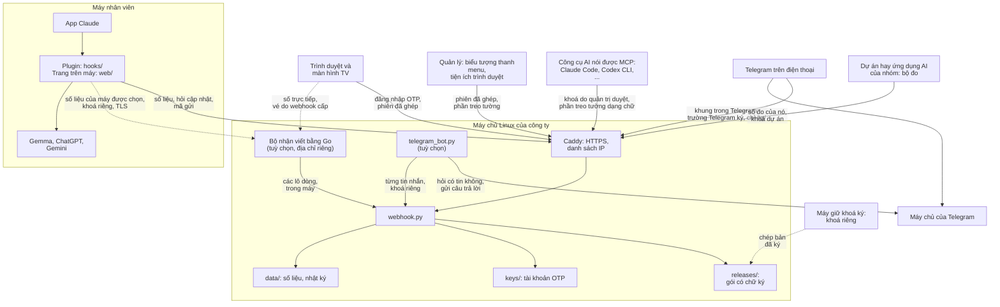

| Thư mục | Chứa |
|---|---|
| `hooks/` | Plugin. `register.tsx` nối với app Claude; các file khác là logic thuần, hoặc nhận vào/ra qua tham số (`hooks/io.ts`: kho và mạng), như `hooks/send.ts` |
| `web/` | Trang mở bằng `/office` trên máy |
| `server/` | Webhook, các trang trong `static/`, test, file cài |
| `server/menubar/` | Biểu tượng thanh menu cho quản lý: app cho macOS, app cho Windows (`windows-app/`, C#, cài từ file .msi; script khay PowerShell giữ làm dự phòng), chương trình AppIndicator trong gói .deb cho Ubuntu (script Argos vẫn dùng được) |
| `extensions/manager/` | Tiện ích trình duyệt cho quản lý (Chrome, Edge), cài tay |
| `connectors/` | Bộ nối cho Codex, Cursor và Gemini CLI: hook (`ai-worker-hook.sh`, `.ps1`), bộ cài của nó (`install.sh`, `.ps1`) và phần gộp JSON mà bộ cài dùng (`merge-hooks.js`). Không cần có plugin |
| `receiver/` | Bộ nhận tuỳ chọn viết bằng Go cho tổ chức lớn: `main.go`, `limits.go` và các gói trong `internal/`; dựng bằng `packaging/build-receiver.sh`, cài bằng `server/install-receiver.sh` ([RECEIVER.vi.md](RECEIVER.vi.md)) |
| `packaging/` | Đóng gói, file cài, ký bản phát hành, kiểm tra trước khi công khai |
| `skills/`, `agents/`, `commands/` | Các skill (loại dùng hằng ngày và loại cho viết code, vận hành), trợ lý `planner`, và các lệnh app liệt kê trước khi phiên bắt đầu. `skills/ai-cost-report/meter/` chứa các bộ đo mà dự án AI chép về, mỗi ngôn ngữ một file |
| `tests/` | Test plugin, test cài trên Linux và Windows, kiểm tra ngôn ngữ, test thanh menu (`tests/menubar/`), test bộ nối (`tests/connectors/`) và bước kiểm tiện ích (`tests/extension/`) |

### Ngôn ngữ lập trình

Mỗi phần dùng thứ có sẵn trên nền của nó, nên gần như không phải cài thêm gì. Ngoại lệ là bộ WebView2 của Microsoft, đi kèm cho khung thanh menu Windows, và các gói GTK, WebKit2, AppIndicator mà apt cài cùng gói .deb của Ubuntu:

| Ngôn ngữ | Ở đâu | Vì sao |
|---|---|---|
| TypeScript | `hooks/` | App Claude chạy mã plugin viết bằng TypeScript |
| JavaScript, HTML, CSS | `web/`, `server/static/`, `extensions/manager/`, `connectors/merge-hooks.js` | Trang trong trình duyệt và tiện ích trình duyệt; không cần bước dựng. `merge-hooks.js` chạy bằng `osascript` trên macOS và Node ở nơi khác |
| Python 3 | `server/webhook.py` và `server/board/`, `server/menubar/ai-worker.1m.py`, `server/menubar/ai-worker-indicator.py`, các bước kiểm trong `tests/` | Có sẵn trên mọi máy chủ Linux và trên Ubuntu. Chỉ dùng thư viện chuẩn, trừ `ai-worker-indicator.py` dùng python3-gi, AppIndicator và WebKit2 do apt cài |
| Swift | `server/menubar/macos-app/main.swift` | App thanh menu macOS: khung gốc của macOS dưới biểu tượng |
| PowerShell | `server/menubar/ai-worker-tray.ps1` (biểu tượng Windows dự phòng), file cài Windows trong `packaging/`, bộ nối cho Windows trong `connectors/` | Có sẵn trong Windows |
| C# | `server/menubar/windows-app/`, `server/menubar/menubar-popup.cs` | App Windows `AI Worker.exe` trên .NET Framework 4.8 và khung của nó (WebView2); dựng được trên Mac bằng .NET SDK hoặc trên Windows |
| WiX | `server/menubar/windows-app/AIWorker.wxs` | Gói cài `AI Worker.msi`, dựng trên Windows của GitHub; `fetch-msi.sh` đưa vào `server/menubar/`, máy chủ tự điền địa chỉ của nó |
| Shell (bash), Batchfile | `packaging/`, `server/install.sh`, `connectors/install.sh` | File cài và script đóng gói trên macOS, Linux, Windows |
| Shell (sh) | `connectors/ai-worker-hook.sh`, `server/install-receiver.sh`, `packaging/build-receiver.sh` | Hook của bộ nối: máy macOS và Linux nào cũng có sh, awk, sed và grep. Bộ cài của bộ nhận và bước dựng nó cũng không cần bash |
| Go | `receiver/` | Bộ nhận tuỳ chọn: chỉ thư viện chuẩn, một file để đặt lên máy chủ, dựng cho Linux ở máy đóng gói |

Thanh ngôn ngữ của GitHub chỉ hiện sáu ngôn ngữ lớn nhất; Swift và C# được tính trong "Other". Mã của người khác (xem `THIRD-PARTY.md`) không được tính, nhờ `.gitattributes`.

## 3. Các luồng chính

### Gửi số liệu

Chỉ gói đóng cho công ty mới gửi. Bước nào có thể từ chối thì từ chối trước khi lưu bất cứ thứ gì.

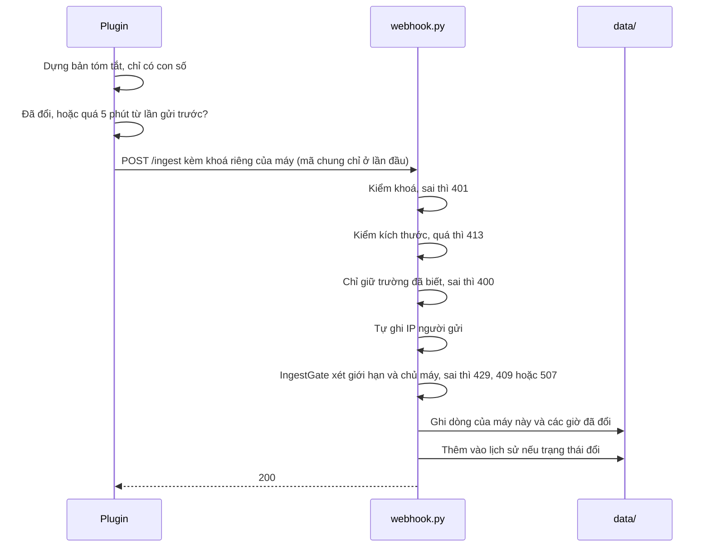

Gửi lỗi thì plugin thử lại ở nhịp sau, và báo một lần khi lỗi kéo dài.

### Gửi qua bộ nhận Go (tuỳ chọn)

Chỉ tổ chức lớn mới cài phần này ([RECEIVER.vi.md](RECEIVER.vi.md)); không có nó thì mọi lần gửi đi theo luồng ở trên. Bộ nhận nhận lần gửi của những máy quản trị đã chọn, trả lời ngay, rồi trao cho webhook theo lô. Webhook vẫn là bản gốc: chỉ nó ghi `data/`, và chỉ nó biết tên, vai và việc đăng nhập.

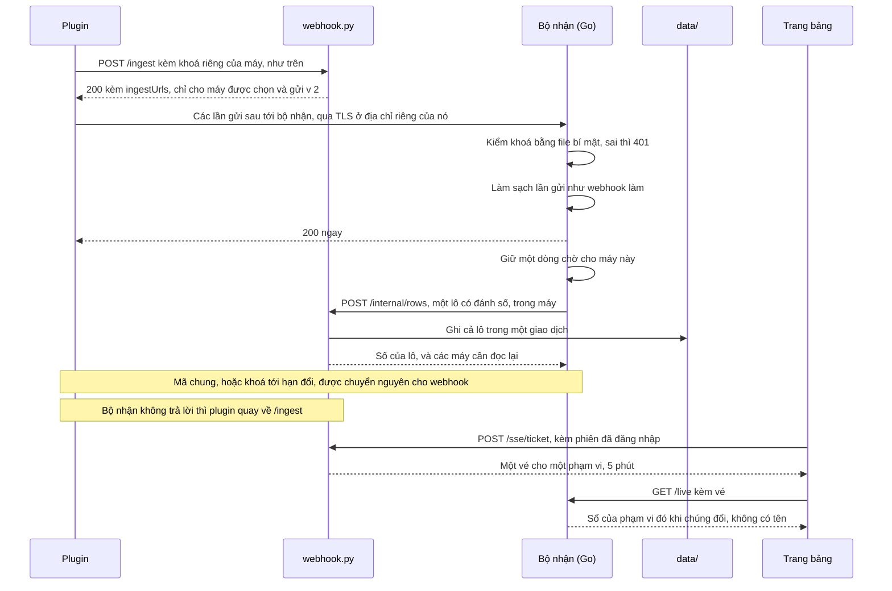

Các đường dưới `/internal/` chỉ trả lời lời gọi từ chính máy đó kèm mã nội bộ; từ nơi khác thì chúng như không tồn tại (404). Bộ nhận không giữ tên hay email nào, và không ghi file nào; địa chỉ của máy đi kèm dòng của nó tới webhook. Máy nào sang bộ nhận là do quản trị chọn (`RECEIVER_INGEST_DEVICES`, `RECEIVER_INGEST_PERCENT`), và để trống `RECEIVER_INGEST_URLS`, hoặc dừng bộ nhận, là đưa tất cả về lại webhook.

### Báo cáo từ Codex, Cursor và Gemini CLI

Bộ nối (`connectors/`) là một hook trong từng công cụ này. Nó không cần Claude Code, không cần Python hay Node: sh, awk, sed, grep và curl hoặc wget trên macOS và Linux, PowerShell trên Windows.

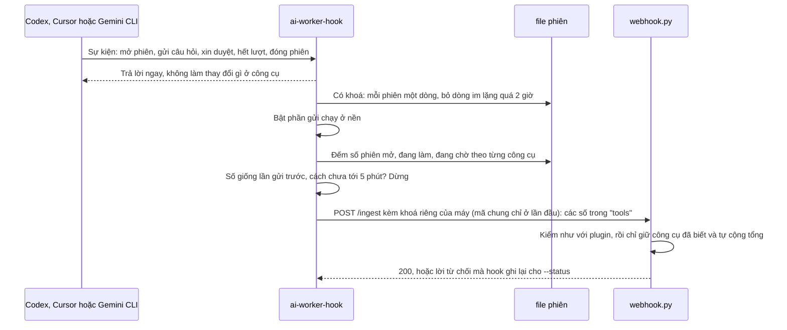

Một phiên là đang chờ khi công cụ xin duyệt, hoặc khi câu cuối của nó kết thúc bằng dấu hỏi; hook chỉ nhìn đúng ký tự đó và không giữ lại gì của câu. Máy chủ tính một báo cáo của bộ nối trong 2 giờ (`is_fresh` trong `server/board/devices.py`), vì giữa các sự kiện không có nhịp gửi nào, và không bao giờ tính nó là một máy hay một bản cài plugin. Một bộ nối báo cho cả ba công cụ, nên mỗi máy có nhiều nhất hai mã máy: của plugin và của bộ nối.

### Đăng nhập và xem bảng

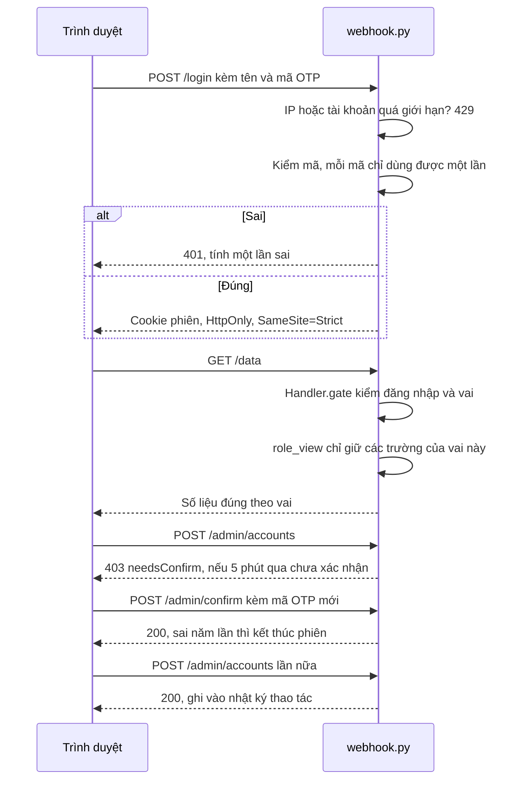

### Đăng nhập bằng Telegram (tuỳ chọn)

Chỉ khi đã cài bot. Trang không nạp gì từ Telegram, và với việc này máy chủ không bao giờ gọi Telegram: trình duyệt đi sang đó rồi quay về.

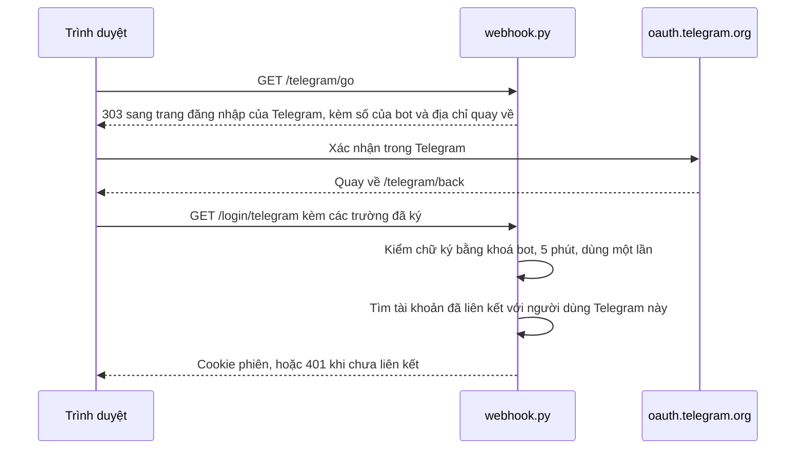

Liên kết cũng đi đường này, sau khi nhập mã 6 số ở `/telegram`: địa chỉ quay về mang một mã bước dùng một lần gắn với phiên đó.

### Ghép màn hình TV

Mã hiện trên TV để quản trị duyệt. Phiên chỉ về tay TV, vì chỉ TV giữ khoá trong cookie: người nhìn thấy mã cũng không lấy được phiên.

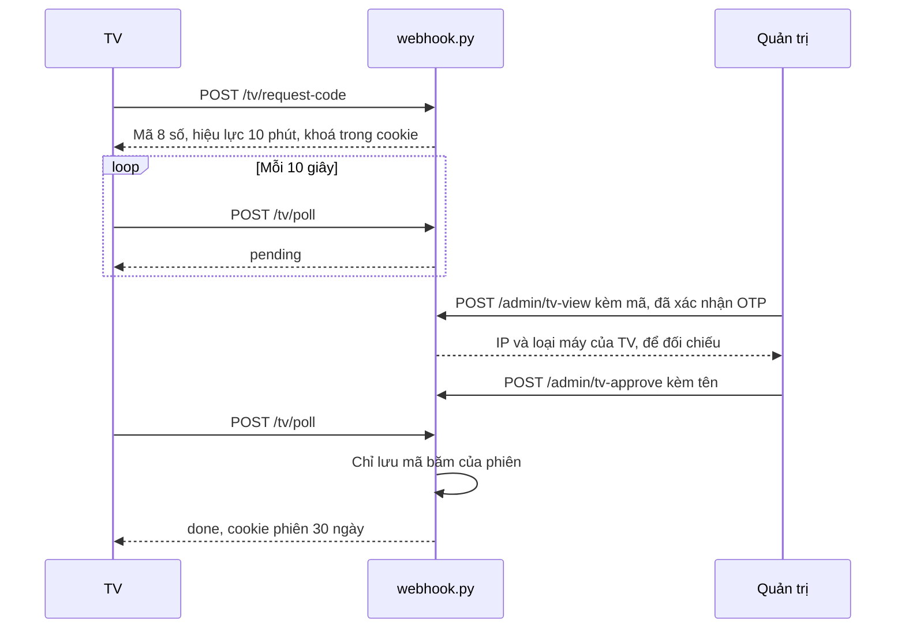

### Hỏi bảng từ một công cụ AI (MCP)

Công cụ AI nói được MCP (Claude Code, Codex CLI, Cursor, Gemini CLI) đọc bảng bằng một khoá của riêng nó. Khoá được cấp theo đúng quy trình mã của màn hình TV, xin trên trang `/mcp/connect` của chính bảng, và quản trị chọn khoá được đọc gì. Khoá loại này chỉ được tìm thấy bằng `TvStore.find(..., side=KIND_MCP)`, và không khoá nào khác được tìm thấy theo cách đó: nó mở `/mcp` và không gì khác, và không gì khác mở được `/mcp`.

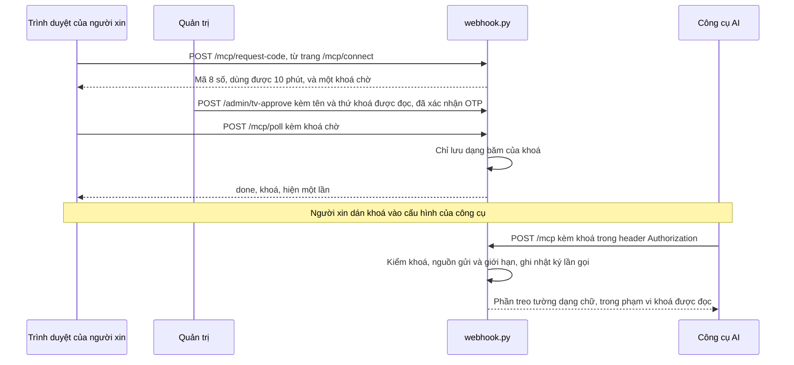

`server/board/mcp.py` chỉ lo giao thức: một thông điệp JSON-RPC, các header của nó và một phần xem đi vào, một mã trạng thái và một câu trả lời đi ra, nên được kiểm thử mà không cần máy chủ. Phần đếm, gộp văn phòng nhỏ và lọc tên nằm ở `server/board/summary.py`. Nó nói hai đời MCP trên cùng một đường, vì các công cụ đang dùng hiện nay khác nhau: bản 2026-07-28, không bắt tay (`server/discover`, `tools/list`, `tools/call`, mỗi yêu cầu được đối chiếu với các header `MCP-Protocol-Version`, `Mcp-Method` và `Mcp-Name` của nó), và các bản cũ hơn từ 2025-03-26 tới 2025-11-25 mở đầu bằng `initialize`. Chỉ có một công cụ, `board_summary`, không nhận đầu vào: khoá được đọc gì là do khoá quyết, không bao giờ do yêu cầu. Cố ý bỏ: luồng SSE, đăng ký nhận thông báo, resources, prompts, sampling, elicitation, tasks và OAuth; GET hay DELETE ở `/mcp` trả 405.

`Handler.mcp_post` lo phần còn lại: mỗi khoá 120 yêu cầu trong 10 phút (`CallLimit`), mỗi thông điệp tối đa 16 KB, và mỗi lần gọi công cụ một dòng trong bảng nhật ký (`mcp-call`), giữ 3 tháng và đọc tách khỏi nhật ký của quản trị. Công cụ đi tìm cấu hình OAuth sau khi nhận 401 thì nhận một 404 thường, không tính là dò. `MCP=0` làm mọi đường trên trả 404.
### Hỏi bảng qua Telegram (tuỳ chọn)

Chỉ khi có `TELEGRAM_ASK=1`. Tiến trình nói chuyện với Telegram không phải là webhook: `server/telegram_bot.py` chạy thành một dịch vụ riêng, kết nối ra Telegram và không tới đâu khác, rồi chuyển từng tin cho webhook trên cùng máy. Webhook không bao giờ kết nối ra ngoài.

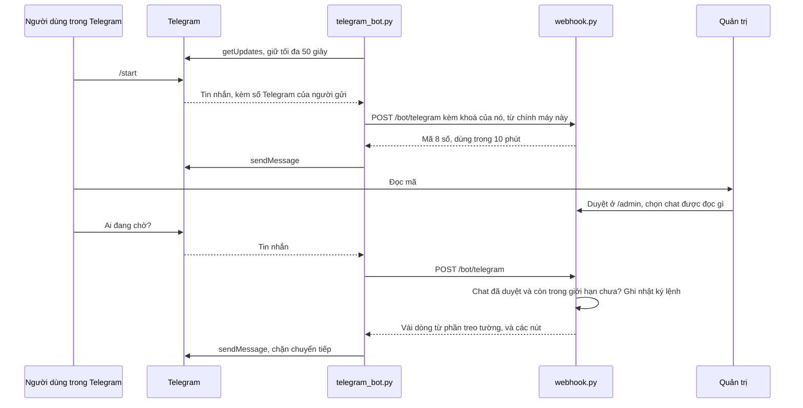

`server/board/ask.py` là mã thuần. Nó đọc một tin nhắn thành một trong chín lệnh (tên lệnh, tên tiếng Việt không dấu, một nút, hoặc một từ khoá trong câu gõ tự do) và viết câu trả lời từ phần treo tường, bằng tiếng Anh hoặc tiếng Việt. Không mô hình AI nào đọc câu hỏi, nên mọi con số đều là của chính bảng; tin không ứng với lệnh nào thì nhận danh sách lệnh. `server/board/chat.py` quyết định phần còn lại: chat chưa được quản trị duyệt chỉ nhận một mã ghép, tin nhắn hoàn tất việc ghép nhận lời chào, mỗi chat được gửi 20 tin trong 10 phút, và mỗi câu trả lời có số liệu là một dòng trong bảng nhật ký (`telegram-ask`), giữ 3 tháng và đọc cùng các lần gọi MCP. Chỉ chat riêng được trả lời; với nhóm thì tiến trình bot được bảo rời đi.

Thứ đứng thay cho một chat là số Telegram của người gửi, vốn không bí mật. Vì vậy các dòng đã ghép nằm ở bốn phía (`side_of` trong `server/board/stores.py`): khoá cho cổng MCP, chat Telegram, khoá của dự án hay ứng dụng AI, và mọi thứ còn lại. Một dòng chỉ được tìm, đếm và thay ở đúng phía của nó, và `/bot/telegram` chỉ nhận lời gọi thẳng từ cùng máy kèm `TELEGRAM_ASK_KEY`: yêu cầu mang header của proxy nhận 404.

`server/telegram_bot.py` không nạp gì của bảng, không ghi gì xuống đĩa và cầm hai thứ bí mật: token của bot và khoá đó. Nó dùng Bot API của Telegram qua HTTPS theo kiểu giữ kết nối chờ tin (`getUpdates`) chứ không dùng webhook do Telegram gọi tới, nên không mở gì về phía Internet và bảng không có địa chỉ công khai vẫn dùng được. Nó không dùng MTProto, giao thức của chính các app Telegram: thư viện chuẩn không nói được giao thức đó, và dùng nó là đăng nhập như một người. Khi Telegram từ chối token, khi có chương trình khác đọc cùng bot, hay khi không tới được Telegram, tiến trình báo cho webhook và trang Quản trị hiện điều đó. Bộ cài chạy nó thành dịch vụ `ai-worker-telegram` dưới người dùng riêng, với `IPAddressDeny=any` và danh sách cho phép gồm chính máy này, các máy chủ DNS của nó và các mạng của Telegram.

### Khung bảng bên trong Telegram (tuỳ chọn)

Chỉ khi có thêm `TELEGRAM_APP=1`, và chỉ cho chat được quản trị cho mở khung. Chat được đọc từng người đọc phần treo tường; chat chỉ đọc số gộp đọc số tổng của cả team, cộng sẵn trên máy chủ, không có người nào trong đó. Telegram không chở số liệu: app của nó mở trang `/tg/app` của bảng trong trình duyệt riêng, và trình duyệt đó tự hỏi bảng qua HTTPS, nên điện thoại hay máy tính phải ở mạng mà proxy cho vào. Tiến trình bot chỉ đặt nút menu cho từng chat.

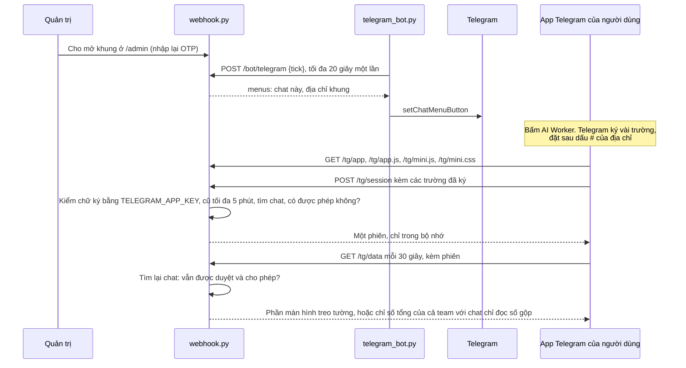

`server/board/tgapp.py` chứa phần kiểm, phiên và nút menu. Quy tắc của Telegram ký các trường bằng HMAC-SHA256, khoá là HMAC-SHA256("WebAppData", khoá bot); bộ cài ghi khoá đó thành `TELEGRAM_APP_KEY`, nên webhook kiểm được chữ ký mà không bao giờ cầm khoá bot, và khoá này không điều khiển được bot. Các trường nằm sau dấu `#` của địa chỉ, phần trình duyệt không bao giờ gửi đi, nên chúng không vào nhật ký nào. Phiên là một chuỗi ngẫu nhiên, giữ dạng băm trong bộ nhớ, sống 1 giờ sau lần dùng cuối, tối đa 12 giờ, 3 phiên mỗi chat; mỗi lần gọi đều tìm lại chat, nên **Thôi mở khung**, **Thu hồi** hay `/stop` đều kết thúc phiên ngay. Chữ ký sai bị tính là dò; các trường chỉ quá cũ thì không.

Trang là chính trang của khung thanh menu (`page_mini(telegram=True)`): các file của nó lấy từ `/tg/`, để proxy có thể chỉ cho riêng tiền tố đó đi qua; nó không có liên kết tới bảng, thẻ cài đặt của nó đặt tin báo của chính chat, và nút bỏ ghép thì ngắt chat. `server/static/tg-app.js` chạy trước `mini.js` và đưa cho nó `window.MiniApi`, như tiện ích trình duyệt. Nó không nạp script của Telegram từ telegram.org: nó tự đọc các trường trong địa chỉ và nói với app qua cầu nối Telegram đặt sẵn trong trang, nên không có script từ trang khác chạy ở nơi hiện số liệu của team, và `script-src 'self'` của trang giữ nguyên.

`MenuSync` trong cùng module so các chat cần có khung với những gì tiến trình bot được báo lần trước, rồi giao phần thay đổi cho nó; sau khi khởi động lại, nó báo lại cho mọi chat còn hạn, nên chat bị bỏ quyền lúc máy chủ tắt cũng được trả lại menu thường. `TELEGRAM_APP=0` làm mọi đường dưới `/tg/` trả 404.

Cùng vòng hỏi đó của tiến trình bot (`{tick}`) còn chở tin báo. `server/board/alerts.py` đọc phần treo tường, tìm các lần chờ vượt số phút của từng chat mà chưa báo, rồi áp khoảng cách giữa hai tin, trần mỗi giờ, mỗi ngày và giờ im lặng (19:00 tới 07:00); `alerts_due` trong `server/board/chat.py` giao các tin cho tiến trình bot, kèm địa chỉ khung khi chat được mở khung, và ghi mỗi tin một dòng nhật ký (`telegram-alert`, kèm số người). Mỗi chat tự đặt việc này, bằng `/alerts` hoặc trong khung (`/tg/settings`); tắt cho tới lúc đó. Những gì đã báo chỉ giữ trong bộ nhớ.

### Đo một dự án hay ứng dụng AI

Một dự án hay ứng dụng do nhóm tự làm, bằng ngôn ngữ nào và với hãng LLM nào cũng được, tự đo bằng bộ đo chép từ `skills/ai-cost-report/meter/`. Bộ đo chỉ ghi số đếm và thời gian, không bao giờ ghi câu hỏi, câu trả lời hay người dùng; lỗi của bộ đo không bao giờ làm dự án dừng. Gửi lên bảng là tuỳ chọn, và bảng chỉ nhận khi có `AI_PROJECTS=1`.

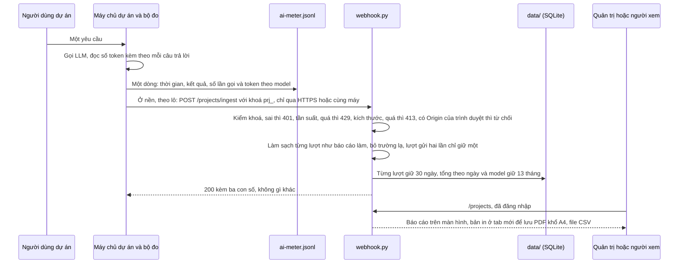

Không có bảng thì skill làm đúng báo cáo đó từ file trên máy của dự án: `report.py` là cùng đoạn mã với `server/board/costreport.py`. Định dạng một dòng có trong `skills/ai-cost-report/FORMAT.vi.md`.

### Cập nhật plugin

Không tin máy chủ: máy chủ bị chiếm cũng không phát được gói xấu, vì máy nhân viên kiểm chữ ký bằng khoá nó đã có sẵn.

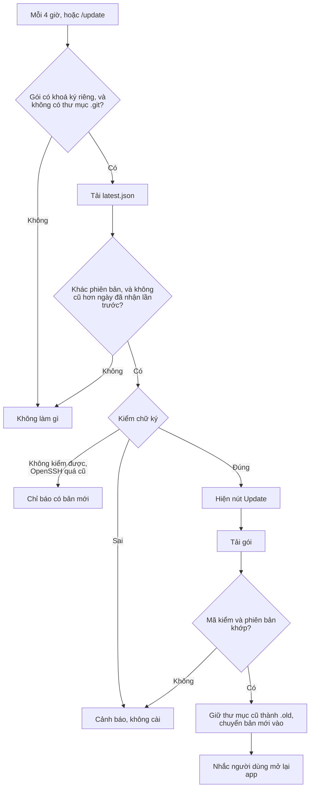

Quay lui là phát hành lại bản cũ với chữ ký mới: phiên bản khác thì được nhận, còn file cũ có ngày cũ hơn thì không, nên không phát lại được.

### Gửi chữ cho trợ lý

Áp dụng cho các công cụ riêng của plugin, dùng khi máy không có máy chủ MCP `ai-workers`; bước kiểm bí mật áp dụng cả cho server `ai-workers` riêng, ở `tool.check`. Gemma chạy trên máy; ChatGPT và Gemini là công ty bên ngoài.

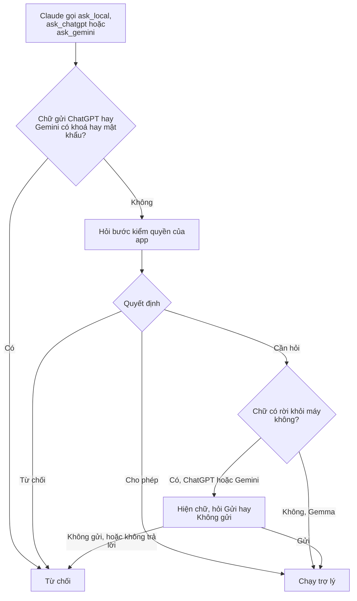

### Phát hành

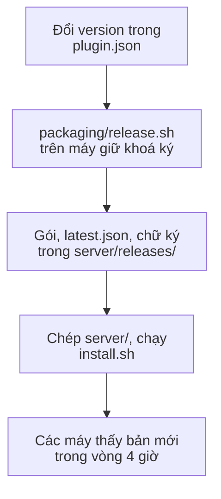

## 4. Lựa chọn thiết kế

| Lựa chọn | Cách làm | Vì sao |
|---|---|---|
| Một bảng đường dẫn, một cổng (định tuyến bằng bảng, một điểm kiểm duy nhất) | Mọi đường dẫn nằm trong `GET_ROUTES` hoặc `POST_ROUTES` kèm quyền. `Handler.gate` là nơi duy nhất kiểm quyền. Đường không có trong bảng trả 404 | Đường mới không thể quên kiểm quyền; có test giữ bảng quyền |
| Danh sách cho phép ở chiều ra (lọc trường theo vai) | `role_view` chỉ chép các trường đã liệt kê cho từng vai | Trường mới vẫn ẩn cho tới khi có người chọn hiện nó |
| Danh sách cho phép ở chiều vào (dựng lại, không tin dữ liệu vào) | `clean_payload` dựng lại mỗi lần gửi từ danh sách trường cố định, và dựng lại khi một dòng được nạp từ bảng vào bộ nhớ | Dữ liệu xấu hay file hỏng không tới được trang |
| Lớp nhỏ để giữ trạng thái (lớp cơ sở dùng chung, mỗi quy tắc một chủ) | `Store` giữ một bảng trong bộ nhớ và ghi các dòng đã đổi trong một giao dịch; `Accounts`, `TvStore`, `RevokedKeys`, `DocumentStore` xây trên đó. `LoginGate`, `IngestGate`, `BotBlocker` mỗi lớp giữ một nhóm giới hạn | Mỗi quy tắc ở một chỗ và thử riêng được |
| Tách logic thuần khỏi đọc ghi (functional core, imperative shell) | `hooks/*.ts` thuần, hoặc nhận vào/ra qua tham số (`hooks/io.ts`); `register.tsx` là file duy nhất dùng giao diện `$` của app | Thử được logic mà không cần chạy app |
| Tin chữ ký, không tin máy chủ (signed manifest) | Máy kiểm manifest có chữ ký bằng khoá trong chính gói của nó | Chiếm được máy chủ vẫn chưa tới được máy nhân viên |
| Tiếng Anh trong mã, tiếng Việt trong từ điển (message catalog) | `tx("...")` tra `*.vi.js`, `webhook_vi.py`, `lang.vi.ts`; script thanh menu dùng `server/menubar/vi.json`, tiện ích dùng `extensions/manager/_locales/` | Chữ có một nguồn; `tests/check-i18n.py` tìm chỗ còn thiếu |
| Máy chủ không dùng thư viện ngoài | Chỉ dùng thư viện chuẩn của Python; bộ nhận tuỳ chọn chỉ dùng thư viện chuẩn của Go | Không phải cài, cập nhật hay rà soát thêm gì |
| Mỗi cửa một loại khoá (khoá gắn với kênh) | Khoá cho cổng MCP chỉ được tra bằng `TvStore.find(..., side=KIND_MCP)`, và mọi lần tra khác đều bỏ qua loại khoá này | Khoá lộ từ cấu hình của một công cụ AI không mở được trang nào, và khoá của TV hay tiện ích không mở được cổng MCP |

### Lưu trữ: SQLite

Máy chủ lưu mọi thứ trong hai file SQLite: `data/board.db` cho số liệu và `keys/accounts.db` cho tài khoản, tách riêng để bản sao lưu dữ liệu không bao giờ chứa mã bí mật OTP. SQLite có sẵn trong Python nên không phải cài thêm gì. Nó cho giao dịch, truy vấn nhật ký qua nhiều tháng, và chỗ cho bảng mới như chat. Các bản tới 0.24 lưu mỗi bảng một file JSON; máy chủ tự chuyển chúng vào ở lần khởi động đầu. Chi tiết: [DATA-MODEL.vi.md](DATA-MODEL.vi.md).

### Đã cân nhắc nhưng không chọn

Ghi lại để lần rà sau không đề xuất lại khi không có lý do mới.

| Ý tưởng | Vì sao không |
|---|---|
| Viết lại bộ nhận Go bằng Rust | Bộ nhớ của nó dồn vào các kết nối và dữ liệu đang giữ, không phải do ngôn ngữ; Rust chỉ được cân nhắc lại cho phần nặng nhất, và chỉ khi Go vẫn không đủ |
| Đặt bộ nhận Go và máy chủ Python ở hai máy | Theo các lần đo, một máy 4 nhân 8 GB phục vụ được 40.000 máy; máy thứ hai thêm một chặng mạng và thêm một thứ phải vận hành |
| `/data` gửi phần thay đổi kể từ lần đọc trước | Chi phí nằm ở việc gom dòng theo người, gửi phần thay đổi không bỏ được việc đó |
| `gc.freeze()`, vòng HTTP tự viết thay cho `net/http` | Đã quyết bỏ trong tháng 11/2026: không đáng phần mã thêm vào so với những chỗ đo được là quan trọng hơn |
| Một bước làm sạch lần gửi, viết bằng một ngôn ngữ | Máy chủ Python và bộ nhận Go cố ý mỗi bên tự làm sạch mọi lần gửi; các ca dùng chung trong `tests/contract/` giữ hai bên giống nhau |
| Một module "nhận một lần gửi" dùng chung cho `/ingest` và các dòng của bộ nhận | Hai đường chỉ chung vài dòng; phần còn lại cố ý khác nhau: một lần gửi so với cả lô ghi trong một giao dịch, bên nào quyết thứ tự, lúc nào ghi lịch sử, tên và tài khoản lấy từ đâu. Một module chung sẽ cần một cờ cho mỗi điểm đó, rộng ngang phần nó làm. `server/test_two_paths.py` giữ các điểm khác nhau trong một bảng thay vào đó |

## 5. Kiểm tra thay đổi

```bash
claude plugin test .
npx -y -p typescript@5.9.3 tsc -p tsconfig.json
uvx ruff check .
cd server && python3 -m unittest
cd receiver && go test ./...
python3 tests/connectors/test_connectors.py
python3 tests/appmeter/test_appmeter.py
python3 tests/check-i18n.py --comments
node tests/extension/check-extension.js
node tests/check-map-layout.js
```

`.github/workflows/test-install.yml` chạy ở mỗi lần đẩy code lên repo công khai, và ở mọi nơi khi được bấm chạy tay; lần đẩy lên repo riêng tư, như bản phát triển, bỏ qua mọi việc, nên ở đó các bước kiểm ở trên được chạy trên máy người phát triển. Việc `code-check` kiểm mã Python, chạy test của hook, mọi module test của máy chủ (`python3 -m unittest`), `go vet` và `go test` của bộ nhận, test bộ nối và bộ đo, bước kiểm tiện ích và bước kiểm bố cục bản đồ. Trên Ubuntu thì đóng gói, thử bước kiểm dữ liệu riêng (`tests/test-check-clean.sh`), phần đầu của các skill, quy tắc hai ngôn ngữ (`tests/check-i18n.py`) và các bản đồ, rồi cài thử plugin, máy chủ và bộ nhận Go (`tests/linux/test-receiver.sh`), và thử script thanh menu và gói .deb (`tests/menubar/test-menubar.sh`, `test-deb.sh`). Trên Windows có ba việc: một việc cài thử, thử mở lại app sau `/update`, bộ nối và biểu tượng ở khay (`tests/menubar/test-menubar.ps1`); một việc dựng `AI Worker.exe` và `AI Worker.msi`, cài không cần quyền quản trị, ghép với máy chủ giả, cài bản mới đè lên app đang chạy rồi gỡ (`tests/menubar/test-windows-app.ps1`); một việc dựng gói `.msi` của plugin và thử nó (`tests/windows/test-msi.ps1`). Xem thêm [TEST-PLAN.vi.md](TEST-PLAN.vi.md), mục 1.

`server/test_webhook.py` đối chiếu tên trường giữa trang và máy chủ, nhưng chỉ đọc mã, nên sửa trang vẫn phải mở trình duyệt xem.

## 6. Giới hạn đã biết

- **Khoá chung, để ghi danh.** Mỗi máy nhận khoá riêng (`awd1.…`) trong câu trả lời của lần gửi đầu, và khi đã gửi bằng khoá đó thì chỉ khoá đó được gửi cho máy (khoá mới chỉ được cấp thì chưa ràng buộc gì, nên plugin quá cũ không giữ được khoá cũng không bị khoá ngoài); `--revoke-device` cắt một máy. Việc ghi danh vẫn dùng `INGEST_KEY` mà mọi gói cài đều mang, nên nhân viên vẫn ghi danh được một máy bịa dưới một tên chưa gắn với máy nào. Khi mọi máy đã có khoá riêng, `SHARED_KEY_MODE=known-only` hoặc `off` đóng chỗ đó.
- **Số máy.** `MAX_DEVICES` mặc định là 300 máy, khoảng 100 tới 150 người, và một tiến trình trên một máy nhận mọi lần gửi; nâng được cho vài nghìn máy, còn bộ nhận Go tuỳ chọn nhận lần gửi của hàng chục nghìn máy ([chọn cách cài theo quy mô](INSTALL.vi.md#chọn-cách-cài-theo-quy-mô)). Mức trần đã đo và việc tiếp theo: [BENCHMARK.vi.md](BENCHMARK.vi.md). Lần gửi bị giới hạn theo từng máy (một xô 20 lượt, tự đầy lại một lượt mỗi giây), nên các máy đi chung một địa chỉ công cộng không chặn lẫn nhau.
- **HTTP khi không có proxy.** Kết nối chỉ được mã hoá khi đi qua Caddy hoặc nginx.
- **Người có sudo trên máy chủ** đọc được mọi số liệu và tự cấp được tài khoản. Nên giữ ít người.
- **Chuỗi của nhật ký** bắt được một dòng bị sửa hay bị xoá bằng tay, không bắt được người viết lại được cả cơ sở dữ liệu lẫn `audit_head`: việc đó cần một bản giữ ngoài máy chủ, nên mỗi sáng mã của ngày niêm phong được gửi tới Telegram của quản trị và được liệt kê trên trang Quản trị để chép lại. Chi phí của một ngày vẫn sửa được trong tuần nó còn được đếm lại, và máy chủ chưa có quản trị nào liên kết Telegram thì không có bản nào ở ngoài trừ khi có người chép lại. Bước kiểm bí mật và kiểm trang dựa vào hình dạng của khoá và câu chữ của lệnh, nên bí mật không có hình dạng quen, hay lệnh viết kiểu khác, vẫn lọt.
- **File lớn.** Máy chủ đã tách vào `server/board/` (cấu hình, đăng nhập, máy gửi, tổng theo ngày, kho lưu, quyền xem, trang, gói cài), `server/webhook.py` giữ phần nhận yêu cầu và bảng đường dẫn. `hooks/register.tsx` và `server/static/ops.js` vẫn lớn: các phần trong đó dùng chung biến trong một khối và chưa có test riêng, nên chờ có test rồi mới tách. Việc gửi số liệu của máy là phần đầu tiên rời `register.tsx`, sang `hooks/send.ts`, sau khi `tests/share.test.ts` che nó đầu-cuối.
- **Bộ nối biết ít hơn plugin.** Nó chỉ gửi khi có sự kiện, nên công cụ bị đóng mà không có sự kiện kết thúc còn hiện trên bảng tới 2 giờ. Lượt bị lỗi cũng không gửi sự kiện nào: đã thấy với Codex CLI 0.164.0, khi một yêu cầu mô hình bị từ chối để phiên kẹt ở đang làm. (Lượt bị cắt ngang bằng Esc thì gửi `Interrupt` thay cho `Stop`, và sự kiện đó đã được gắn hook.) Vì vậy máy chủ chỉ tin "đang làm" của bộ nối trong 30 phút kể từ lần gửi cuối; trong Cursor, nơi không có hook sau từng bước, một lượt chạy lâu hơn thế sẽ hiện là rảnh cho tới khi lượt đó kết thúc. Nó không biết token, chi phí, hạn mức hay mô hình. Bản sao khoá gửi của nó nằm ở một chỗ thứ hai trên máy. Tên và email của nó phải đúng cặp mà plugin gửi, nếu không một người sẽ hiện thành hai dòng. Cursor, Gemini CLI và Windows chưa được thử trong công cụ thật.
- **Cổng MCP.** Mới thử trong công cụ thật trên macOS: Claude Code, Codex CLI, và tab Chat của app Claude trên máy tính qua một kết nối của claude.ai. Cursor, Gemini CLI và mọi công cụ trên Windows và Linux chưa được thử. Những gì công cụ đọc sẽ tới hãng làm ra nó. Khoá chỉ đọc số gộp vẫn để lộ một đội hay một nhóm còn lại chỉ một hai người qua số gộp. Các lần gọi được ghi vào bảng nhật ký sẵn có chứ không có bảng riêng, để bản máy chủ cũ hơn vẫn mở được cơ sở dữ liệu. Xem thêm [SECURITY.vi.md](../SECURITY.vi.md).
- **Hỏi bảng qua Telegram.** Đã thử với Telegram thật bằng cách chạy tay trên macOS, và mới được cài lên một máy chủ thật, với một chat chỉ đọc số gộp và, một lần, một chat đọc từng người; trong các câu trả lời có kèm tên thì mới thấy câu về chi phí. Những gì một chat đọc sẽ đi qua Telegram, một bên thứ ba, và nằm lại trong chat. Danh sách cho phép các mạng của Telegram là bản chép từ danh sách Telegram công bố: nếu Telegram chuyển mạng, bot dừng cho tới khi danh sách được sửa.
- **File chép đôi.** `web/` và `server/static/` cùng có `ops.js`, `ops.css`, `ops3d.js`, `i18n.js`, `ops.vi.js`. Script đóng gói kiểm các bản này khớp nhau. `extensions/manager/mini/` giữ bản chép của `mini.js`, `mini.css` và logo; `tests/extension/check-extension.js` kiểm các bản đó.
- **Kiểm kiểu TypeScript chỉ chạy trên máy.** `tsc` cần file kiểu Claude Code ghi vào `.claude-plugin/types` (không có trong git), nên CI chỉ chạy ruff và các bộ test; chạy `tsc` trên máy trước khi đẩy.
